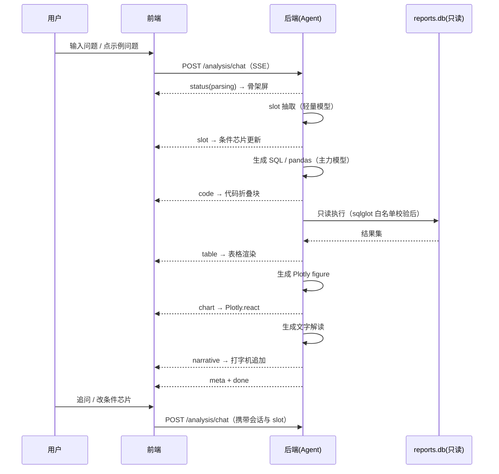
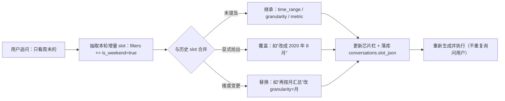
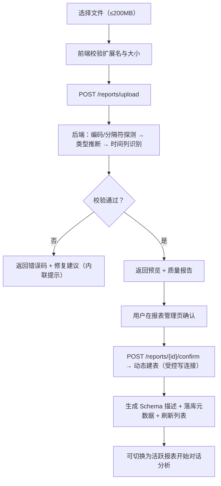

# 智电析报——基于LLM的能源电力报表智能分析Agent UI/UX 设计文档

| 项目名称 | 智电析报（PowerReport Agent） |
| --- | --- |
| 文档版本 | v1.4.0（会话模块回填版） |
| 文档状态 | 待评审 |
| 编写日期 | 2026-09-15 |
| 对应 PRD | 《智电析报_PRD文档》**v1.9.0**（第 4/5/6/9 章） |
| 线框图目录 | `04.实训指导书/images2/`（SVG 源码 + PNG 导出） |
| 所属交付物 | 任务书任务 1「需求分析与系统设计」→ 实训 2「AI 共创 UI/UX 界面设计文档」 |

---

## 目录

1. [文档说明](#1-文档说明)
2. [设计原则](#2-设计原则)
3. [页面清单](#3-页面清单)
4. [全局设计规范](#4-全局设计规范)
5. [关键页面原型](#5-关键页面原型)
6. [条件芯片（SlotChip）设计](#6-条件芯片slotchip设计)
7. [图表与表格联动](#7-图表与表格联动)
8. [流式状态展示](#8-流式状态展示)
9. [错误提示样式](#9-错误提示样式)
10. [响应式规则](#10-响应式规则)
11. [体验细节与可访问性](#11-体验细节与可访问性)
12. [关键交互流程](#12-关键交互流程)
13. [组件清单与前端目录映射](#13-组件清单与前端目录映射)
14. [交付物与变更记录](#14-交付物与变更记录)

---

## 1. 文档说明

### 1.1 目的

定义智电析报 Web 端的**信息架构、界面布局、交互规则与视觉规范**，作为前端开发、后端联调与验收的依据，同时作为「AI 共创」流程中喂给 AI 编程助手的界面上下文。

### 1.2 范围

| 范围 | 说明 |
| --- | --- |
| 包含 | 5 个路由的界面结构、全局视觉规范、条件芯片、图表与表格联动、流式状态展示、错误提示样式、响应式规则、交互流程、组件清单 |
| 不包含 | 具体组件代码、后端接口实现（见 API 接口文档）、动效动画细节（按需补充） |
| 设计形态 | 低保真线框（已产出 SVG + PNG），视觉规范以本文字号/色彩表为准 |

### 1.3 线框图清单

| 序号 | 页面/组件 | SVG 源码 | PNG 导出 |
| --- | --- | --- | --- |
| ① | 对话工作台（主界面） | `01_workbench.svg` | `01_workbench.png` |
| ② | 登录 / 注册 | `02_login.svg` | `02_login.png` |
| ③ | 报表管理 | `03_reports.svg` | `03_reports.png` |
| ④ | 评测中心 | `04_eval.svg` | `04_eval.png` |
| ⑤ | 个人中心 | `05_profile.svg` | `05_profile.png` |
| ⑥ | 条件芯片组件规格 | `06_chip_states.svg` | `06_chip_states.png` |
| ⑦ | 错误提示与异常态样式 | `07_error_states.svg` | `07_error_states.png` |

> **PNG 导出方式**：源 SVG 是唯一事实源，执行
> `.venv\Scripts\python.exe 01.code\tools\svg2png.py "04.实训指导书\images2"`
> 即可批量重新生成 PNG（调用本机 Edge 无头截图，2 倍图）。

---

## 2. 设计原则

| 编号 | 原则 | 落地方式 |
| --- | --- | --- |
| P1 | **对话即主界面** | 主链路全部在对话工作台完成：提问 → 看结果 → 追问；管理类功能收进独立页面，不干扰分析流 |
| P2 | **口径可见** | 当前生效条件以芯片常驻展示、数据来源与口径随结论一同展示，用户永远知道"这个数字是怎么来的" |
| P3 | **过程可见** | 流式阶段时间线实时展示「解析 → 生成 → 执行 → 画图 → 解读」，等待期间不出现无反馈空白 |
| P4 | **失败不静默、不编造** | 执行失败必须给出错误块（原因 + 已尝试路径 + 下一步按钮），并明确声明"本次未生成结果" |
| P5 | **一次点击可纠正** | 条件芯片可点选修改、错误块带重试、拒答带推荐问法，避免用户重新组织语言 |
| P6 | **语义色全站一致** | 峰/平/谷/未计量/异常/缺采六种语义色在图表、表格、标签、提示中统一 |
| P7 | **浅色优先、暗色可选** | 亮色为默认主题，暗色跟随系统并可手动切换；导出图片始终使用亮色底 |
| P8 | **移动端可用但克制** | 手机端保证"提问 + 看结论 + 看图表"三件事可用，复杂管理功能提示在桌面端使用 |

---

## 3. 页面清单

| 路由 | 页面 | 权限 | 承载功能（PRD 编号） | 线框图 |
| --- | --- | --- | --- | --- |
| `/login` | 登录 / 注册 | 匿名 | F6.1 注册、F6.2 登录 | `02_login.png` |
| `/`（`/chat/:conversationId?`） | **对话工作台** | 登录用户 | F1.6 报表切换、F2 全部分析能力、F3 可视化、F4 多轮追问 | `01_workbench.png` |
| `/reports` | 报表管理 | 登录用户 | F1.1 上传、F1.2 类型推断、F1.3 动态建表、F1.4 Schema、F1.5 质量报告、F1.6 管理与删除 | `03_reports.png` |
| `/eval` | 评测中心 | 登录用户 | F5.1 问题集、F5.2 批量评测、F5.3 报告、F5.4 bad case 归因 | `04_eval.png` |
| `/profile` | 个人中心 | 登录用户 | F6.3 会话与记录管理、F6.4 数据隔离与删除 | `05_profile.png` |

**页面级全局元素**：顶部栏（Logo + 主导航 + 当前报表选择器 + 主题切换 + 用户菜单）在所有登录后页面共享；左栏导航仅在对话工作台出现（会话列表语义）。

---

## 4. 全局设计规范

### 4.1 栅格与布局

| 项 | 规范 |
| --- | --- |
| 基准画布 | 1440 × 900（设计基准），内容区最大宽度 1440，居中 |
| 栅格 | 12 列 / 间距 16px；页面左右留白 24px |
| 顶部栏 | 高 56px，固定吸顶 |
| 对话工作台三栏 | 左 240px（会话列表，可折叠至 0）+ 中 flex（对话流，最小 560px）+ 右 408px（图表与表格，可折叠） |
| 卡片 | 圆角 10px，边框 1px `#D9DEE7`，白底，无投影（用描边代替阴影，保持"工程感"） |
| 内边距 | 卡片内 20px；表单项间距 24px；区块间距 16px |

### 4.2 色彩规范

**主色与中性色**

| 用途 | 色值 | 说明 |
| --- | --- | --- |
| 主色 | `#1D4ED8` | 深蓝，按钮/选中/链接/主数据线 |
| 主色浅底 | `#E8EFFD` | 芯片底色、选中态背景 |
| 主色悬停 | `#D6E2FF` | 芯片与按钮悬停 |
| 品牌区深底 | `#1D4ED8` → `#0B3AA8` 渐变 | 登录页左栏 |
| 文字主色 | `#1F2937` | 正文与表格数值 |
| 文字次色 | `#6B7280` | 说明、单位、辅助信息 |
| 文字禁用 | `#ADB5BD` | 占位符、禁用态 |
| 分隔线 | `#D9DEE7` / `#EEF1F5` | 卡片边框 / 表格行线 |
| 页面底色 | `#F5F7FA` | 全站背景 |
| 卡片底色 | `#FFFFFF` | 内容容器 |
| 弱底 | `#F1F3F5` / `#F8FAFC` | 表头、只读块、次级卡片 |

**语义色（全站统一，严禁混用）**

| 语义 | 色值 | 使用场景 |
| --- | --- | --- |
| 峰段 peak | `#E8590C` 橙红 | 峰段电量、峰段占比、峰值标记 |
| 平段 flat | `#1D4ED8` 蓝 | 平段电量、主趋势线 |
| 谷段 valley | `#0CA678` 青绿 | 谷段电量、成功态 |
| 未计量 unmetered | `#7048E8` 紫 | 未计量用电、"其他电器" |
| 异常 anomaly | `#E03131` 红 | 异常标记、错误、危险操作 |
| 缺采 missing | `#ADB5BD` 灰 | 缺失分钟、不完整周期、禁用 |

**用途色板（按用途拆分专用，与上表时段语义色**互不共用**）**

PRD 红线 R3 要求"按用途"与"按时段"两套拆分不可混加；视觉层同样必须区分——**时段色板与用途色板不得共用颜色**，否则用户会把"谷段电量"与"洗衣房电量"看混。

| 用途 | 色值 | 说明 |
| --- | --- | --- |
| 厨房（SM1） | `#0B7285` 深青 | 仅用于按用途拆分的图表与标签 |
| 洗衣房（SM2） | `#15AABF` 亮青 | 同上 |
| 热水器与空调（SM3） | `#4C6EF5` 靛蓝 | 同上 |
| 未计量（其他电器） | `#7048E8` 紫 | 与语义色中的"未计量"同义，可共用 |

> 使用约束：按用途拆分时**只允许**使用用途色板；按时段拆分时**只允许**使用语义色板（峰/平/谷）。UI 在选择拆分维度时给出提示，禁止同一张图混合两套色板。

**时段口径（供图例与提示文案使用）**：谷 `00:00–07:59` / 平 `08:00–17:59` / 峰 `18:00–23:59`（左闭右开，覆盖 24 小时无缝无重叠，与 PRD 8.4 一致）。

> 暗色模式：语义色与用途色板均保持色相不变，亮度提升 8–12%（如 `#E8590C` → `#FF7A33`），底色替换为 `#141821` / 卡片 `#1C2230` / 文字 `#E5E9F0`。

### 4.3 字体与排版

| 层级 | 字号 / 行高 | 字重 | 用途 |
| --- | --- | --- | --- |
| H1 | 20px / 28px | 600 | 页面标题 |
| H2 | 16px / 24px | 600 | 卡片标题、区块标题 |
| H3 | 14px / 22px | 600 | 小节标题 |
| 正文 | 12px / 20px | 400 | 对话文本、说明 |
| 表格 / 标签 | 11px / 18px | 400 | 表格内容、芯片文字 |
| 大数值 | 22–26px / 32px | 600 | 指标卡主数值 |
| 代码 | 11–12px / 18px | 400 | SQL / pandas 代码（等宽字体） |

字体族：`"Microsoft YaHei", "PingFang SC", system-ui, sans-serif`；数字使用等宽数字（`font-variant-numeric: tabular-nums`）保证表格对齐。

### 4.4 间距、圆角与图标

| 项 | 规范 |
| --- | --- |
| 间距序列 | 4 / 8 / 12 / 16 / 20 / 24 / 32（px），统一取序列值 |
| 圆角 | 卡片 10px、按钮 8px、输入框 6px、芯片 13px（全高胶囊）、标签 4px |
| 图标 | 统一 16px 线性图标；语义图标：✓ 成功、⚠ 警告、✕ 失败、⛔ 拦截、⚡ 品牌 |
| 动效 | 仅用于状态切换与骨架屏（150–200ms ease-out）；不做装饰性动画 |

### 4.5 组件取值约定

| 组件 | 规范 |
| --- | --- |
| 按钮 | 主按钮：主色实心白字，高 32/36/44px（小/中/大）；次按钮：白底 + 描边；危险按钮：仅"删除/删除账号"使用红描边 |
| 输入框 | 高 40px，描边 `#D9DEE7`，聚焦时主色 2px 描边 |
| 校验错误 | 输入框红描边 2px + 下方 11px 红字（详见第 9 章） |
| 表格 | 表头弱底 `#F1F3F5`、行高 36px、斑马纹关闭、行线 `#EEF1F5`、数值右对齐、文字左对齐 |
| 卡片 | 见 4.1 |
| 空状态 | 居中文案 + 主行动按钮（如"上传第一份报表"） |
| 加载 | 骨架屏（灰块）优先于转圈；超过 5s 补充文字提示"正在执行沙箱查询…" |

### 4.6 Ant Design 与 Tailwind 分工

| 层次 | 技术 | 说明 |
| --- | --- | --- |
| 交互组件 | **Ant Design** | Button、Input、Select、DatePicker、Table、Tabs、Drawer、Modal、Toast、Form、Pagination、Popover、Skeleton |
| 布局与视觉 | **Tailwind CSS** | 栅格、间距、颜色、圆角、响应式断点、自定义卡片与芯片 |
| 冲突处理 | `StyleProvider layer` | 用 `@layer` 降低 AntD 样式优先级，避免 Tailwind preflight 覆盖 AntD 基础样式 |
| 图表 | **Plotly.js** | 后端直传 figure JSON，前端 `Plotly.react` 渲染；样式通过 figure `layout` 注入语义色 |

---

## 5. 关键页面原型

### 5.1 对话工作台（主界面）


**区域拆解**

| 编号 | 区域 | 内容与行为 |
| --- | --- | --- |
| 1 | 顶部栏 | Logo + 副标题；**当前报表选择器**（显示 `report_daily（日报）`，点击下拉切换，切换后新提问作用于新报表）；主题切换；用户菜单（个人中心 / 退出） |
| 2 | 左栏 · 会话列表 | 「+ 新建会话」主按钮；会话历史（标题 = 首问摘要、时间、消息数），当前会话高亮；**悬停显示操作：重命名 / 置顶 / 删除**（置顶会话独立成组排在顶部）；底部三个入口：报表管理 / 评测中心 / 个人中心；栏位可折叠 |
| 3 | 条件芯片栏 | 常驻展示当前生效口径（时间 / 粒度 / 指标 / 筛选 / 对比）+「+」添加入口；点击芯片就地编辑，点 × 清除（详见第 6 章） |
| 4 | 阶段时间线 | 每条回答顶部展示执行阶段与耗时（✓ 已完成 / ● 进行中），让 8 秒等待过程可见 |
| 5 | SQL / 代码折叠块 | 默认折叠一行摘要（可展开、可复制、可查看字段字典）；执行路径（SQL / pandas）可见 |
| 6 | 输入区 | 多行输入框 + 发送按钮；提示"会继承上方当前口径"；空状态时展示 8 个示例问题（点击即问） |
| 7 | 右栏 · 图表 | 图表类型切换（折线 / 柱状 / 饼图 / 表格）+ 导出图片；图例固定语义色；点击数据点高亮 |
| 8 | 执行信息 | 路径、重试次数、耗时、模型与 token、报表口径版本、免责声明 |

**关键交互**

| 场景 | 行为 |
| --- | --- |
| 首次进入（无会话） | 中部展示欢迎语 + 8 个示例问题 + 上传入口；右栏展示当前报表的概览缩略图 |
| 发送问题 | 输入框清空并禁用（可点"停止"）；立即插入用户气泡与助手占位卡片（骨架屏）；SSE 事件驱动逐项填充 |
| 追问 | 继承上方芯片中的口径，只更新被修改的部分；回答顶部标注"已继承：时间=全期，粒度=月" |
| 点击图表数据点 | 下方表格滚动定位并高亮对应行；反之悬停表格行时图上对应点加粗 |
| 一键沿用口径 | 回答底部提供「沿用本次口径」「重新生成」「复制 SQL」「导出图片」快捷操作 |
| 切换报表 | 顶部选择器切换后，输入框上方提示"已切换到 report_monthly（月报）"，历史消息保留原报表标记不予重算 |
| 会话管理 | 悬停会话项显示「重命名 / 置顶 / 删除」；重命名就地编辑标题；置顶后进入列表顶部「置顶」分组（最多 5 条）；删除需二次确认，提示"将同时删除该会话的消息与分析记录，安全日志保留"（对应 PRD F6.3）。**数据来源与落地行为**：列表取 `GET /conversations`（置顶组在前，支持 `?q=` 与时间范围筛选）；置顶超 5 条时后端自动取消最早置顶的那条并在响应 `evicted_pinned_code` 回显 → 前端 Toast 提示"已取消最早置顶的会话"（不弹错误）；删除走 `DELETE /conversations/{conversation_code}`，响应回显级联删除的消息数，用于二次确认文案 |

**状态清单**

| 状态 | 展示 |
| --- | --- |
| 空会话 | 欢迎语 + 8 个示例问题 + 上传引导 |
| 分析中 | 阶段时间线推进 + 骨架屏；输入区禁用；芯片禁用编辑并提示"生成中，请稍候" |
| 成功 | 图表 + 表格 + 解读 + 关键数值标签 + 执行信息 |
| 失败 | 错误块（原因 / 已尝试路径 / 下一步按钮），明确声明"本次未生成结果" |
| 拒答 | 中性灰卡片 + 字段范围说明 + 2 个推荐问法 |
| **需澄清** | 主色描边卡片：一句确认问题 + **2–3 个可点选选项** + 「都不是，我重新描述」；点选后按原 slot 继续执行，已解析条件不丢失（对应 PRD F2.6 / F4.4，接口 `POST /analysis/clarify`） |
| 结果过大 | 表格顶部提示"结果已截断（上限 1000 行），请细化条件"，提供快捷"按月汇总"按钮 |

### 5.2 登录 / 注册页


| 编号 | 区域 | 说明 |
| --- | --- | --- |
| 1 | 左栏品牌区（720px） | 深蓝底；项目名「智电析报」+ 副标题；三条核心能力；底部标注**数据来源：UCI #235 公开数据集** |
| 2 | 右栏表单卡片（480px） | 登录态：用户名 + 密码 + 登录按钮 + 「立即注册」切换；注册态：增加"确认密码"与密码强度提示 |
| 3 | 内联错误 | 登录失败提示"连续失败 5 次将锁定 5 分钟"（红色内联） |

**规则**：登录成功后跳转 `/`（若 URL 带 `next` 参数则跳回原页）；**注册成功即自动登录**（后端直接返回 token，与登录同一套后续流程），同样跳转 `/`；Token 过期时以 Toast 提示并保留未发送的输入（见 9.4）；页面底部固定免责声明。

### 5.3 报表管理


| 编号 | 区域 | 说明 |
| --- | --- | --- |
| 1 | 上传区 | 拖拽 / 点击选择；限制说明（`.csv`/`.txt`、≤200MB、需含时间列）；**两步确认**：选择文件 → 预览与质量校验 → 确认入库 |
| 2 | 报表列表 | 报表名（类型）/ 数据时间范围 / 行数 / **上传时间**（预置报表显示"系统预置"）/ 状态 / 操作（预览、质量、Schema、**切换**、删除）；当前活跃报表高亮；预置 5 张报表不可删除。**高亮来源**：会话内取 `conversations.active_report_id`，会话外回落到**系统默认活跃报表**（接口 `is_active = 1`，当前为 `r_daily`） |
| 3 | 数据质量报告 | 缺失行数与占比、时间轴缺口、越界值警告（黄底提示，不删除数据）；数据来自 `GET /reports/{report_code}/quality`（`dataset` 段 + 与本报表相关的 `checks`） |
| 4 | Schema 数据字典（抽屉） | 字段名 / 类型与单位 / **可否 SUM**（比率列显式标"否"）；数据来自 `GET /reports/{report_code}/schema` 的 `structured.columns`；底部「查看完整口径与红线规则」渲染同接口的 `text` 字段——**该文本与注入给模型的说明逐字一致**（取自 `02.data/schema/schema_text.md`） |
| — | 上传流程条 | 步骤可视化，明确「入库后自动生成 Schema 描述并可直接对话分析」 |

**交互**：删除需二次确认（输入报表名或勾选确认），提示"将级联清理该报表的分析记录，安全日志保留"；上传解析中显示进度与已耗时（207 万行文件预期 ≤60s，**对应 PRD N4**）；报表列表加载与活跃报表切换 ≤1s（**对应 PRD N5**）。

### 5.4 评测中心


| 编号 | 区域 | 说明 |
| --- | --- | --- |
| 1 | 发起评测 | 模型（默认百炼主力模型）、**温度固定 0（只读）**、题量（120 题 / 抽样）、含陷阱题提示；「开始评测」/「导出报告」 |
| 2 | 指标卡 | 执行正确率（目标 ≥85%）、结论关键数值命中率（≥90%）、平均响应时间（≤8s，附 P95 与首字）、**陷阱题正确率**（单列，便于定位口径类问题） |
| 3 | 分类正确率 | 按 6 类题型横向条形图；低于 85% 的用橙色标注 |
| 4 | bad case 归因 | 4 类归因卡片（口径理解错误 / SQL 语法与函数 / slot 继承错误 / 执行失败未重试成功），每类给出"→ 下一步动作"；底部展示与上一批次的差值 |
| — | 逐题结果 | 题号 / 问题 / 题型 / 路径 / 结果 / 耗时 / 错误类型；可筛选（全部 / 错误 / 陷阱题 / 多轮）；点击行展开生成 SQL、代码与结果对照 |

**进度展示**：评测运行中显示总进度（`已完成 68 / 120`）、实时正确率、预计剩余时间；支持中断；大批量运行时按配置并发度与退避重试执行（PRD TBD2）。

### 5.5 个人中心


| 编号 | 区域 | 说明 |
| --- | --- | --- |
| 1 | 账号信息 | 头像、用户名、显示名、最近登录（标注本机/局域网）、密码状态（已 bcrypt 加密）；操作：修改密码、编辑资料 |
| 2 | 我的数据统计 | 会话数、分析记录数、上传报表数、平均耗时；近 7 天分析次数迷你柱状图 |
| 3 | 我的分析记录 | 列表（时间 / 问题 / 报表 / 状态 / 耗时 / 操作：查看、重跑、删除）；支持关键词搜索与时间筛选 |
| 4 | 数据与隐私（危险区） | 红描边卡片：清空历史记录、删除账号（级联删除报表与记录，需二次确认并输入用户名）；说明"安全日志不随记录清空而删除" |

---

## 6. 条件芯片（SlotChip）设计


### 6.1 结构与状态

| 状态 | 样式 | 行为 |
| --- | --- | --- |
| 默认 | 底 `#E8EFFD`、描边 1px 主色、文字主色 12px、高 26px 全圆角 | 点击 → 弹出编辑气泡；点 × → 清除该条件 |
| 悬停 / 聚焦 | 底 `#D6E2FF`、描边 2px | 鼠标 pointer；键盘 Tab 可聚焦（`aria-label` 为"编辑条件：粒度"） |
| 编辑中 | 主色实心白字 + 气泡展开 | 气泡内应用/取消；回车提交、Esc 取消 |
| 不可用 | 灰底 `#F1F3F5`、灰字 | 分析执行中禁用，悬浮提示"生成中，请稍候" |

### 6.2 文本格式

- 统一格式：**「字段名：值」**，如 `时间：全期`、`粒度：月`、`筛选：仅周末`；
- 值超过 10 个中文字符时省略中间：`时间：2006-12-16 → 20…`，悬浮 tooltip 显示完整值；
- 多值条件合并为一个芯片：`筛选：仅周末、排除不完整周期`；
- 芯片顺序固定：时间范围 → 粒度 → 指标 → 过滤 → 对比 → 「+」。

### 6.3 字段与编辑控件映射

| 字段（slot） | 控件 | 取值示例 | 清除后行为 |
| --- | --- | --- | --- |
| `time_range` | 日期区间选择器 + 快捷标签（全期 / 今年 / 近 30 天 / 自定义） | 全期、2020-07、2006-12-16 → 2010-11-26 | 回到默认「全期」 |
| `granularity` | 下拉单选 | 小时 / 日 / 月 / 年 | 由问题自动重新推断 |
| `metric` | 下拉单选（选项带单位） | 总电量 kWh、峰段电量 kWh、未计量用电 kWh | **不可清除**（必填，清除按钮隐藏） |
| `filters` | 多选标签 + 开关 | 仅周末、仅工作日、排除不完整周期、电压 > 250V | 移除该条过滤器 |
| `compare` | 下拉单选 | 无 / 同比 / 环比 | 回到「无对比」 |

### 6.4 校验与异常

| 情形 | 处理 |
| --- | --- |
| 结束日期早于起始日期 | 气泡内红字提示，禁用「应用」 |
| 时间区间超出报表数据范围 | 气泡内黄字提示"已自动截断到 2006-12-16 ~ 2010-11-26"，应用后按截断值执行 |
| 修改后结果为空 | 结果区展示空状态："该条件下没有数据"，并提供「清除筛选」按钮 |
| 报表切换导致条件失效 | 自动清除不适用字段，并在输入区上方提示"已根据新报表重置条件：粒度=日" |

### 6.5 与后端的数据契约

芯片与 `conversations.slot_json` 一一对应，`filters` 为对象数组：

```json
{
  "time_range": { "type": "all" },
  "granularity": "month",
  "metric": "consumption_kwh",
  "filters": [{ "field": "is_weekend", "op": "=", "value": true }],
  "compare": "none"
}
```

前端渲染规则：每项 `filters` 生成一个可移除标签，`op` 与 `value` 决定展示文案（`is_weekend = true` → "仅周末"）。

---

## 7. 图表与表格联动

### 7.1 联动规则矩阵

| 用户动作 | 图表 | 表格 | 说明 |
| --- | --- | --- | --- |
| 点击折线上的数据点 / 柱状图某柱 | 该点放大并加描边 | 自动滚动到对应行并高亮（2s 后淡出） | 高亮色使用主色浅底 `#E8EFFD` |
| 悬停表格某行 | 对应数据点加粗、tooltip 常显 | 该行悬停底色 | 双向联动 |
| 切换图表类型（折线/柱状/饼图/表格） | 用**已返回的数据**重绘，不调用大模型 | 表格数据不变 | 重绘走 `POST /charts/rerender` 或纯前端重排 |
| 调整聚合粒度 | 重新聚合已返回明细（若数据足够） | 同步更新 | 若后端未返回明细，则提示"需要重新聚合，点击执行" |
| 切换 topN / 排序 | 同步 | 同步 | 表格排序优先 |
| 导出图片 | `Plotly.toImage()` 输出 PNG（2 倍图，亮色底） | 可选"图片 + 表格"一起导出 | 后端 kaleido 作为兜底 |
| 无数据 | 空状态插图 + "该条件下没有数据" | 空表格 | 同时给出「清除筛选」按钮 |

### 7.2 图表规范

| 项 | 规范 |
| --- | --- |
| 折线图 | 主趋势线用平段蓝 `#1D4ED8`；峰值点用峰段橙红加标注；缺采区间用灰色虚线断开（不插值） |
| 柱状图 | 单系列用主色；按时段分组时严格使用峰/平/谷语义色 |
| 饼图 | **按用途拆分**时使用 4.2 节的**用途色板**（厨房 `#0B7285`、洗衣房 `#15AABF`、热水空调 `#4C6EF5`、未计量 `#7048E8`）；**按时段拆分**时使用语义色板（峰/平/谷）；**禁止同时展示用途与时段两套拆分，也禁止两套色板混用**（PRD 红线 R3），界面在选择拆分维度时给出提示 |
| 坐标轴 | Y 轴单位标注在轴顶部（如"单位：kWh"）；时间轴按粒度自适应刻度 |
| 交互 | 默认开启 hover tooltip（值 + 单位 + 口径）；框选缩放（zoom）默认关闭，避免误操作 |
| 暗色模式 | 图表随主题切换；导出图片固定亮色底 |

### 7.3 表格规范

- 列顺序：维度列 → 度量列 → 占比列 → 标记列（异常 / 不完整）；
- 数值统一右对齐并保留与口径一致的小数位（电量 6 位、比率 6 位、功率 3 位，界面按精度格式化展示为 2–3 位）；
- 比率列在表头显示"（比率，不可相加）"提示，鼠标悬浮说明"跨周期汇总需分子分母分别求和"；
- `is_partial_period = 1` 的行加灰色"不完整"标签（如 `2010-11`）；
- `is_anomaly = 1` 的行加红色"异常"标签，悬浮显示 `anomaly_reason`；
- 默认分页 20 行，提供"每页 50 / 100"切换；结果超过 1000 行时顶部显示截断提示。

---

## 8. 流式状态展示

### 8.1 SSE 事件 → 界面映射

| SSE 事件 | 界面反应 | 目标时延 | 对应指标 |
| --- | --- | --- | --- |
| `status`（parsing） | 插入助手占位卡片，阶段时间线第 1 项变为进行中，输入区禁用 | **≤2s（首字）** | **N1** |
| `slot` | 更新顶部条件芯片栏（新增/变更的芯片做 0.3s 高亮闪动） | ≤2.5s | — |
| `clarify` | 渲染澄清卡片（确认问题 + 2–3 个可点选选项）；点选后前端回填 slot 并调用 `POST /analysis/clarify` 继续执行，已解析条件不丢失 | ≤3s | — |
| `code` | 展示 SQL/代码折叠块（默认折叠，显示路径标签 SQL/pandas） | ≤4s | — |
| `status`（executing） | 阶段时间线推进到"沙箱执行"，骨架屏保持 | — | — |
| `table` | 渲染数据表格（先渲染首屏 20 行） | ≤6s | — |
| `chart` | 渲染图表（Plotly.react），表格与图表同时就绪 | ≤7s | — |
| `narrative` | 逐段追加文字解读（打字机效果，每段 40ms/字以内） | ≤8s | **N2** |
| `meta` | 填充右侧执行信息（耗时、重试、模型、token、口径版本） | — | — |
| `done` | 阶段时间线全部变绿，控件恢复可用（发送、芯片编辑） | — | — |
| `error` | 替换占位卡片为错误块（见第 9 章） | — | — |

> 时延口径说明（与 PRD 6.1 一致）：N1 指 SSE 首个 `status` 事件到达浏览器；N2 指**简单问数**端到端平均（**不含**澄清轮次与重试），N3 为单轮 P95 ≤15s。上表"≤8s"即 N2 的落地位置。
>
> `clarify` 事件为本次自查补入项：PRD 9.1 已有 `POST /analysis/clarify` 接口，但 9.2 事件表原先缺失对应事件，已在 **PRD v1.4.0 同步补齐**。

### 8.2 阶段时间线

固定 5 个阶段：`解析问题` → `生成 SQL/代码` → `沙箱执行` → `生成图表` → `生成解读`。

> 与 PRD 3.3 的阶段差异说明：PRD 算法流程写作 6 步（`Schema 注入 → 问题解析 → 代码生成 → 沙箱执行 → 图表绘制 → 文字解读`），其中 **Schema 注入属于前置步骤**（会话创建或报表切换时完成，单次提问内不重复），因此不在用户可见的阶段时间线中单独展示。

| 状态 | 样式 |
| --- | --- |
| 已完成 | 青绿色圆点 + ✓ + 阶段名 + 耗时（如 `解析问题 0.4s`） |
| 进行中 | 主色圆点 + 脉冲动画 + 阶段名 + "…" |
| 未开始 | 灰色圆点 + 阶段名（灰字） |
| 跳过 | 灰点 + 阶段名 + "（跳过）"，如仅取数不需画图 |
| 重试 | 阶段名后追加橙字"重试 1 次"，悬浮展示失败原因 |

### 8.3 等待体验规则

| 时长 | 展示 |
| --- | --- |
| 0–2s | 骨架屏 + "正在解析问题…" |
| 2–5s | 阶段时间线推进；若进入执行阶段，附加"正在执行沙箱查询…" |
| >5s | 追加进度说明（如"数据集较大，正在聚合 200 万行明细…"） |
| >15s | 提示"耗时较长，可先查看已生成的部分结果"，并提供「取消」按钮 |
| 用户取消 | 中断 SSE，保留已生成内容，标注"已取消（结果可能不完整）" |

---

## 9. 错误提示样式


### 9.1 呈现层次（五种）

| 层次 | 使用场景 | 样式 | 位置 |
| --- | --- | --- | --- |
| 内联校验 | 表单 / 上传字段错误 | 输入框红描边 2px + 下方 11px 红字，可含修复提示 | 就地 |
| 卡片错误块 | 分析执行失败（SQL/代码/沙箱超时） | 红描边卡片：错误码标题 + 原因 + 已尝试路径 + 明确"本次未生成结果" + 操作按钮（重试 / 查看代码 / 查看字段字典 / 复制错误） | 对话流内 |
| Toast | 鉴权失效、限流、网络异常、成功提示 | 右上角，4s 自动消失，可手动关闭；带 `request_id` | 全局浮层 |
| 拒答卡片 | 超出报表范围、预测类问题 | **中性灰**（非红色）：说明为什么不能回答 + 字段范围 + 2 个推荐问法 | 对话流内 |
| 澄清卡片 | 歧义问题（时间 / 指标 / 报表 / 粒度未明确） | **主色描边**（非错误色）：一句确认问题 + 2–3 个可点选选项 + 「都不是，我重新描述」 | 对话流内 |

> 澄清与拒答的语义区别：**澄清**是"信息不足以执行"，属正常交互，用主色；**拒答**是"超出数据或能力范围"，用中性灰。两者都不使用红色——红色只保留给真正的执行失败与安全拦截。

### 9.2 错误码 → 呈现映射

| 错误码 | 呈现 | 主色 | 可重试 | 文案要点 |
| --- | --- | --- | --- | --- |
| `E_NO_TIME_COLUMN` | 表单内联 | 红 | 改文件后重试 | 说明缺少时间列并给出示例表头 |
| `E_ENCODING` | 表单内联 | 红 | 改文件后重试 | 建议另存为 UTF-8 |
| `E_SQL_FORBIDDEN` | 卡片错误块 | 红 | 是 | 说明被拦截的规则，强调只支持只读查询 |
| `E_SQL_EXEC` | 卡片错误块 | 红 | 是（最多 2 次） | 展示失败原因与已尝试路径，提供字段字典入口 |
| `E_SANDBOX_TIMEOUT` | 卡片错误块 | 红 | 是 | 建议缩小时间范围或改用聚合提问 |
| `E_OUT_OF_SCOPE` | 拒答卡片 | 灰 | 否 | 给出可问的相近指标建议 |
| `E_AUTH` | Toast + 跳登录 | 红 | 登录后重试 | 保留未发送输入 |
| `E_FORBIDDEN` | Toast | 红 | 否 | 越权访问提示（不泄露他人资源信息） |
| `E_LLM` | Toast + 自动退避 | 橙 | 自动重试 3 次 | 展示重试进度与 `request_id` |
| `E_CREDENTIALS` | 登录表单内联 | 红 | 修改后重试 | 「用户名或密码错误」——**不提示账号是否存在** |
| `E_AUTH_LOCKED` | 登录表单内联 + Toast | 红 | 等待后重试 | 「连续登录失败次数过多，账号已锁定，请在 N 分钟后重试」（按 `data.locked_seconds` 显示倒计时） |
| `E_USERNAME_TAKEN` | 注册表单内联 | 红 | 换用户名 | 「该用户名已被占用」，建议追加数字 |
| `E_ACCOUNT_DISABLED` | Toast | 红 | 否 | 「账号已停用，请联系管理员」 |
| `E_VALIDATION` | 表单内联 | 红 | 修改后重试 | 指明不合法字段（用户名 4–20 位字母数字下划线；密码 8–64 位且含字母与数字；密码过长） |
| `E_NOT_FOUND` | Toast | 橙 | 否 | 「资源不存在或已被删除」，不泄露资源详情 |
| 结果截断（非错误） | 表格顶部提示条 | 橙 | — | "结果已截断（上限 1000 行）"，提供细化条件按钮 |

### 9.3 安全拦截样式

危险请求（如 `DROP TABLE`、文件访问、提示词注入）**必须显著阻断**：

- 红描边 2px 卡片 + ⛔ 图标；
- 展示被拦截内容摘要（代码形式）+ 命中规则（如 `sqlglot:non_select`）+ 动作（blocked）；
- 说明"已写入安全审计日志"，并强调系统仅提供只读分析能力；
- 不提供「重试」按钮（重试无意义），提供「换个问法」引导。

### 9.4 文案规范

| 原则 | 正例 | 反例 |
| --- | --- | --- |
| 说清原因 | 未识别到时间列，请确保表头包含 Date/日期/时间戳 | 上传失败 |
| 给出下一步 | 已自动重试 2 次仍失败，可点击「查看字段字典」确认字段名 | 执行错误 |
| 不编造 | 本次未生成任何结果，系统不会给出推测数据 | （静默返回空结果） |
| 不甩锅 | 数据集较大，正在聚合 200 万行明细… | 系统繁忙 |
| 保留用户输入 | 未保存的输入已保留在输入框中，登录后可继续发送 | （清空输入框） |

---

### 9.5 安全相关界面表现（对应 PRD S1–S8）

| PRD 安全项 | 界面表现 |
| --- | --- |
| S1 生成代码沙箱 | 代码块上展示"已通过只读白名单校验"标签；超时或越权代码进入 9.3 安全拦截样式，不展示执行细节 |
| S2 提示词注入防护 | 命中注入规则时，回复整体替换为拦截卡片（见 9.3），**不展示模型原文与完整 system 提示词** |
| S3 危险操作拦截 | 见 9.3；不提供「重试」按钮，改为「换个问法」引导 |
| S4 鉴权与隔离 | 未登录 → Toast + 跳登录（保留输入）；越权访问 → Toast「无权访问该资源」（403 文案不泄露资源是否存在） |
| S5 数据保护 | 上传文件显示"仅你可见"标识；错误信息与页面中**不展示文件绝对路径、token**；日志脱敏由后端保证 |
| S6 内容安全 | 解读文本过敏感词过滤，命中词以 `***` 占位替换，不中断整体回答 |
| S7 免责声明 | 登录页底部 + 对话工作台右栏底部固定展示（见 5.2 / 5.1 区域 8） |
| S8 报表库只读 | 界面**不提供任何"编辑数据 / 修改报表内容"入口**；报表操作仅：预览、质量、Schema、切换、删除 |

---

## 10. 响应式规则

### 10.1 断点定义

| 断点 | 宽度 | 目标设备 | 布局策略 |
| --- | --- | --- | --- |
| XL | ≥1366px | 桌面主力（设计基准） | 三栏：240 / flex（≥560）/ 408 全部展开 |
| LG | 1024–1365px | 小笔记本、平板横屏 | 左栏折叠为图标条（64px）；右栏折叠为**标签页**（图表 / 表格 / 条件）置于对话下方，可通过按钮展开为抽屉 |
| MD | 768–1023px | 平板竖屏 | 单栏：对话流为主；图表与表格通过顶部标签切换；会话列表进抽屉 |
| SM | <768px（**最小支持宽度 375px**，与 PRD 6.4 一致） | 手机 | 单栏窄边距（12px）；顶部栏精简为 Logo + 菜单；图表高度压缩至 240px；表格横向滚动；示例问题一列展示 |

### 10.2 各断点的关键变化

| 元素 | XL | LG | MD | SM |
| --- | --- | --- | --- | --- |
| 顶部栏 | 完整（含副标题、当前报表全名） | 隐藏副标题 | 隐藏副标题，报表选择器改为图标 + 名称缩写 | 仅 Logo + 汉堡菜单 |
| 会话列表 | 固定左栏 | 图标条（悬浮展开） | 抽屉（点汉堡打开） | 抽屉 |
| 条件芯片栏 | 一行全部展示，超出横向滚动 | 允许换行 | 折行为 2 行，超出折叠为"+2" | 单行横向滚动 |
| 图表 | 右栏固定 408px 宽 | 对话下方标签页 | 标签页，高度 280px | 高度 240px，图例折叠 |
| 数据表格 | 右栏完整表格 | 标签页内，分页 10 行 | 标签页内，横向滚动 | 横向滚动，仅保留 2 个关键列 + "查看全部" |
| 示例问题 | 4 列 × 2 行 | 3 列 | 2 列 | 1 列 |
| 评测/报表/个人中心 | 多列卡片 | 两列 | 单列 | 单列，表格转卡片列表 |

### 10.3 移动端取舍

| 功能 | 移动端策略 |
| --- | --- |
| 提问 / 查看结论 / 查看图表 | **完整可用**（三大核心） |
| 条件芯片编辑 | 可用（气泡改为底部抽屉） |
| 上传报表 | 可用（选择文件；拖拽不支持） |
| 评测中心 | 可查看结果，发起评测提示"建议在桌面端执行 120 题评测" |
| 报表 Schema 字典、质量报告 | 可查看，表格横向滚动 |
| 导出图片 | 可用（下载 PNG） |

---

## 11. 体验细节与可访问性

| 项 | 规范 |
| --- | --- |
| 键盘操作 | 输入框 `Ctrl/Cmd + Enter` 发送；`Esc` 关闭气泡/抽屉/弹窗；芯片间 `Tab` 顺序为 时间→粒度→指标→过滤→对比 |
| 焦点可见 | 所有可聚焦元素聚焦时显示 2px 主色描边，禁止 `outline: none` |
| 对比度 | 正文文字对比度 ≥4.5:1；语义色仅用于图形与标签，长文本一律使用文字主色 |
| 屏幕阅读器 | 图表提供同源数据表格作为替代文本（`aria-label` 描述图表类型与关键值）；阶段时间线使用 `aria-live="polite"` 播报 |
| 空状态 | 每个列表/图表/表格均有空状态文案与主行动按钮（无会话→示例问题；无记录→去提问；无数据→清除筛选） |
| 危险操作 | 删除类操作一律二次确认；「删除账号」需输入用户名 |
| 免责声明 | 对话工作台右栏底部与登录页固定展示，措辞与 PRD 6.1 一致 |
| 数据来源标注 | 报表管理页与登录页标注"数据来源：UCI Machine Learning Repository #235" |
| 主题切换 | 默认跟随系统；切换后立即生效并记忆（localStorage）；导出图片固定亮色 |
| 并发表现 | ≥5 用户并发会话不降级（对应 PRD N6）：前端不做轮询，SSE 按需建立、`done`/`error` 后即断；同一会话同时只允许一个进行中的分析（输入区禁用即为其表现形式） |

---

## 12. 关键交互流程

### 12.1 主分析链路



### 12.2 多轮追问状态流



### 12.3 上传入库流程



### 12.4 评测流程


---

## 13. 组件清单与前端目录映射

| 组件 | 类型 | 说明 | 对应目录（规划） |
| --- | --- | --- | --- |
| `SlotChip` | 基础 | 条件芯片（4 态 + 编辑气泡） | `components/SlotChip/` |
| `SlotBar` | 复合 | 芯片栏（排序、溢出折叠、添加入口） | `components/SlotBar/` |
| `StageTimeline` | 基础 | 5 阶段时间线 | `components/StageTimeline/` |
| `ChatMessage` | 复合 | 用户气泡 / 助手卡片（含代码块、解读、关键数值、快捷操作） | `components/ChatMessage/` |
| `CodeBlock` | 基础 | SQL / pandas 折叠块（复制、字典跳转） | `components/CodeBlock/` |
| `ResultChart` | 复合 | Plotly 容器（类型切换、导出、点击联动） | `components/ResultChart/` |
| `ResultTable` | 复合 | 数据表（排序、分页、标记列、联动高亮） | `components/ResultTable/` |
| `ErrorBlock` | 基础 | 卡片错误块（错误码、原因、按钮组） | `components/ErrorBlock/` |
| `RefuseCard` | 基础 | 拒答卡片（灰底 + 推荐问法） | `components/RefuseCard/` |
| `ClarifyCard` | 基础 | 澄清卡片（主色描边 + 2–3 个可点选选项 + 「重新描述」入口） | `components/ClarifyCard/` |
| `UploadPanel` | 复合 | 拖拽上传 + 两步确认 + 质量报告 | `components/UploadPanel/` |
| `QualityPanel` | 基础 | 质量指标卡与警告条 | `components/QualityPanel/` |
| `SchemaDrawer` | 复合 | Schema 数据字典抽屉（含可否 SUM） | `components/SchemaDrawer/` |
| `EvalMetrics` / `EvalTable` | 复合 | 评测指标卡与逐题结果表 | `pages/Eval/` |
| 状态管理 | — | `chatStore`（会话/消息/流式状态）、`reportStore`（报表与活跃报表）、`slotStore`（条件） | `stores/` |
| API 层 | — | 统一 axios 实例 + SSE 封装（`fetchEventSource`） | `api/` |

**页面目录**：`pages/{Login, Workbench, Reports, Eval, Profile}/`；布局 `layouts/MainLayout.tsx`（顶部栏 + 内容区）。

---

## 14. 交付物与变更记录

### 14.1 交付物

| 类型 | 文件 | 位置 |
| --- | --- | --- |
| 设计文档 | `智电析报_UIUX设计文档.md` | `04.实训指导书/AI共创过程文档/` |
| 线框图源文件 | `01_workbench.svg` ~ `07_error_states.svg` | `04.实训指导书/images2/` |
| 线框图导出 | `01_workbench.png` ~ `07_error_states.png` | `04.实训指导书/images2/` |
| 导出工具 | `svg2png.py` | `01.code/tools/` |

### 14.2 待确认与待回填

| 编号 | 事项 | 说明 |
| --- | --- | --- |
| U1 | 前端依赖实际版本 | 创建前端工程后按 `package.json` 回填（对应 PRD TBD1） |
| U2 | 图表库最终版本与 Plotly 主题定制细节 | 前端工程初始化后确认 |
| U3 | 移动端是否提供"上传报表"入口 | 当前设计保留，若评估复杂度高可仅提示桌面端 |
| U4 | 评测页是否开放"抽样题量" | 当前设计提供（120 题 / 抽样），可按需关闭 |

> 编号说明：U1–U4 为本文档的 UI 侧专项待确认项；其中 **U1 对应 PRD v1.4.0 的 TBD1**，U2 / U3 / U4 属纯 UI 决策（PRD 无对应编号），不与 PRD 的 `TBD` 编号体系冲突。

### 14.3 变更记录

| 版本 | 日期 | 变更内容 |
| --- | --- | --- |
| v1.1.0 | 2026-09-15 | **自查修订版**（以 PRD v1.5.0 为基准逐章自查，共 14 项）：① 4.2 新增**用途色板**并明确"与时段色板互不共用"，修正 7.2 饼图色板冲突（原用途拆分复用峰/平/谷色）；② 4.2 补时段口径说明；③ 5.1 补"需澄清"状态与澄清卡片交互（对应 PRD F2.6 / F4.4）；④ 5.1 补会话**重命名 / 置顶 / 删除**交互（对应 PRD F6.3）；⑤ 5.3 报表列表补**上传时间**列（线框图 `03_reports.svg` 同步重绘并重出 PNG）；⑥ 8.1 事件表补 `clarify` 事件与"对应指标"列（N1 / N2）；⑦ 8.2 说明与 PRD 3.3 的阶段差异（Schema 注入为前置步骤）；⑧ 9.1 新增澄清卡片层级并写明澄清与拒答的语义区别；⑨ 新增 **9.5 安全相关界面表现（S1–S8 全覆盖）**；⑩ 10.1 补最小支持宽度 375px；⑪ 11 章补并发表现（N6）；⑫ 5.3 补 N4 / N5 指标标注；⑬ 13 章补 `ClarifyCard` 组件；⑭ 14.2 补 U1–U4 与 PRD 编号的对应说明 |
| v1.1.1 | 2026-09-15 | **引用同步**：头部「对应 PRD」由 v1.3.0 更新为 **v1.5.1**，v1.1.0 条目中的自查基准同步写为 v1.5.1（PRD 自 v1.5.0 起仅追加数据实测回填与配套文档版本标注，功能章节未变）。**文档正文内容未变更。** |
| v1.1.2 | 2026-09-15 | **引用同步**：头部「对应 PRD」由 v1.5.1 更新为 **v1.6.0**。PRD v1.6.0 的改动为 6.4 服务端运行环境、10.3 后端依赖（`passlib[bcrypt]` → `bcrypt`）、12.2 配套文档版本，本文档引用的第 4/5/6/9 章功能与界面规格未变，故**本文档正文内容未变更**。 |
| v1.4.0 | 2026-09-15 | **会话模块回填**（PRD v1.9.0 同步）：5.1「会话管理」行补数据来源与落地行为 —— 列表取 `GET /conversations`（置顶组在前）；置顶超 5 条时后端自动取消最早置顶并在 `evicted_pinned_code` 回显，前端以 Toast 提示（不弹错误）；删除接口响应回显级联删除的消息数。头部「对应 PRD」更新为 **v1.9.0**。 |
| v1.3.0 | 2026-09-15 | **报表读路径回填**（PRD v1.8.0 同步）：5.3 区域 3（数据质量报告）与区域 4（Schema 数据字典抽屉）补数据来源接口 —— 质量来自 `/quality` 的 `dataset` + `checks`；字典来自 `/schema` 的 `structured.columns`，底部「查看完整口径」渲染同接口 `text`（与模型注入文本逐字一致）。URL 标识改用 `report_code`。头部「对应 PRD」更新为 **v1.8.0**。 |
| v1.2.0 | 2026-09-15 | **鉴权与列表契约回填**（PRD v1.7.0 同步）：① **9.2** 错误码 → 呈现映射新增 6 行（`E_CREDENTIALS` / `E_AUTH_LOCKED`（含倒计时文案）/ `E_USERNAME_TAKEN` / `E_ACCOUNT_DISABLED` / `E_VALIDATION` / `E_NOT_FOUND`）；② **5.2** 登录规则补「注册成功即自动登录并跳 `/`」；③ **5.3** 报表列表补活跃高亮来源（会话 `active_report_id`，会话外回落系统默认活跃报表 `is_active=1`）。头部「对应 PRD」更新为 **v1.7.0**。 |
| v1.0.0 | 2026-09-15 | 初版：确立 5 页面信息架构、全局视觉与语义色规范、条件芯片组件规格、图表与表格联动规则、SSE 流式状态映射、四级错误呈现与错误码映射、四断点响应式规则、4 条关键交互流程图、组件清单与目录映射；配套产出 7 张线框图（SVG + PNG） |
