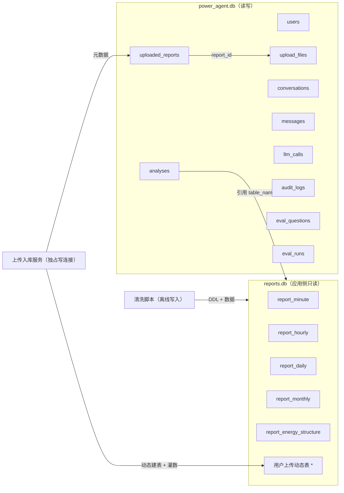
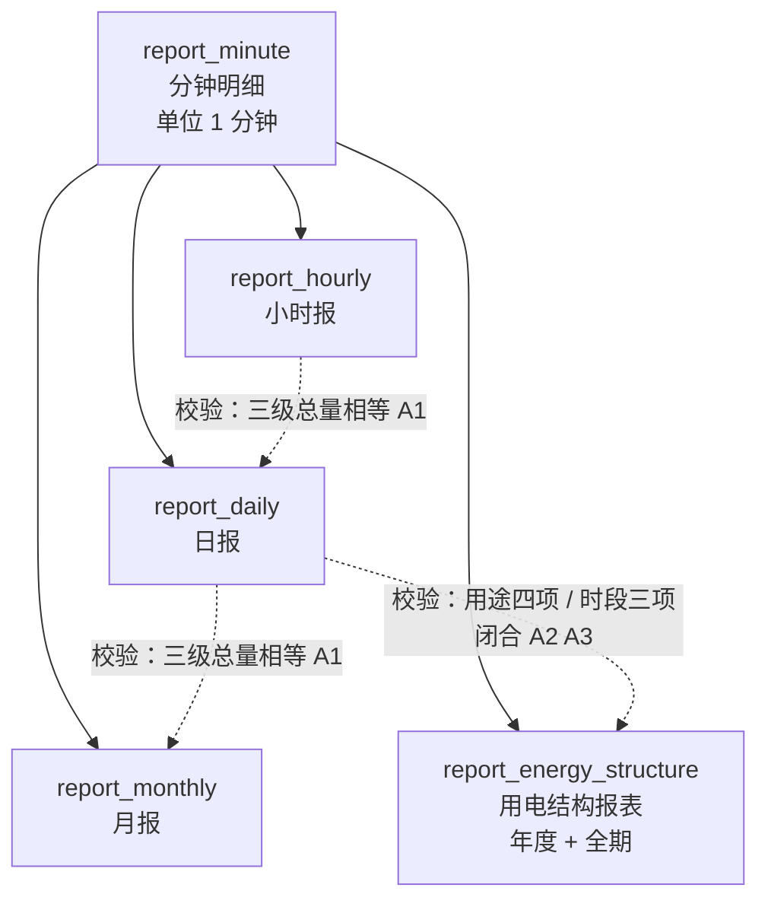
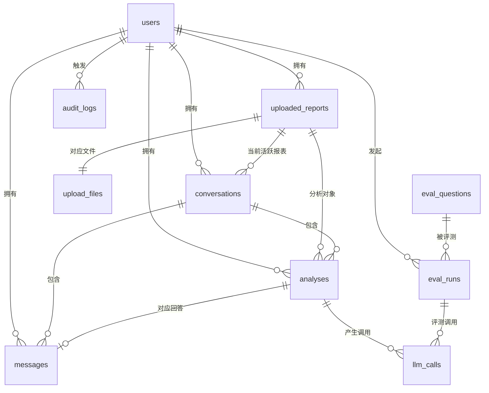
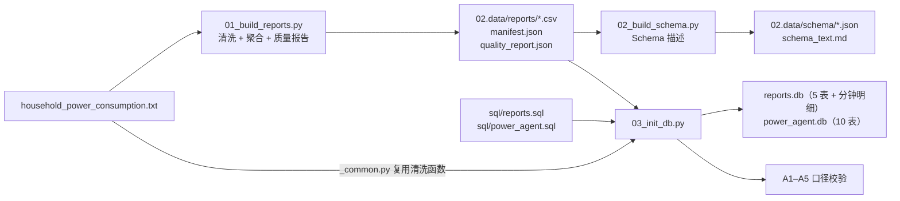

# 智电析报——基于LLM的能源电力报表智能分析Agent 数据库设计文档

| 项目名称 | 智电析报（PowerReport Agent） |
| --- | --- |
| 文档版本 | v1.2.0（实测回填版） |
| 文档状态 | 待评审 |
| 编写日期 | 2026-09-15 |
| 对应 PRD | 《智电析报_PRD文档》**v1.4.0** 第 7.4 节、第 8 章 |
| DDL 事实源 | `01.code/scripts/sql/reports.sql`、`01.code/scripts/sql/power_agent.sql` |
| 所属交付物 | 任务书任务 1「需求分析与系统设计 → 数据库设计」 |

---

## 目录

1. [文档说明](#1-文档说明)
2. [设计目标与原则](#2-设计目标与原则)
3. [总体设计](#3-总体设计)
4. [`reports.db` 报表库设计](#4-reportsdb-报表库设计)
5. [`power_agent.db` 系统库设计](#5-power_agentdb-系统库设计)
6. [参照完整性与删除行为](#6-参照完整性与删除行为)
7. [索引设计汇总](#7-索引设计汇总)
8. [容量与性能估算](#8-容量与性能估算)
9. [初始化、迁移与校验](#9-初始化迁移与校验)
10. [数据安全与访问控制](#10-数据安全与访问控制)
11. [与 PRD 的对应关系](#11-与-prd-的对应关系)
12. [变更记录](#12-变更记录)

---

## 1. 文档说明

### 1.1 目的

本文档定义智电析报的**两个 SQLite 数据库**：业务报表库 `reports.db` 与系统库 `power_agent.db` 的库表结构、约束、索引、访问权限与初始化流程，作为数据清洗脚本、后端代码与评测模块的共同依据。

### 1.2 范围

| 范围 | 说明 |
| --- | --- |
| 包含 | 数据模型与设计原则、**5 张报表静态表 + 10 张系统表（共 15 张固定表，不含用户上传生成的动态表）**的字段与约束、索引、外键与级联、容量估算、初始化与校验流程、访问控制 |
| 不包含 | 具体 SQL DDL 全文（见两份 `.sql` 事实源文件）、后端 ORM 映射代码、清洗算法实现（见清洗脚本） |
| 数据库 | SQLite 3（本机文件型；不引入服务端数据库） |

### 1.3 术语与约定

| 约定 | 说明 |
| --- | --- |
| 时间 | 统一 TEXT，ISO8601 格式 `YYYY-MM-DD HH:MM:SS`（可直接比较、排序、`LIKE`） |
| 主键 | 物理主键统一 `INTEGER PRIMARY KEY AUTOINCREMENT`；对外暴露 `*_code` 业务编号（TEXT UNIQUE） |
| 布尔 | 统一 `INTEGER` 0/1，列名以 `is_` 开头 |
| JSON | 统一 TEXT 存储，列名以 `_json` 结尾，写入前必须校验可被 `json.loads` 解析 |
| 单位 | 电量 `*_kwh`（kWh，**可 SUM**）；功率 `*_kw`（kW，**不可 SUM**）；比率 `*_ratio`/`coverage`/`load_factor`（**不可 SUM**） |
| 小数位 | 电量类 6 位、比率类 6 位、功率类 3 位（PRD 8.10） |

---

## 2. 设计目标与原则

### 2.1 设计目标

| 编号 | 目标 | 说明 |
| --- | --- | --- |
| G1 | **分析对象不可被篡改** | 报表库与系统库物理分离，报表库应用侧只读，LLM 生成代码永远无法写入 |
| G2 | **口径单一来源** | 报表字段口径由 PRD 第 8 章统一定义，DDL 与清洗脚本、Schema 描述三处一致 |
| G3 | **Text2SQL 友好** | 时间用可读 TEXT、字段名语义化、提供 `year`/`month`/`weekday`/`period` 等直查维度，减少 LLM 出错 |
| G4 | **可审计可回放** | 每次分析保留问题、slot、生成 SQL/代码、结果快照、图表、耗时、重试与错误 |
| G5 | **评测可自动化** | 120 题含 gold 答案与关键数值，评测批次与逐题结果可落地、可回归对比 |
| G6 | **可演进** | 新增报表类型不需改结构；新增表不影响既有查询 |

### 2.2 设计原则

1. **两库分离**：`reports.db`（只读分析对象）与 `power_agent.db`（读写系统数据）为两个独立文件，不跨库 JOIN，不在同一连接中混用。
2. **DDL 为唯一事实源**：`sql/reports.sql` 与 `sql/power_agent.sql` 是表结构的唯一事实源；SQLAlchemy models 只做查询映射，**不调用 `create_all()`**。
3. **不预置会算错的列**：所有派生列（比率、日均、未计量）都显式入表并标注不可 SUM，把口径写进数据而不是留给模型猜。
4. **陷阱显式化**：结构报表加 `is_total_row` 标记"全期合计行"，日报/月报加 `is_partial_period` 标记不完整周期，让"错误答案"在数据层就可被识别。
5. **一切写入可追溯**：写报表库只有两个入口（清洗脚本、上传入库服务），系统库写入全部走参数化 SQL，安全拦截写 `audit_logs`。

---

## 3. 总体设计

### 3.1 两库职责



| 库 | 文件 | 表数 | 访问模式 | 写入方 |
| --- | --- | --- | --- | --- |
| 报表库 | `02.data/reports.db` | 5 张静态 + N 张动态 | 应用侧 **只读**（`mode=ro`） | ① 清洗脚本（离线）② 上传入库服务（受控、独占写连接） |
| 系统库 | `02.data/power_agent.db` | 10 张 | 读写 | 后端服务（参数化 SQL / ORM） |

### 3.2 `reports.db` 关系概览

报表库内 5 张静态表**彼此独立、不做 JOIN**，各自是一张口径完整的报表：分钟明细 → 小时 → 日 → 月 是**不同粒度的平行产物**（都由分钟明细聚合得到，三级总量必须相等，见 PRD 8.11 A1）；结构报表是年度+全期的结构汇总。



### 3.3 `power_agent.db` ER 图



---

## 4. `reports.db` 报表库设计

> 字段级定义以 `01.code/scripts/sql/reports.sql` 为唯一事实源；口径定义见 PRD 第 8 章。本节给出结构要点、约束、索引与典型查询。

### 4.1 `report_minute` 分钟级明细

| 项 | 内容 |
| --- | --- |
| 用途 | 任意时间窗查询、异常定位、其他报表的数据来源 |
| 行数（预估） | **2,075,259 行**（原始数据每分钟一行，缺失分钟也保留占位） |
| 主键 | `id` 自增 |
| 唯一约束 | `dt`（时间戳唯一） |
| 是否需要 CSV | **否**——分钟明细**仅入库 `reports.db`，不导出 CSV**；小时、日、月、结构 4 张报表仍导出 CSV（见 PRD 7.3），因此 `02.data/reports/` 内不会出现 200MB+ 的大文件 |

**字段分组**

| 分组 | 字段 | 说明 |
| --- | --- | --- |
| 时间维度 | `dt`、`year`、`month`、`day`、`hour`、`weekday`（0=周一）、`is_weekend` | 供 LLM 直接 GROUP BY，无需自行解析时间 |
| 时段维度 | `period` | `peak` 峰 18:00–23:59 / `flat` 平 08:00–17:59 / `valley` 谷 00:00–07:59（左闭右开） |
| 电量（可 SUM） | `gap_kwh`（= `gap_kw`/60）、`sm1_kwh`、`sm2_kwh`、`sm3_kwh`、`unmetered_kwh` | `unmetered_kwh` = `gap_kw`/60 − `sm1` − `sm2` − `sm3`（PRD R2） |
| 功率与电学量（不可 SUM） | `gap_kw`、`voltage`、`intensity`、`reactive_power_kw` | 求平均才有效 |
| 缺失标记 | `is_missing` | 1 表示原始行是 `?`（该分钟数值列全为 NULL） |

**约束与索引**：`CHECK` 限定 `period` 取值、`hour`/`weekday` 范围、布尔列取值；索引 `ux_report_minute_dt`（唯一）、`ix_report_minute_ym`、`ix_report_minute_ymd`、`ix_report_minute_period`、`ix_report_minute_hour`、`ix_report_minute_we`。

**典型查询**

```sql
-- 某个任意时间窗的总电量（明细表的典型用法）
SELECT SUM(gap_kwh) AS total_kwh
FROM report_minute
WHERE dt >= '2009-07-01 00:00:00' AND dt < '2009-08-01 00:00:00';
```

### 4.2 `report_hourly` 小时报

| 项 | 内容 |
| --- | --- |
| 行数（预估） | 约 3.46 万行（以清洗实测为准） |
| 唯一约束 | `dt_hour` |
| 关键口径 | `expected_minutes` 恒 60；`coverage = active_minutes / 60`（比率，不可 SUM） |

**字段分组**：维度（`dt_hour`、年/月/日/时/星期/周末、`period`）+ 电量（`consumption_kwh`、三个分表、`unmetered_kwh`）+ **时段电量**（`peak_kwh`、`flat_kwh`、`valley_kwh`）+ 完整性（`active_minutes`、`expected_minutes`、`coverage`）+ 功率电学量（`avg_power_kw`、`max_power_kw`、`min_power_kw`、`avg_voltage`、`avg_intensity`）。

**注意**：小时报**不加** `is_partial_period`——单个小时的完整性已由 `coverage` 表达（缺失分钟导致 coverage < 1）。

### 4.3 `report_daily` 日报

| 项 | 内容 |
| --- | --- |
| 行数（预估） | 约 1442 行（完整自然日范围） |
| 唯一约束 | `date` |
| 关键口径 | `expected_minutes` 恒 1440；`daily_avg_kwh = consumption_kwh × 1440 / active_minutes`；**`active_minutes = 0` 时 `daily_avg_kwh` 为 NULL** |

**新增于小时报的字段**：派生（`daily_avg_kwh`、`load_factor`）、占比（`sm1_ratio`、`sm2_ratio`、`sm3_ratio`、`unmetered_ratio`、`peak_ratio`、`flat_ratio`、`valley_ratio`，全部**不可 SUM**）、异常（`peak_hour`、`is_anomaly`、`anomaly_reason`）、完整性（`is_partial_period`、`partial_reason`）。

其中：

- `peak_hour` 为当日用电量最大的整点，以 **0–23 的小时整数**表示，如 `18` 表示 18:00–18:59 这一小时（与 PRD 8.9.3 一致）；
- `anomaly_reason` 记录命中的异常规则名，多规则命中以 `|` 分隔（如 `rolling3sigma_high|voltage_out_of_range`）。

**典型查询**

```sql
-- 排除不完整周期后的月度均值（正确写法：先剔 NULL 与不完整日）
SELECT AVG(daily_avg_kwh) AS avg_daily
FROM report_daily
WHERE is_partial_period = 0 AND daily_avg_kwh IS NOT NULL;

-- 错误示范（不要这样写）：SUM(daily_avg_kwh) —— 日均不可 SUM
```

### 4.4 `report_monthly` 月报

| 项 | 内容 |
| --- | --- |
| 行数（预估） | 48 行（2006-12 ~ 2010-11） |
| 唯一约束 | `year_month` |
| 关键口径 | `expected_minutes = days_in_month × 1440`；`mom_rate` 环比、`yoy_rate` 同比（**比率，不可 SUM**） |

**字段分组**（与 PRD 8.9.4 逐项对齐）

| 分组 | 字段 |
| --- | --- |
| 维度 | `year_month`、`year`、`month`、`days_in_month` |
| 基础度量 | `consumption_kwh`、`sm1_kwh`、`sm2_kwh`、`sm3_kwh`、`unmetered_kwh`、`active_minutes`、`expected_minutes`、`coverage`、`avg_power_kw`、`max_power_kw`、`min_power_kw` |
| 时段度量 | `peak_kwh`、`flat_kwh`、`valley_kwh` |
| 派生指标 | `daily_avg_kwh`（同 8.6 口径）、`mom_rate`（环比，比率）、`yoy_rate`（同比，比率） |
| 异常标记 | `is_anomaly`、`anomaly_reason` |
| 完整性与边界标记 | `is_partial_period`、`partial_reason` |

其中 `days_in_month` 用于计算 `expected_minutes = days_in_month × 1440`（自然时间口径，PRD 红线 R4），因此该列必须在灌库时一并写入，不能依赖运行时用 `strftime()` 推算。

### 4.5 `report_energy_structure` 用电结构报表

| 项 | 内容 |
| --- | --- |
| 行数（预估） | 6 行（`2006`–`2010` 五个年份行 + `全期` 合计行） |
| 唯一约束 | `period` |
| 关键设计 | **`is_total_row`**：1 表示该行是"全期"合计行，防止把年份行与全期行一起 SUM（PRD 红线 R7） |

**两套正交拆分（PRD 红线 R3，禁止混加）**

| 拆分 | 字段 | 求和关系 |
| --- | --- | --- |
| 按用途 | `kitchen_kwh`（SM1）、`laundry_kwh`（SM2）、`water_heating_ac_kwh`（SM3）、`other_unmetered_kwh` | 四项之和 = `total_kwh` |
| 按时段 | `peak_kwh`、`flat_kwh`、`valley_kwh` | 三项之和 = `total_kwh` |

闭合校验列：`structure_closed`（用途四项之和 − `total_kwh`）、`time_closed`（时段三项之和 − `total_kwh`），二者应 ≈ 0（PRD 8.11 A2 / A3）。

**典型查询**

```sql
-- 正确的"全期结构占比"
SELECT period, kitchen_ratio, laundry_ratio, water_heating_ac_ratio, other_unmetered_ratio
FROM report_energy_structure
WHERE is_total_row = 1;

-- 错误示范：WHERE period IN ('2007','全期') 后再 SUM(kitchen_kwh) —— 全期行与年份行重复计数
```

### 4.6 用户上传的动态表

| 项 | 规则 |
| --- | --- |
| 归属 | **同属 `reports.db`**，与预置表相同的只读约束（PRD F1.3 / 7.4） |
| 表名 | 原文件名 → 小写 → 非字母数字转 `_` → 冲突追加序号（如 `report_daily_2`） |
| 列名 | 规范化安全列名；原始列名保存于 `uploaded_reports.schema_json` |
| 时间列 | 识别后额外派生 `year`/`month`/`day`/`hour`/`weekday`/`is_weekend` |
| 比率列 | 列名含 `ratio`/`rate`/`factor`/`coverage` 时标记为**不可 SUM** |
| 索引 | 时间列建唯一/普通索引，派生维度列建普通索引（按实际列存在情况生成） |
| 写入方 | **仅上传入库服务**（独占写连接，事务提交后立即关闭）；LLM 生成代码永远只读 |

---

## 5. `power_agent.db` 系统库设计

> 字段级定义以 `01.code/scripts/sql/power_agent.sql` 为唯一事实源。
>
> **表顺序说明**：本节表顺序与 PRD 7.4 表清单保持一致（`users` → `uploaded_reports` → `conversations` → `messages` → `analyses` → `eval_questions` → `eval_runs` → `upload_files` → `llm_calls` → `audit_logs`）；`sql/power_agent.sql` 中的物理定义顺序按**依赖关系**排列（先被引用的表在前），内容与本节完全一致。

### 5.1 `users` 用户账号

| 字段 | 类型 | 约束 | 说明 |
| --- | --- | --- | --- |
| `id` | INTEGER | PK AUTOINCREMENT | 物理主键 |
| `username` | TEXT | NOT NULL UNIQUE | 4–20 位 |
| `password_hash` | TEXT | NOT NULL | bcrypt 哈希，**禁止明文/可逆加密** |
| `display_name` / `email` | TEXT | | 展示名与邮箱 |
| `is_active` | INTEGER | DEFAULT 1 | 是否启用 |
| `login_fail_count` | INTEGER | DEFAULT 0 | 连续失败计数 |
| `locked_until` | TEXT | | 连续失败 5 次锁定 5 分钟 |
| `last_login_at` | TEXT | | 最近登录时间 |
| `created_at` / `updated_at` | TEXT | DEFAULT `datetime('now','localtime')` | 时间戳 |

### 5.2 `uploaded_reports` 报表元数据

| 字段 | 类型 | 约束 | 说明 |
| --- | --- | --- | --- |
| `id` | INTEGER | PK | |
| `report_code` | TEXT | NOT NULL UNIQUE | 对外业务编号，如 `r_daily`、`r_up_000003` |
| `user_id` | INTEGER | FK → `users(id)` ON DELETE CASCADE，可空 | 预置报表为 NULL |
| `filename` | TEXT | NOT NULL | 原始文件名 |
| `table_name` | TEXT | NOT NULL | `reports.db` 中的物理表名 |
| `report_type` | TEXT | NOT NULL CHECK | `minute`/`hourly`/`daily`/`monthly`/`structure`/`uploaded` |
| `row_count` / `column_count` | INTEGER | | 行列数 |
| `time_start` / `time_end` | TEXT | | 数据时间范围 |
| `caliber_version` | TEXT | | 口径版本（如 `caliber-v1.0`），口径变更时用于回归识别 |
| `is_preset` | INTEGER | DEFAULT 0 | 1=系统预置报表 |
| `is_active` | INTEGER | DEFAULT 0 | 当前活跃报表标记 |
| `status` | TEXT | CHECK | `pending`/`parsing`/`ready`/`failed`/`deleted` |
| `schema_json` | TEXT | | Schema 结构化描述（注入提示词用） |
| `quality_json` | TEXT | | 数据质量报告 |
| `error_message` | TEXT | | 解析失败原因 |
| `created_at` / `updated_at` | TEXT | | |
| 唯一 | | `UNIQUE(user_id, table_name)` | 同一用户下表名不重复 |

### 5.3 `conversations` 会话

| 字段 | 类型 | 约束 | 说明 |
| --- | --- | --- | --- |
| `id` | INTEGER | PK | |
| `conversation_code` | TEXT | NOT NULL UNIQUE | 如 `c_20260915_0001` |
| `user_id` | INTEGER | NOT NULL FK CASCADE | 归属用户 |
| `title` | TEXT | | 默认取首问摘要 |
| `active_report_id` | INTEGER | FK → `uploaded_reports(id)` **ON DELETE SET NULL** | 当前活跃报表 |
| `slot_json` | TEXT | | 结构化查询条件（时间范围/粒度/指标/过滤/对比），多轮追问继承的**权威状态** |
| `message_count` | INTEGER | DEFAULT 0 | 消息数 |
| `last_message_at` | TEXT | | |
| `created_at` / `updated_at` | TEXT | | |

> `slot_json` 结构示例：`{"time_range":{"type":"all"},"granularity":"month","metric":"consumption_kwh","filters":[{"field":"is_weekend","op":"=","value":true}]}`（与 PRD 9.2 SSE 的 `filters` 结构一致）。

### 5.4 `messages` 对话消息流

| 字段 | 类型 | 约束 | 说明 |
| --- | --- | --- | --- |
| `id` | INTEGER | PK | |
| `conversation_id` | INTEGER | NOT NULL FK CASCADE | |
| `user_id` | INTEGER | NOT NULL FK CASCADE | |
| `seq_no` | INTEGER | NOT NULL，`UNIQUE(conversation_id, seq_no)` | 会话内顺序号，从 1 开始 |
| `role` | TEXT | CHECK | `user`/`assistant`/`system` |
| `content` | TEXT | | 文本内容 |
| `analysis_id` | INTEGER | FK → `analyses(id)` **ON DELETE SET NULL** | 助手消息对应的分析记录 |
| `created_at` | TEXT | | |

### 5.5 `analyses` 分析记录（核心表）

| 字段 | 类型 | 说明 |
| --- | --- | --- |
| `id` / `analysis_code` | INTEGER / TEXT UNIQUE | 主键与业务编号（如 `a_000123`） |
| `user_id` / `conversation_id` / `report_id` | INTEGER FK | 归属与对象（均 `ON DELETE CASCADE`） |
| `question` | TEXT NOT NULL | 用户原始问题 |
| `slot_json` | TEXT | 本次生效的查询条件 |
| `route` | TEXT CHECK | `sql` / `pandas`（LLM 自主选择的路径） |
| `sql_text` / `code_text` | TEXT | 生成的 SQL / pandas 代码（供审查与复制） |
| `result_columns_json` / `result_rows_json` | TEXT | 结果快照；**超出 200KB 时截断，并置 `result_truncated = 1`**（与 PRD 7.5、10 节 S8 一致） |
| `result_row_count` / `result_truncated` | INTEGER | 行数与截断标记 |
| `chart_json` | TEXT | Plotly figure JSON |
| `narrative` | TEXT | 文字解读 |
| `key_numbers_json` | TEXT | 解读中的关键数值（供结论准确性判分） |
| `anomalies_json` | TEXT | 识别到的异常项 |
| `retries` / `path_switched` | INTEGER | 重试次数 / 是否发生过换路径 |
| `status` | TEXT CHECK | `success` / `failed` |
| `error_code` / `error_message` | TEXT | 失败原因（**失败必须明确反馈，禁止编造结果**） |
| `llm_model` / `elapsed_ms` | TEXT / INTEGER | 模型名与端到端耗时（用于 N2 考核） |
| `prompt_version` / `schema_version` | TEXT | 提示词与 Schema 版本，用于评测可复现 |
| `created_at` | TEXT | |

> 建议索引：`(conversation_id, created_at)`、`(user_id, created_at)`、`(report_id)`、`(status)`。

### 5.6 `eval_questions` 评测问题集

| 字段 | 类型 | 说明 |
| --- | --- | --- |
| `id` / `question_code` | INTEGER / TEXT UNIQUE | 如 `q001` |
| `question` | TEXT NOT NULL | 题目 |
| `qtype` | TEXT CHECK | `stat`/`agg`/`compare`/`anomaly`/`structure`/`multi_turn` |
| `difficulty` | TEXT CHECK | `easy`/`medium`/`hard` |
| `report_table` | TEXT NOT NULL | 目标报表 |
| `gold_sql` / `gold_code` | TEXT | 标准 SQL / 标准 pandas 代码（至少一项） |
| `gold_answer_json` | TEXT | 真实执行得到的标准结果 |
| `key_numbers_json` | TEXT | 结论判分用的关键数值 |
| `is_trap` / `trap_rule` | INTEGER / TEXT | 是否口径陷阱题及命中的红线规则（`R1`量纲/`R3`正交/`R6`比率/`R7`全期行） |
| `tags` / `sort_no` / `created_at` | | 标签与排序 |

> 题量 **120 题**，覆盖 6 类题型；陷阱题占比约 15%（PRD 5.6 F5.1）。

### 5.7 `eval_runs` 评测批次

| 字段 | 类型 | 说明 |
| --- | --- | --- |
| `id` / `run_code` | INTEGER / TEXT UNIQUE | 如 `run_20260920_01` |
| `user_id` | INTEGER FK SET NULL | 发起人 |
| `model_name` / `temperature` / `prompt_version` / `schema_version` | | 版本信息（评测可复现的必要条件） |
| `question_total` | INTEGER | 题目总数 |
| `exec_correct_count` / `exec_correct_rate` | INTEGER / REAL | 执行正确率（目标 ≥0.85） |
| `narrative_hit_rate` | REAL | 结论关键数值命中率（目标 ≥0.90） |
| `avg_elapsed_ms` / `p95_elapsed_ms` / `first_token_avg_ms` | INTEGER | 性能指标（目标 ≤8s / N3 / N1） |
| `retry_total` | INTEGER | 总重试次数 |
| `result_json` | TEXT | **逐题明细**（生成 SQL/代码/答案、是否命中、差异类型、耗时、错误码） |
| `report_path` | TEXT | 评测报告文件路径 |
| `status` / `error_message` / `started_at` / `finished_at` / `created_at` | | 运行状态 |

> 设计说明：逐题明细以 JSON 存入 `eval_runs.result_json`（保持 10 张表约定）。若后续需要按题型/难度做 SQL 级聚合统计，可拆出独立表 `eval_run_items(run_id, question_id, …, is_correct, diff_type)`，届时同步升版本（见 11.2 TBD6）。

### 5.8 `upload_files` 上传文件元数据（与 `uploaded_reports` 一对一）

| 字段 | 类型 | 约束 | 说明 |
| --- | --- | --- | --- |
| `id` | INTEGER | PK | |
| `report_id` | INTEGER | NOT NULL FK ON DELETE CASCADE，UNIQUE | 一对一关联报表 |
| `origin_filename` | TEXT | NOT NULL | 原始文件名 |
| `stored_path` | TEXT | NOT NULL | **相对 `02.data/` 的路径**（不存绝对路径） |
| `file_size` | INTEGER | | 字节 |
| `sha256` | TEXT | | 指纹，用于去重与完整性校验 |
| `encoding` / `delimiter` | TEXT | | 编码与分隔符探测结果 |
| `status` | TEXT | CHECK | `stored`/`parsed`/`failed` |
| `uploaded_at` | TEXT | | |

> 落盘目录：`02.data/uploads/{user_id}/{report_code}/{原始文件名}`。

### 5.9 `llm_calls` 大模型调用流水

| 字段 | 类型 | 说明 |
| --- | --- | --- |
| `id` | INTEGER PK | |
| `analysis_id` / `eval_run_id` | INTEGER FK CASCADE | 归属分析或评测批次 |
| `stage` | TEXT NOT NULL | `slot`/`gen_sql`/`gen_pandas`/`retry`/`narrative`/`clarify` |
| `model_name` / `temperature` | TEXT / REAL | 模型与温度（评测固定 0） |
| `prompt_tokens` / `completion_tokens` / `total_tokens` | INTEGER | token 用量统计 |
| `elapsed_ms` / `first_token_ms` | INTEGER | 耗时与流式首字延迟（支撑 N1） |
| `is_retry` | INTEGER | 是否重试调用 |
| `http_status` / `status` / `error_message` | | 调用结果 |
| `request_id` | TEXT | 与后端日志贯穿的请求 ID |
| `created_at` | TEXT | |

### 5.10 `audit_logs` 安全审计日志

| 字段 | 类型 | 说明 |
| --- | --- | --- |
| `id` | INTEGER PK | |
| `user_id` / `conversation_id` | INTEGER FK **ON DELETE SET NULL** | 保留日志（不随用户删除而消失） |
| `event_type` | TEXT CHECK | `sql_blocked`/`code_blocked`/`injection_attempt`/`auth_forbidden`/`cascade_delete` |
| `severity` | TEXT CHECK | `low`/`medium`/`high` |
| `rule_id` | TEXT | 命中的校验项（如 `sqlglot:non_select`、`ast:import_os`） |
| `action` | TEXT CHECK | `blocked`/`warned`/`allowed` |
| `payload` | TEXT | 被拦截内容（截断 ≤2000 字符） |
| `ip` / `user_agent` / `created_at` | | 来源信息 |

> 该表是 **TBD5「安全用例集拦截通过率」** 的数据来源：恶意样例执行后按 `event_type` + `action` 统计即可。

---

## 6. 参照完整性与删除行为

### 6.1 外键开启方式

SQLite 的外键约束**默认关闭**，且是**连接级**设置。要求：

```python
conn.execute("PRAGMA foreign_keys = ON")   # 每个连接建立后必须执行
```

后端统一在连接工厂中执行；清洗脚本写库连接同样执行。

### 6.2 删除行为矩阵

| 删除对象 | 级联行为 | 设计理由 |
| --- | --- | --- |
| 删除 `users` 行 | 级联删除其 `uploaded_reports`（用户上传的）、`conversations`（连带 `messages`、`analyses`、`llm_calls`）、`eval_runs`（连带 `llm_calls`） | 数据隔离与"一键清空我的数据" |
| 删除 `uploaded_reports` 行 | 级联删除 `upload_files`、`analyses`；`conversations.active_report_id` 置 NULL | 报表删除后会话仍可用，只需重新选择报表 |
| 删除 `conversations` 行 | 级联删除 `messages`、`analyses`（连带其 `llm_calls`） | 会话维度清理 |
| 删除 `analyses` 行 | `messages.analysis_id` 置 NULL；级联删除 `llm_calls` | 保留对话文本，不保留执行明细 |
| 删除 `eval_runs` 行 | 级联删除其 `llm_calls` | 评测清理 |
| 删除用户/会话/报表时的审计 | `audit_logs.user_id` / `conversation_id` 置 NULL，**日志本身保留** | 安全日志不可被删除操作抹去 |

### 6.3 跨库一致性

`reports.db` 由清洗脚本与上传入库服务写入，与系统库的 `uploaded_reports.table_name` 存在**逻辑关联**（跨库无法建外键）。因此规定**删除顺序**：

1. 先在 `power_agent.db` 中标记/删除 `uploaded_reports` 记录（并落 `audit_logs` 级联删除事件）；
2. 再在受控事务中 `DROP TABLE` 清理 `reports.db` 中的动态表与索引；
3. 若第 2 步失败，记录 `uploaded_reports.status='failed'` + `error_message`，由后续清理任务补偿。

---

## 7. 索引设计汇总

### 7.1 `reports.db`

| 表 | 索引 | 类型 | 支撑的查询 |
| --- | --- | --- | --- |
| `report_minute` | `dt` | 唯一 | 精确时间点、时间窗口范围扫描 |
| | `(year, month)`、`(year, month, day)` | 普通 | 按年/月/日过滤（LLM 最常用） |
| | `period`、`hour`、`is_weekend` | 普通 | 峰谷分析、日内曲线、周末对比 |
| `report_hourly` | `dt_hour` | 唯一 | 小时窗口 |
| | `(year, month)`、`(year, month, day)`、`period`、`hour`、`is_weekend` | 普通 | 同上 |
| `report_daily` | `date` | 唯一 | 按日取数 |
| | `(year, month)`、`is_weekend`、`is_anomaly`、`is_partial_period` | 普通 | 月度聚合、周末对比、异常清单、剔除不完整周期 |
| `report_monthly` | `year_month` | 唯一 | 月度取数 |
| | `year`、`is_anomaly`、`is_partial_period` | 普通 | 年度聚合、异常月、剔除不完整月 |
| `report_energy_structure` | `period` | 唯一 | 结构报表取数（6 行，不走索引也快） |

### 7.2 `power_agent.db`

| 表 | 索引 | 支撑的查询 |
| --- | --- | --- |
| `users` | `username`（唯一）、`created_at` | 登录、用户列表 |
| `uploaded_reports` | `(user_id, created_at)`、`report_type`、`is_active`、`table_name`、`report_code`（唯一） | 我的报表列表、活跃报表切换、Schema 注入 |
| `conversations` | `(user_id, updated_at)`、`active_report_id` | 会话列表排序、按报表筛选 |
| `messages` | `(conversation_id, seq_no)`（含唯一约束）、`(user_id, created_at)` | 消息历史分页 |
| `analyses` | `(conversation_id, created_at)`、`(user_id, created_at)`、`report_id`、`status` | 分析记录列表、筛选与失败排查 |
| `eval_questions` | `(qtype, difficulty)`、`is_trap`、`question_code`（唯一） | 分类统计、陷阱题回归 |
| `eval_runs` | `(status, created_at)`、`(user_id, created_at)`、`run_code`（唯一） | 评测批次列表与历史对比 |
| `upload_files` | `report_id`（唯一）、`sha256` | 一对一取文件、重复上传识别 |
| `llm_calls` | `analysis_id`、`eval_run_id`、`(stage, created_at)` | 耗时/成本分析、限流排查 |
| `audit_logs` | `(event_type, created_at)`、`(user_id, created_at)`、`action` | 安全统计（TBD5）、越权排查 |

---

## 8. 容量与性能估算

### 8.1 行数预估

| 表 | 实测行数 | 依据 |
| --- | --- | --- |
| `report_minute` | **2,075,259** | 原始数据行数（清洗后行数不变，缺失行保留占位） |
| `report_hourly` | **34,589** | 分钟数按小时去重 |
| `report_daily` | **1,442** | 自然日数量 |
| `report_monthly` | **48** | 2006-12 ~ 2010-11 |
| `report_energy_structure` | **6** | 5 个年份 + 全期 |
| 4 张报表 CSV 合计 | **约 4.5 MB** | 以小时报 4.2 MB 为主（明细不落 CSV） |

> 以上为**交付物 2 实测值**（caliber-v1.0，2026-09-15）；初版对 `report_hourly` 估 3.46 万行，实测 34,589 行，已修正。

### 8.2 体积与性能

| 项 | 估算 | 说明 |
| --- | --- | --- |
| `reports.db` 体积 | **实测 408 MB** | 分钟明细为主（2,075,259 行 × 18 列 + 6 个索引）；初版估 250–350 MB 偏低，已按实测修正 |
| `power_agent.db` 体积 | **实测 200 KB**（当前仅预置元数据） | 随用户、分析记录与评测结果增长 |
| 单表统计查询 | < 100 ms | 走 `(year, month)` 索引 |
| 任意时间窗明细查询 | < 300 ms | 走 `dt` 索引，建议限定 ≤1 年 |
| 默认 `LIMIT` | 1000 行 | 聚合查询不受影响（仅安全兜底） |

**性能设计说明**：

1. 分钟明细表列数控制在 20 列以内，避免行宽过大导致扫描变慢；
2. 所有常用分组维度（年/月/日/时/星期/时段）已物化为列并建索引，避免 LLM 写 `strftime()` 计算出错；
3. 报表库只读连接可安全并发（SQLite 多读一写），系统库启用 `WAL` 提升并发读写体验。

---

## 9. 初始化、迁移与校验

### 9.1 初始化流程



| 脚本 | 输入 | 输出 | 幂等策略 |
| --- | --- | --- | --- |
| `_common.py` | —（被调用的公共模块） | 路径常量、原始文件解析与清洗函数（`parse_clean_minute()` 等） | 无状态纯函数；被 `01_build_reports.py` 与 `03_init_db.py` **共用**，保证口径单一来源 |
| `01_build_reports.py` | 原始 txt | 4 张报表 CSV、`manifest.json`、`quality_report.json` | 覆盖写；带 `--force` 才重算，默认检测产物存在则跳过 |
| `02_build_schema.py` | `sql/reports.sql` + 报表 CSV | `schema/*.schema.json`、`schema_text.md` | 覆盖写 |
| `03_init_db.py` | 两份 DDL + 报表 CSV + 原始 txt | `reports.db`、`power_agent.db` | `CREATE TABLE IF NOT EXISTS` + 灌数前 `DELETE FROM`（或 `DROP`/重建）；预置报表元数据 upsert |

### 9.2 口径校验（A1–A5，PRD 8.11）

| 锚点 | 校验内容 | 期望 | 失败处理 |
| --- | --- | --- | --- |
| A1 | 小时/日/月三级总电量 | 三者完全相等 | 抛错并终止灌库 |
| A2 | 用途四项之和 vs `total_kwh` | 误差 ≤ 1e-6 | 抛错并终止 |
| A3 | 时段三项之和 vs `total_kwh` | 误差 ≤ 1e-6 | 抛错并终止 |
| A4 | 未计量用电占比 | 记录到 `quality_report.json`（不作硬阈值） | 仅记录 |
| A5 | 行数 | 分钟表 = 2,075,259；小时/日/月行数符合时间范围推导 | 不一致则警告并记录 |

**实测结果（caliber-v1.0，2026-09-15；`03_init_db.py` 在库上重跑一遍）**

| 锚点 | 实测值 | 结论 |
| --- | --- | --- |
| A1 | 小时 = 日 = 月 = **37283.7477 kWh**，最大偏差 **0.0** | 通过 |
| A2 | 最大闭合误差 **7.28e-12** kWh | 通过 |
| A3 | 最大闭合误差 **1.82e-12** kWh | 通过 |
| A4 | 未计量占比 **51.1977%**（19088.4147 / 37283.7477 kWh） | 记录 |
| A5 | 分钟 2,075,259 · 小时 34,589 · 日 1,442 · 月 48 · 结构 6 | 通过 |

> 校验结果同时写入 `02.data/quality/db_verification.json` 与 `reports/manifest.json`。灌数耗时参考：分钟明细 207 万行约 7.6 秒（先灌数后建索引）。

### 9.3 迁移策略

- 本阶段为**一次性初始化**，不引入迁移框架；
- 表结构变更流程：改 `.sql` 事实源 → 在《数据库设计文档》变更记录中登记 → 重建开发库（`03_init_db.py --force`）；
- 口径变更（影响报表数值）：必须同步修改 `sql/reports.sql` 注释、`manifest.json` 的 `caliber_version`、`schema_text.md`，并重跑 A1–A5 校验；
- 生产/演示数据不跨版本混用：库文件与 `caliber_version` 绑定。

---

## 10. 数据安全与访问控制

| 编号 | 措施 | 实现位置 |
| --- | --- | --- |
| S1 | 报表库只读打开 | 连接串 `file:02.data/reports.db?mode=ro`（后端与沙箱统一） |
| S2 | LLM 生成的 SQL 只允许 SELECT，表名命中白名单 | `sqlglot` 校验层（执行前） |
| S3 | 生成的 pandas 代码禁网络/文件写/危险模块 | AST 预检 + RestrictedPython |
| S4 | 系统库写入全部参数化 | SQLAlchemy / 绑定变量，禁止字符串拼接 |
| S5 | 密码 bcrypt、JWT 鉴权、资源归属校验 | `users` + 接口层 |
| S6 | 安全事件留痕并可统计 | `audit_logs` |
| S7 | 上传文件按用户隔离落盘、路径不入库明文 | `upload_files.stored_path` 存相对路径 |
| S8 | 关键结果快照限长 | `analyses.result_rows_json` ≤ 200KB，超出置 `result_truncated=1` |

---

## 11. 与 PRD 的对应关系

### 11.1 红线规则落点

| PRD 规则 | 落点 |
| --- | --- |
| R1 量纲（kW/kWh 不可相加） | 字段命名 `_kw` / `_kwh`；Schema 描述标注；`llm_calls` 无关 |
| R2 未计量用电公式 | `report_minute.unmetered_kwh` 已实体化，禁止模型自行推导 |
| R3 两套正交拆分 | 结构报表分列存储；`eval_questions.trap_rule='R3'` |
| R4 自然时间口径 | `expected_minutes` 常量列（60/1440/天数×1440） |
| R5 日均折算 | `daily_avg_kwh` 列 + `active_minutes` 列；`active_minutes=0` 时为 NULL |
| R6 比率不可 SUM | `*_ratio`、`coverage`、`load_factor` 列；Schema 标注 `agg: none` |
| R7 全期行不可混加 | `report_energy_structure.is_total_row` |

### 11.2 待回填事项

| 编号 | 待回填项 | 时机 | 位置 |
| --- | --- | --- | --- |
| TBD3 | 实际行数、体积、各列缺失分布与分位数 | 清洗脚本运行后 | 第 8.1 节、PRD 7.2 |
| TBD4 | A1–A5 锚点实际数值 | 灌库校验后 | 第 9.2 节、PRD 8.11 |
| TBD6 | 是否拆出 `eval_run_items` 表 | 交付物 8（评测模块）设计时 | 第 5.7 节 |

> 编号与 PRD 12.4 完全一致：本表只登记**与数据库相关**的 TBD3 / TBD4 / TBD6；TBD1（前端依赖实际版本）、TBD2（百炼模型名与限流参数）、TBD5（安全用例集拦截通过率）属前端与 Agent 侧，仅在 PRD 12.4 中登记，此处不重复。
>
> 状态更新（2026-09-15）：**TBD3 与 TBD4 已随交付物 2 完成回填**（第 8.1 节行数、第 8.2 节体积、第 9.2 节校验结果均已替换为实测值）；TBD6 仍待交付物 8。

> 编号前缀说明：待回填事项统一使用 `TBD`（To Be Determined）前缀，以区别于 PRD 11.2 的业务风险编号 `B1–B3` 与第 8 章红线规则编号 `R1–R7`。

---

## 12. 变更记录

| 版本 | 日期 | 变更内容 |
| --- | --- | --- |
| v1.0.0 | 2026-09-15 | 初版：确立两库分离与只读原则、15 张表结构、外键与级联矩阵、索引清单、容量估算与初始化校验流程；同步产出 `sql/reports.sql` 与 `sql/power_agent.sql` |
| v1.1.0 | 2026-09-15 | **与 PRD 对齐修订**（依据《PRD 与数据库设计文档对齐修订清单》）：① 4.4 月报补全字段分组（维度/基础度量/时段度量/派生指标/异常标记/完整性标记）并说明 `days_in_month` 与 `expected_minutes` 的关系；② 4.3 补 `peak_hour` 格式与 `anomaly_reason` 分隔符说明；③ 4.1 明确"仅分钟明细不落 CSV，其余 4 张报表仍导出 CSV"；④ 第 5 节表顺序调整为与 PRD 7.4 一致（并注明 SQL 文件按依赖顺序排列）；⑤ 5.5 补 `result_rows_json` 截断与 `result_truncated = 1` 说明；⑥ 9.1 补 `_common.py` 脚本行；⑦ 1.2 表数量表述改为"5 张报表静态表 + 10 张系统表（共 15 张固定表）"；⑧ 11.2 TBD6 引用章节号随表序调整更新；⑨ 头部"对应 PRD"版本更新为 v1.4.0；⑩ **待回填编号由 `B` 前缀统一改为 `TBD` 前缀**（消除与 PRD 11.2 业务风险 `B1–B3` 的编号冲突），全文引用同步更新 |
| v1.2.0 | 2026-09-15 | **交付物 2 实测回填**：① 8.1 行数预估改为实测（分钟 2,075,259 · 小时 34,589 · 日 1,442 · 月 48 · 结构 6）；② 8.2 修正体积预估 —— `reports.db` **实测 408 MB**（原估 250–350 MB 偏低）、`power_agent.db` 实测 200 KB；③ 9.2 补 A1–A5 实测结果与灌数耗时参考（207 万行约 7.6s，先灌数后建索引）；④ 11.2 标注 TBD3、TBD4 已完成 |
