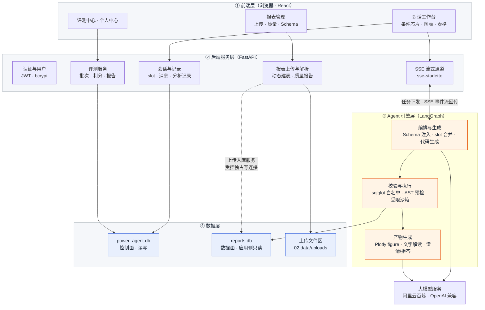
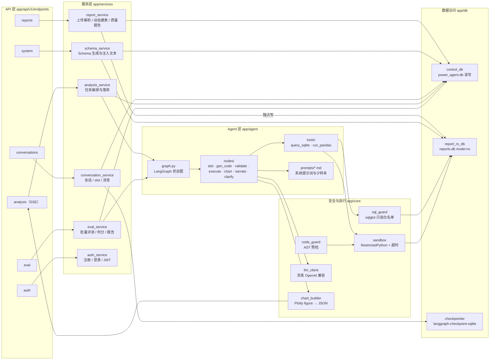
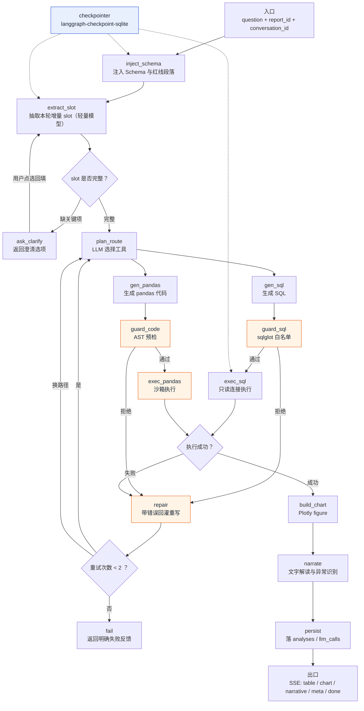
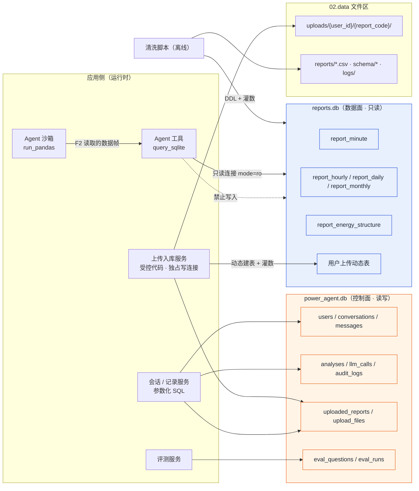
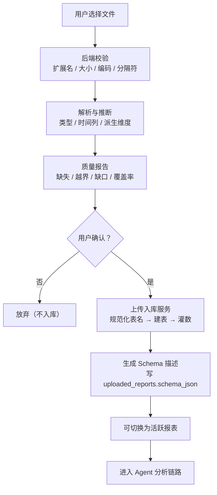
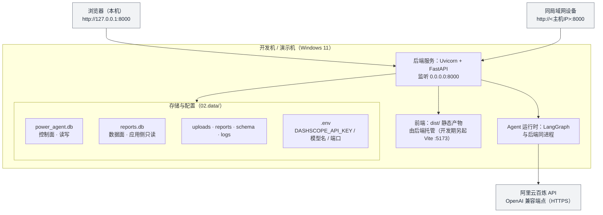
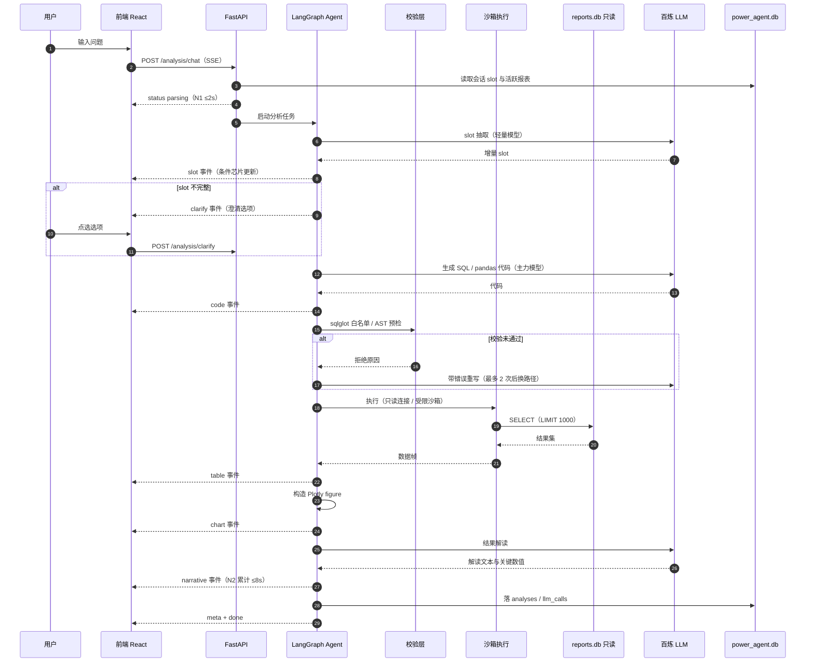
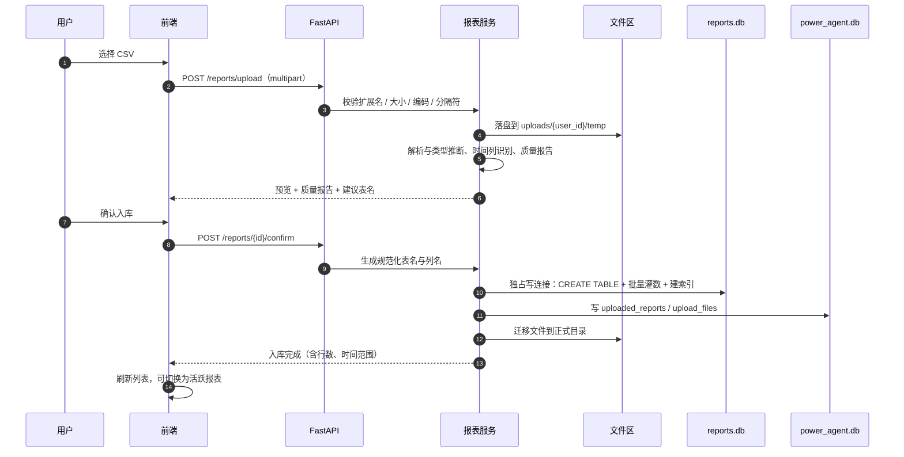
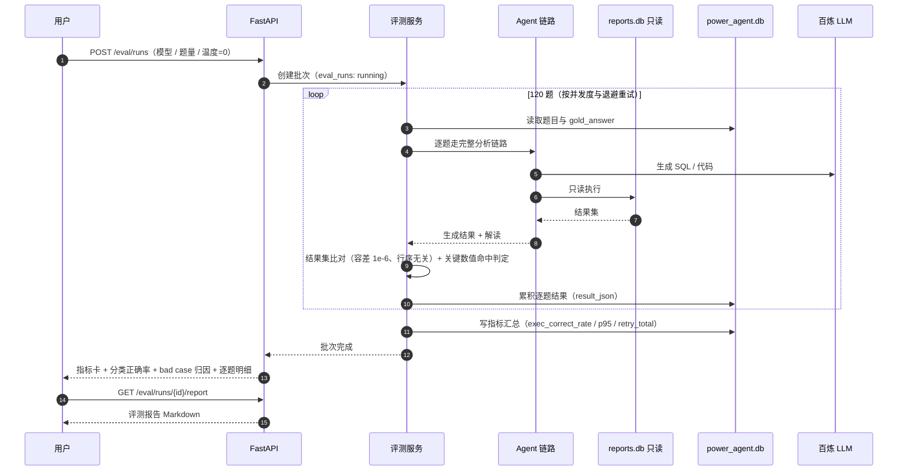

# 智电析报——基于LLM的能源电力报表智能分析Agent 系统架构设计文档

| 项目名称 | 智电析报（PowerReport Agent） |
| --- | --- |
| 文档版本 | v1.0.3（附录 A 补全版） |
| 文档状态 | 待评审 |
| 编写日期 | 2026-09-15 |
| 对应 PRD | 《智电析报_PRD文档》**v1.6.0** |
| 相关文档 | 《智电析报_UIUX设计文档》**v1.1.2**、《智电析报_数据库设计文档》**v1.2.2** |
| 架构图目录 | `04.实训指导书/images_arch/`（Mermaid 源码在本文件内 + PNG 导出） |
| 所属交付物 | 任务书任务 1「需求分析与系统设计 → 架构设计图」 |

---

## 目录

1. [文档说明](#1-文档说明)
2. [架构目标与约束](#2-架构目标与约束)
3. [四层系统架构](#3-四层系统架构)
4. [后端组件与 Agent 流水线](#4-后端组件与-agent-流水线)
5. [数据架构](#5-数据架构)
6. [部署架构](#6-部署架构)
7. [关键时序](#7-关键时序)
8. [非功能设计落点](#8-非功能设计落点)
9. [架构决策记录（ADR）](#9-架构决策记录adr)

---

## 1. 文档说明

### 1.1 目的

定义智电析报的**系统分层、组件划分、数据访问路径、部署形态与关键技术决策**，回答三类问题：

1. **系统怎么搭**：各层职责、层间契约、组件边界；
2. **数据怎么走**：一次提问从用户输入到图表输出，经过哪些组件与数据存储；
3. **为什么这么选**：关键技术选型的取舍与代价（见第 9 章 ADR）。

### 1.2 读者与用途

| 读者 | 用途 |
| --- | --- |
| 开发者（本人） | 作为编码时的结构依据与模块边界约束 |
| 评审/答辩 | 讲清架构与选型逻辑，支撑"技术方案"部分的问答 |
| AI 编程助手 | 作为"AI 共创"上下文的架构约束（配合 `05.RAG语料`） |

### 1.3 架构图清单

| 编号 | 图名 | 位置 | PNG |
| --- | --- | --- | --- |
| 1 | 四层系统架构图 | 3.1 | `images_arch/arch_layers.png` |
| 2 | 后端组件图 | 4.1 | `images_arch/arch_components.png` |
| 3 | Agent 流水线节点图 | 4.2 | `images_arch/arch_agent_pipeline.png` |
| 4 | 数据访问路径图 | 5.1 | `images_arch/arch_data_access.png` |
| 5 | 部署拓扑图 | 6.1 | `images_arch/arch_deploy.png` |
| 6 | 时序图：一次提问全链路 | 7.1 | `images_arch/seq_chat.png` |
| 7 | 时序图：上传入库 | 7.2 | `images_arch/seq_upload.png` |
| 8 | 时序图：批量评测 | 7.3 | `images_arch/seq_eval.png` |
| 9 | 上传数据生命周期图 | 5.4 | `images_arch/arch_upload_lifecycle.png` |

> PNG 由 Mermaid 源码离线渲染生成（本地 `01.code/tools/vendor/mermaid.min.js` + 浏览器无头截图）：
> `.venv\Scripts\python.exe 01.code\tools\mermaid2png.py "04.实训指导书\AI共创过程文档\智电析报_系统架构设计文档.md" "04.实训指导书\images_arch"`

---

## 2. 架构目标与约束

### 2.1 架构目标

| 编号 | 目标 | 与 PRD 的对应 |
| --- | --- | --- |
| A1 | 分析对象不可被生成代码篡改 | S8、6.2 内容安全 |
| A2 | 口径单一来源，杜绝量纲/拆分混算 | 第 8 章红线 R1–R7 |
| A3 | 单轮响应可控（首字 ≤2s、平均 ≤8s） | N1、N2 |
| A4 | 组件可替换（模型、图表、数据源） | 6.6 可扩展性 |
| A5 | 全链路可审计、可回放 | G4（可审计可回放） |
| A6 | 单机可运行、可局域网共享 | 部署形态（本机演示） |

### 2.2 硬约束（架构必须服从）

| 编号 | 约束 | 来源 | 架构含义 |
| --- | --- | --- | --- |
| C1 | `reports.db` 只放报表数据，应用侧只读（`mode=ro`） | PRD 7.4 / S8 | 数据层权限隔离，生成代码只能读 |
| C2 | LLM 生成的 SQL 只允许 SELECT 且表名白名单 | PRD F2.2 | 执行前必须过 sqlglot 校验层 |
| C3 | LLM 生成的 pandas 代码必须在沙箱执行 | PRD F2.3 / S1 | 独立沙箱组件，禁网/禁文件写/超时 |
| C4 | 多轮条件以结构化 slot 持久化 | PRD F4.1 | 会话状态存库，不依赖聊天历史 |
| C5 | 时间字段统一 TEXT ISO8601、主键自增整数 | 数据库设计 1.3 | 数据层实现约束 |
| C6 | 大结果集默认 LIMIT 1000（聚合仅兜底） | PRD F2.2 / N7 | 执行层强制追加 |
| C7 | 评测温度固定 0、判分为结果集比对 | PRD F5.2 / TBD2 | 评测链路可复现 |
| C8 | 不引入 Docker / 服务端数据库 / 向量库 | 决策记录 | 部署与依赖最小化 |

### 2.3 架构原则

1. **单向数据流**：用户 → 前端 → API → Agent → 执行 → 结果回传；报表库不接受任何上行写入。
2. **控制面与数据面分离**：`power_agent.db` 是控制面（用户/会话/记录/评测），`reports.db` 是数据面（只读分析对象）。
3. **所有外部产物先过校验层**：SQL 过 sqlglot、代码过 AST、上传文件过结构与类型校验。
4. **状态集中**：会话状态（slot）与执行结果集中在数据库，前端只做呈现与轻交互。

---

## 3. 四层系统架构

### 3.1 分层架构图

<!-- mermaid: arch_layers -->


### 3.2 各层职责与层间契约

| 层 | 职责 | 对外契约 | 禁止事项 |
| --- | --- | --- | --- |
| ① 前端层 | 上传、对话、图表渲染、条件编辑、记录管理 | 只调用 `/api/v1` REST 与 SSE；不直连数据库、不持有模型密钥 | 不含分析与 SQL 拼接逻辑 |
| ② 后端服务层 | 认证、上传解析、会话与记录、SSE 编排、评测 | 统一响应包络 `{code,message,data,request_id}`；错误码见 PRD 9.3 | 不直接执行生成代码（必须经 Agent 与沙箱） |
| ③ Agent 引擎层 | slot 抽取、代码生成、校验、沙箱执行、图表、解读、澄清 | 输入：问题 + slot + Schema 文本；输出：表格数据 + figure JSON + 解读 | **不得写入 `reports.db`** |
| ④ 数据层 | 控制面读写；数据面只读；上传文件落盘 | 库表契约见《数据库设计文档》 | 数据面不接受应用侧写入 |

### 3.3 层间关键约定

| 约定 | 内容 |
| --- | --- |
| 前端 ↔ 后端 | 除注册/登录/健康检查外均需 JWT；分析链路走 SSE（`text/event-stream`），其余走 JSON |
| 后端 ↔ Agent | 以「分析任务」为单位传递：`conversation_id / report_id / question / slot / schema_text`；Agent 以事件流回调 |
| Agent ↔ 数据层 | 只读连接执行 SQL；pandas 路径由后端提供 DataFrame 视图（来自只读查询），沙箱内不给文件与网络 |
| Agent ↔ LLM | 统一 `LLMClient`（百炼 OpenAI 兼容模式），模型名与温度配置化，轻量模型做 slot、主力模型做代码与解读 |
| 后端 ↔ 上传文件区 | 落盘按 `{user_id}/{report_code}/` 隔离，路径入库仅存相对路径 |

---

## 4. 后端组件与 Agent 流水线

### 4.1 后端组件图

<!-- mermaid: arch_components -->


**组件清单**

| 组件 | 文件/目录 | 职责 | 依赖 |
| --- | --- | --- | --- |
| `sql_guard` | `app/core/sql_guard.py` | sqlglot 解析、单语句校验、仅 SELECT、表白名单、强制 LIMIT | sqlglot |
| `code_guard` | `app/core/code_guard.py` | 生成代码的 AST 预检（禁 import/dunder/危险函数） | ast |
| `sandbox` | `app/core/sandbox.py` | RestrictedPython 执行、超时、结果体积限制 | RestrictedPython |
| `llm_client` | `app/core/llm_client.py` | 统一模型调用、分级模型、token 与耗时记录 | openai SDK |
| `chart_builder` | `app/core/chart_builder.py` | 依据结果与意图构造 Plotly figure JSON | plotly |
| `graph.py` | `app/agent/graph.py` | LangGraph 状态图（节点/条件边/重试环） | langgraph |
| `tools` | `app/agent/tools/` | 双工具：`query_sqlite` / `run_pandas` | 上列 guard 与 sandbox |
| `control_db` / `report_ro_db` | `app/db/` | 控制面读写连接 / 数据面只读连接 | SQLAlchemy、aiosqlite |
| `checkpointer` | `app/db/checkpointer.py` | 会话级 LangGraph 状态持久化（slot 权威来源） | langgraph-checkpoint-sqlite |

### 4.2 Agent 流水线（LangGraph）

<!-- mermaid: arch_agent_pipeline -->


**流水线设计要点**

| 要点 | 说明 |
| --- | --- |
| 状态结构 | 图状态包含 `slot`、`question`、`report_id`、`schema_text`、`route`、`sql`、`code`、`df_preview`、`retries`、`path_switched`、`error` 等字段 |
| slot 权威来源 | 图状态经 `checkpointer` 持久化到 SQLite；会话恢复以库中 slot 为准（PRD C4） |
| 双工具路由 | `plan_route` 由 LLM 决策，工具描述中写明适用场景与反例（聚合/过滤 → SQL；统计/相关性/异常 → pandas） |
| 重试环 | 校验失败或执行失败 → `repair`（回灌错误 + 相关 Schema 片段）→ 重试；**第 2 次失败后允许换路径**（SQL ↔ pandas） |
| 失败即终止 | 重试耗尽后进入 `fail`，明确返回"本次未生成结果"，**禁止编造**（PRD F2.4） |
| 澄清回路 | `ask_clarify` 返回选项，用户点选后回到 `extract_slot` 合并，已解析条件不丢（PRD F4.4） |
| 阶段事件 | 每个节点向 SSE 推送 `status`，前端渲染阶段时间线（UI/UX 8.2） |

### 4.3 双工具路由规则（供提示词与评测共用）

| 问题类型 | 首选工具 | 备选 | 说明 |
| --- | --- | --- | --- |
| 过滤 / 聚合 / 排序 / 分组 / 排行 | `query_sqlite` | `run_pandas` | SQL 表达简洁且可读，便于审查 |
| 同比 / 环比 / 滚动统计 / 标准差 | `query_sqlite` | `run_pandas` | SQLite 无 STDDEV，需用 `SQRT(AVG(x*x)-AVG(x)*AVG(x))`（Schema 中给出可用函数清单） |
| 相关性 / 分布 / 异常检测 / 多步变换 | `run_pandas` | `query_sqlite` | pandas 表达力更强 |
| 任意时间窗明细 | `query_sqlite` | — | 走 `report_minute.dt` 索引 |
| 结果过大 | — | — | 强制 LIMIT 1000，并通过解读提示细化条件 |

---

## 5. 数据架构

### 5.1 数据访问路径图

<!-- mermaid: arch_data_access -->


### 5.2 两库分离的架构含义

| 维度 | `power_agent.db`（控制面） | `reports.db`（数据面） |
| --- | --- | --- |
| 角色 | 用户、会话、消息、分析记录、评测 | 分析对象（报表数据） |
| 访问模式 | 读写（参数化 SQL / ORM） | 应用侧**只读**（`mode=ro`） |
| 写入方 | 后端服务；上传入库服务写元数据 | ① 清洗脚本（离线）② 上传入库服务（受控、独占写连接） |
| 外键与级联 | 全链路 `ON DELETE CASCADE`；安全日志 `SET NULL` | 表间无外键（平行产物） |
| 日志模式 | `WAL`（读写并发） | 默认（只读为主） |
| 失败影响 | 会话/记录不可用 | 分析不可执行（报错而非编造） |

### 5.3 只读的架构级保证（不止靠约定）

| 层次 | 措施 |
| --- | --- |
| 连接层 | 统一连接工厂：数据面连接串固定 `file:...?mode=ro`，任何写尝试由 SQLite 直接抛错 |
| 语句层 | `sql_guard` 仅放行 SELECT；多语句、DDL/DML、ATTACH、PRAGMA 一律拒绝 |
| 表名层 | 表白名单 = 当前会话已注册报表的表名集合（来自 `uploaded_reports.table_name`） |
| 结果层 | 强制 LIMIT 1000；结果行数上限 5000（沙箱内），超出截断并标记 |
| 审计层 | 所有拦截写入 `audit_logs`，可统计拦截率（TBD5） |

### 5.4 上传数据的完整路径

<!-- mermaid: arch_upload_lifecycle -->


> 该图与 5.1 的差别：5.1 描述**运行时的权限边界**，此图描述**一次上传的数据生命周期**。

---

## 6. 部署架构

### 6.1 部署拓扑图

<!-- mermaid: arch_deploy -->


### 6.2 部署说明

| 项 | 方案 | 理由 |
| --- | --- | --- |
| 进程模型 | 前端静态资源由后端（或 Vite preview）托管，后端单进程（Uvicorn）内嵌 LangGraph 运行时 | 单机演示，避免多进程状态同步复杂度 |
| 端口 | 后端 `8000`（对外），前端开发期 `5173` | 与 API 前缀 `/api/v1` 一致 |
| 访问范围 | 本机 `127.0.0.1` + 局域网 `http://<主机IP>:8000` | 演示需要手机/其他电脑查看（UI/UX 10.3） |
| 配置 | `.env` 管理 `DASHSCOPE_API_KEY`、模型名、端口、库路径；`.gitignore` 排除 | PRD 6.5 可维护性 |
| 数据落盘 | 全部在 `02.data/`（库、上传文件、报表、Schema、日志） | 便于整体备份与迁移 |
| 启动顺序 | ① `03_init_db.py` 建库 → ② 后端启动 → ③ 浏览器访问 | 首次部署必需，后续可跳过第 ① 步 |
| 不采用 | Docker / Nginx / HTTPS 证书 / 云服务器 | 决策见 ADR-010；HTTPS 仅在文档中作为生产建议 |
| 局域网访问前提 | Windows 防火墙放行 8000 端口；主机与设备同一网段 | 部署手册中给出排查步骤 |

### 6.3 环境与依赖

| 类别 | 内容 |
| --- | --- |
| 运行时 | Python 3.12+（当前 3.13.12）、Node LTS（前端构建）、SQLite 3 |
| 后端依赖 | FastAPI、Uvicorn、python-multipart、SQLAlchemy、aiosqlite、**bcrypt**（密码哈希，直调；替代已停更且与 bcrypt 5.x 不兼容的 `passlib[bcrypt]`，见 PRD v1.6.0）、PyJWT、sse-starlette、pandas、plotly、kaleido、sqlglot、RestrictedPython、LangGraph、langgraph-checkpoint-sqlite、langchain、openai SDK、json-repair |
| 前端依赖 | Vite、React、TypeScript、Ant Design、Tailwind CSS、plotly.js、axios、zustand（版本以 `package.json` 实际安装为准，TBD1） |
| 工具链 | `01.code/tools/svg2png.py`（线框图）、`01.code/tools/mermaid2png.py`（架构图）、本地 `vendor/mermaid.min.js` |

---

## 7. 关键时序

### 7.1 一次提问的全链路

<!-- mermaid: seq_chat -->


### 7.2 上传入库

<!-- mermaid: seq_upload -->


### 7.3 批量评测

<!-- mermaid: seq_eval -->


---

## 8. 非功能设计落点

### 8.1 性能（N1–N7 → 架构手段）

| 指标 | 目标 | 架构手段 |
| --- | --- | --- |
| N1 首字 | ≤2s | API 收到请求即推 `status`（不等待任何 LLM 调用）；Schema 文本与 slot 读库均走索引 |
| N2 单轮平均 | ≤8s | 模型分级（slot 用轻量模型）；图表与解读并行；会话级结果缓存（同问题+同 slot，5 分钟） |
| N3 P95 | ≤15s | 重试上限 2 次；超 15s 前端提示可取消；沙箱超时 10s 快速失败 |
| N4 上传解析 | 200 万行 ≤60s | 分块读取 + 指定 dtype + 只对必要列建索引；解析耗时写入质量报告 |
| N5 列表/切换 | ≤1s | 报表元数据直读 `power_agent.db`（含索引），不触发数据面扫描 |
| N6 并发 | ≥5 会话不降级 | 数据面只读连接可并发；控制面启用 WAL；SSE 长连接按需建立与断开 |
| N7 大结果集 | LIMIT 1000 | 执行层强制追加；聚合查询仅兜底，不改变语义；截断时显式标注 |

### 8.2 安全（S1–S8 → 架构落点）

| 编号 | 需求 | 架构落点 |
| --- | --- | --- |
| S1 | 生成代码沙箱 | `code_guard`（AST）+ `sandbox`（RestrictedPython + 超时 + 禁网禁写） |
| S2 | 提示词注入防护 | 提示词分区（系统 / Schema / 用户输入）；输入过规则与关键词拦截；`securityLevel` 与输出过滤 |
| S3 | 危险操作拦截 | `sql_guard` 拒绝非 SELECT；沙箱拒绝危险 AST；拦截落 `audit_logs` |
| S4 | 鉴权与隔离 | JWT 校验中间件 + 资源归属校验（`user_id` 过滤）；越权返回 403 |
| S5 | 数据保护 | bcrypt 存储；文件按用户目录隔离；日志脱敏（不记 token/绝对路径）；生产建议 HTTPS |
| S6 | 内容安全 | 解读文本过敏感词过滤后回传 |
| S7 | 免责声明 | 前端固定展示（UI/UX 5.2 / 5.1-8） |
| S8 | 数据库职责与访问隔离 | 数据面只读连接 + sqlglot 白名单 + 表名白名单（5.3 节三重保证） |

### 8.3 可维护性与可测试性

| 手段 | 说明 |
| --- | --- |
| 提示词外置 | `app/agent/prompts/*.md`，版本化并在 `analyses.prompt_version` 记录 |
| 口径外置 | 口径规则集中在 Schema 生成器与 `sql/reports.sql` 注释；变更需同步三处并跑 A1–A5 |
| 统一 LLM 客户端 | 模型名/温度/base_url 全部配置化，切换只改 `.env` |
| 全链路可观测 | `request_id` 贯穿；`llm_calls` 记录阶段/耗时/token；`analyses` 记录重试与失败原因 |
| 可测试性 | **审计层可单独测试**（sql_guard/code_guard 纯函数，安全用例集 ≥20 条）；`sandbox` 可离线单测；评测链路不依赖人工 |
| 可回放 | 分析记录保存问题、slot、SQL/代码与结果快照，可一键重跑 |

### 8.4 可扩展性

| 扩展方向 | 现有设计如何支撑 |
| --- | --- |
| 新增报表类型 | 实现解析器并注册 Schema，Agent 无需改动（表名白名单来自元数据） |
| 更换/升级模型 | `LLMClient` 抽象 + 配置化；轻/重模型可分别替换 |
| 新增分析工具 | LangGraph 工具注册即可（如导出报告、预测占位） |
| 接入其他数据源 | 预留数据源适配器（只读库视图），Agent 侧只依赖 Schema 文本与只读执行接口 |
| 前后端形态变化 | 前端仅依赖 REST + SSE 契约；GUI/移动端可复用同一后端 |

---

## 9. 架构决策记录（ADR）

| 编号 | 决策 | 备选方案 | 选择理由 | 代价与缓解 |
| --- | --- | --- | --- | --- |
| ADR-001 | **前后端分离（FastAPI + React）+ B/S 形态** | 单体模板渲染（Jinja）/ 桌面 GUI | 任务书要求 Web 形态；前后端分离便于图表交互与 SSE 流式；后端契约可被多端复用 | 需要维护 API 契约与 CORS/代理配置 |
| ADR-002 | **Agent 编排用 LangGraph（不用 LangChain Agent 黑盒）** | LangChain AgentExecutor / 自研状态机 | 任务书指定 LangGraph；显式状态图便于控制重试环、澄清回路与阶段事件；节点边界清晰可测 | 需自行定义状态结构与节点，初版开发量略大 |
| ADR-003 | **Text2SQL 与 pandas 双工具，由 LLM 自主路由** | 固定规则路由 / 只用 SQL / 只用 pandas | 任务书要求"SQL 与 pandas 代码转译"；自主路由能覆盖两类问题并按失败原因换路径，鲁棒性最好 | 路由可能选错 → 工具描述中给出场景与反例；失败自动换路径 |
| ADR-004 | **SQL 安全用 sqlglot 只读白名单（而非正则黑名单）** | 关键字正则过滤 / 直接执行 | sqlglot 真实解析语法树，可严格判定"单条 SELECT"，避免注释绕过与多语句注入；同时强制追加 LIMIT | 引入依赖；个别方言函数需提示词配合（如 SQLite 无 STDDEV） |
| ADR-005 | **代码沙箱用 RestrictedPython + AST 预检 + 超时** | 子进程隔离 / Docker 沙箱 / 仅提示词约束 | 单机 Windows 环境无 Docker；RestrictedPython 纯 Python 可用、启动开销小；叠加 AST 预检可覆盖 `__` 属性与危险内建 | 沙箱不是内核级隔离 → 叠加超时、禁网禁写、结果上限；安全用例集回归（TBD5） |
| ADR-006 | **两库物理分离 + 报表库应用侧只读** | 单库多表 + 权限约定 | 从存储层杜绝生成代码篡改分析对象（S8）；控制面与分析对象生命周期、备份策略不同 | 跨库无法建外键 → 明确删除顺序与补偿（数据库设计 6.3） |
| ADR-007 | **图表用后端 Plotly figure JSON 直传，前端 `Plotly.react` 渲染** | 前端 ECharts 组装 option / 后端出图片 | 图表数据与表格同源，联动天然一致；前端零图表映射层；`toImage` 可导出，kaleido 兜底 | 图表类型受 Plotly 能力约束（不做日历热力图）；figure JSON 体积需控制（截断 topN） |
| ADR-008 | **多轮上下文用结构化 slot（非聊天历史）** | 拼接最近 N 轮对话 | slot 可显示、可编辑、可持久化，追问"改一个条件"不会丢其他条件；上下文长度可控、token 成本稳定 | 需维护 slot 合并规则与澄清回路（已在 4.2 落地） |
| ADR-009 | **选 SQLite（单文件）而非服务端数据库** | MySQL / PostgreSQL | 演示环境零安装、单文件便于备份与迁移；只读数据面在下述规模下性能充足（200 万行 + 索引，ms 级查询） | 无内置 STDDEV 等函数 → Schema 给出可用函数清单；并发写入弱 → 控制面启用 WAL 且写入集中在后端 |
| ADR-010 | **仅本机 + 局域网部署，不用 Docker/Nginx/HTTPS** | Docker Compose / Nginx 反代 + 自签证书 | 交付形态是本机演示；Docker 在 Windows 上额外引入虚拟化开销与不确定性；省下的时间用于数据口径与评测 | 生产化需补 HTTPS 与反向代理 → 部署手册给出"生产建议"章节 |

### 9.1 与本次决策相关的红线继承

| 红线 | 架构层如何继承 |
| --- | --- |
| R1 量纲 | Schema 文本显式标注单位；数据物化为 `_kwh` 字段，模型无需自行换算 |
| R2 未计量公式 | 数据层已实体化为列，禁止模型推导 |
| R3 两套正交拆分 | Schema 红线段落 + 评测陷阱题 + 前端色板互斥（UI/UX 4.2） |
| R4 自然时间 | `expected_minutes` 物化列 |
| R5 日均折算 | `daily_avg_kwh` 与 `active_minutes` 物化，0 时置 NULL |
| R6 比率不可 SUM | Schema 逐列标注 `agg: none`；前端表头提示 |
| R7 全期行 | `report_energy_structure.is_total_row` 标记，Schema 明确"不可与年份行一起求和" |

---

## 附录 A：代码结构规划（`01.code/`）

```
01.code/
├── backend/                         # 后端工程（虚拟环境统一复用项目根 .venv，不另建）
│   ├── app/
│   │   ├── main.py                  # FastAPI 入口、中间件（request_id）、路由挂载
│   │   ├── api/v1/
│   │   │   ├── router.py            # v1 路由聚合（main.py 只挂载此对象）
│   │   │   └── endpoints/           # auth / reports / conversations / analysis / eval / system
│   │   ├── core/                    # config / security / sql_guard / code_guard / sandbox / llm_client / chart_builder
│   │   ├── agent/                   # graph.py / nodes/ / tools/ / prompts/
│   │   ├── db/                      # session.py（两库连接工厂）/ models/ / checkpointer.py
│   │   ├── schemas/                 # common.py（统一响应包络）+ Pydantic 请求响应模型
│   │   └── services/                # report / schema / conversation / analysis / eval / auth
│   ├── requirements.txt             # 后端依赖清单（版本按实测回填，分层见 PRD 10.3）
│   ├── .env.example                 # 环境变量样例（复制为 .env 使用，.env 已入 .gitignore）
│   └── .gitignore
├── frontend/
│   └── src/                         # pages / components / stores / api / types / layouts
├── scripts/
│   ├── _common.py                   # 路径常量 + 解析清洗函数（01 / 03 共用）
│   ├── 01_build_reports.py
│   ├── 02_build_schema.py
│   ├── 03_init_db.py
│   └── sql/                         # reports.sql / power_agent.sql（DDL 事实源）
└── tools/                           # svg2png.py / mermaid2png.py / vendor/mermaid.min.js
```

> **虚拟环境**：全项目统一复用**项目根 `.venv`**（与交付物 2 的数据层清洗脚本共用），`backend/` 下不另建虚拟环境。原因：Agent 的 pandas 执行路径在 API 进程内运行，后端本就需要 pandas；另建环境会造成重复安装与版本漂移。
>
> **库路径解析**：`app/core/config.py` 以**项目根**为基准解析 `.env` 中的库路径（不依赖启动时的当前工作目录），故从任意目录启动 uvicorn 或由 IDE 直接运行均可正确连接两库。

## 附录 B：变更记录

| 版本 | 日期 | 变更内容 |
| --- | --- | --- |
| v1.0.0 | 2026-09-15 | 初版：确立四层架构与层间契约、后端组件划分、LangGraph 流水线（含澄清与重试环）、两库数据访问路径与只读三重保证、本机局域网部署拓扑、3 张关键时序图、N1–N7 与 S1–S8 的架构落点、10 条 ADR；配套产出 9 张架构图（Mermaid 源码 + PNG） |
| v1.0.1 | 2026-09-15 | **引用同步**：头部「对应 PRD」由 v1.4.0 更新为 **v1.5.1**；「相关文档」中数据库设计文档由 v1.1.0 更新为 **v1.2.1**、UI/UX 文档由 v1.1.0 更新为 **v1.1.1**；同时修正 v1.0.0 条目中架构图数量（8 → **9** 张，含 5.4 节上传数据生命周期图）。**文档正文技术内容未变更。** |
| v1.0.2 | 2026-09-15 | **引用同步**：头部「对应 PRD」更新为 **v1.6.0**；「相关文档」中数据库设计文档更新为 **v1.2.2**。原因：密码哈希方案由 `passlib[bcrypt]` 改为直调 `bcrypt` 5.x（PRD 10.3、数据库设计文档 5.1），并明确本项目仅面向 Windows 11（PRD 6.4）。**文档正文技术内容未变更。** |
| v1.0.3 | 2026-09-15 | **附录 A 补全**（后端工程骨架落地）：① 目录树补 `backend/requirements.txt`、`backend/.env.example`、`backend/.gitignore`；② `app/api/v1/` 拆出 `router.py`（v1 路由聚合，`main.py` 只挂载此对象），`app/schemas/` 补 `common.py`（统一响应包络 `{code, message, data, request_id}`）；③ `main.py` 职责注释补 request_id 中间件；④ 新增「虚拟环境统一复用项目根 `.venv`」与「库路径以项目根为基准解析」两条说明；⑤ 6.3 环境与依赖表的 `passlib[bcrypt]` 改为 **`bcrypt`**（与 PRD v1.6.0 的密码哈希方案对齐）；⑥ 「相关文档」中 UIUX 文档版本同步为 **v1.1.2**。配套产出：`01.code/backend/` 工程骨架。PRD 12.2 引用同步为本版。 |
