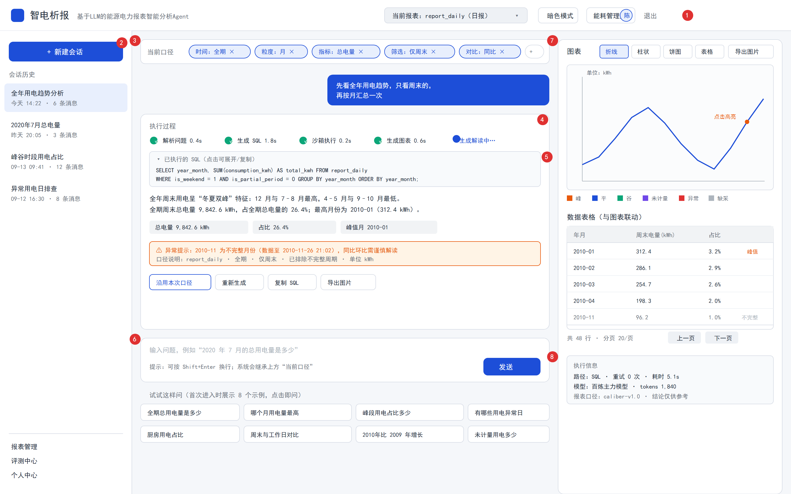
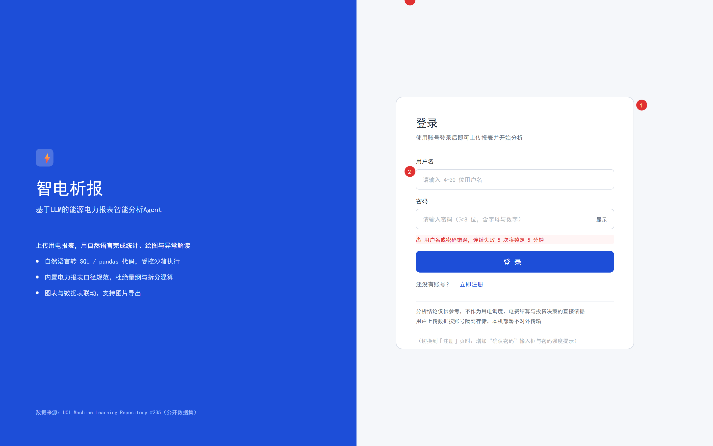
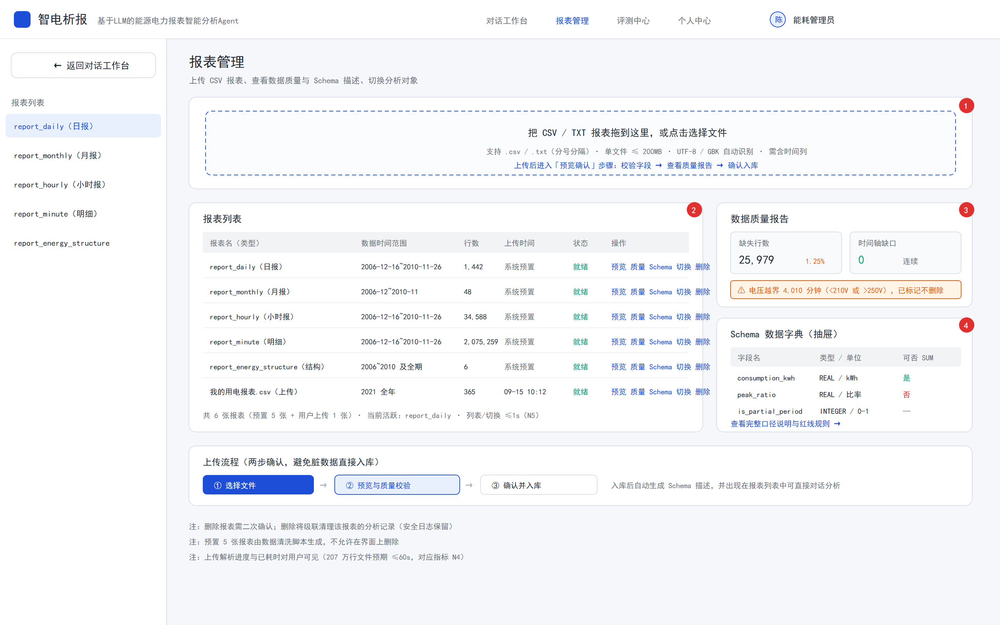
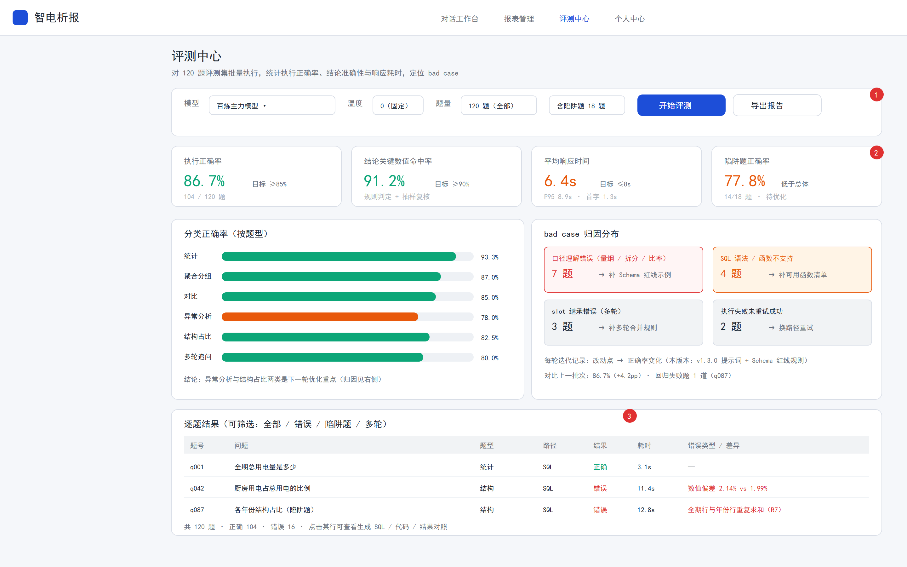
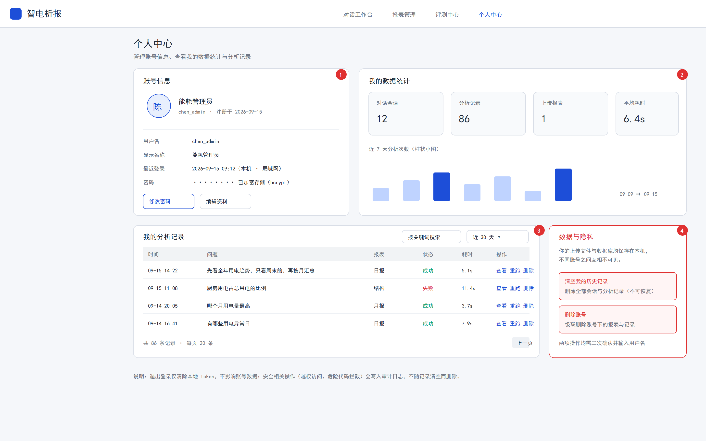
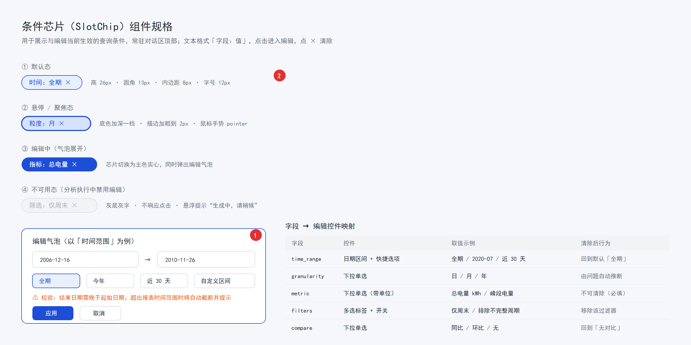
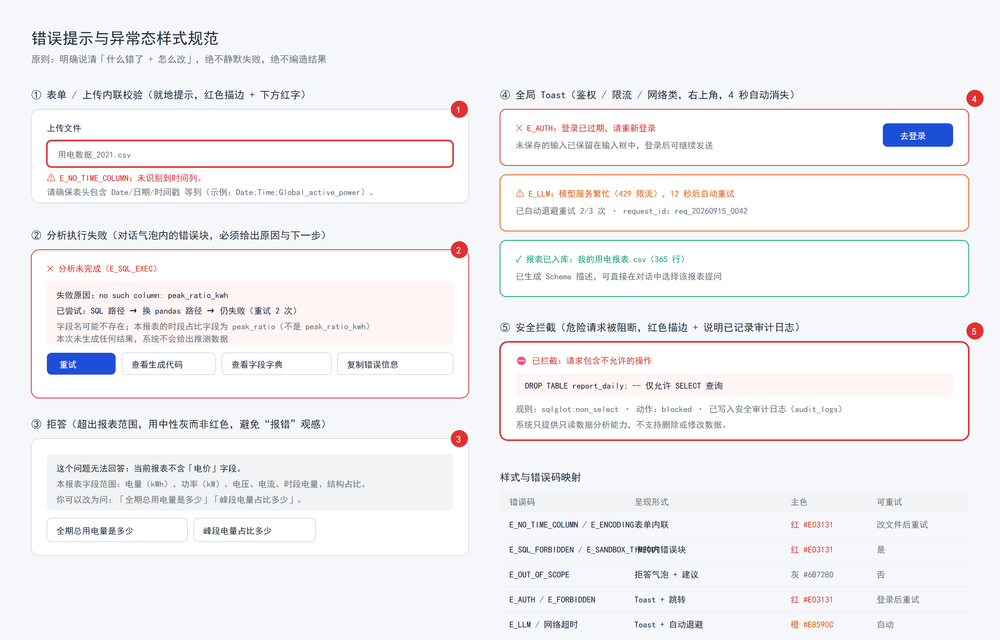
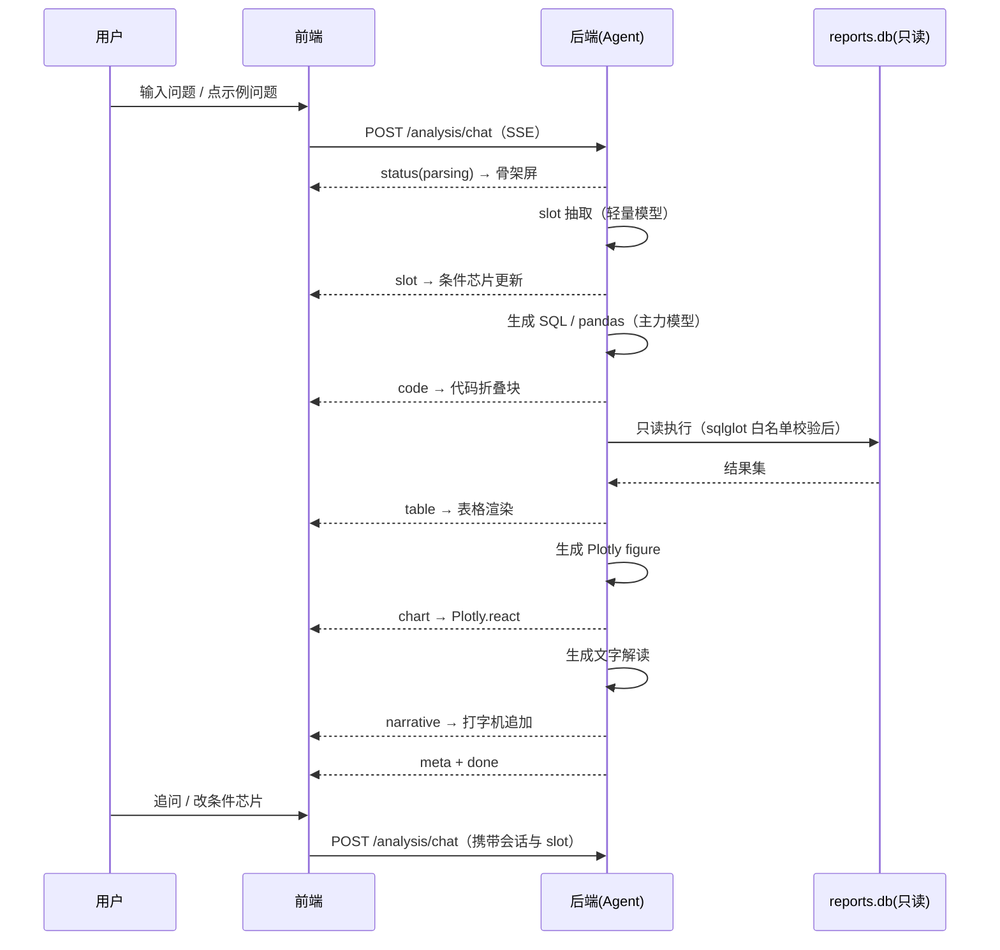
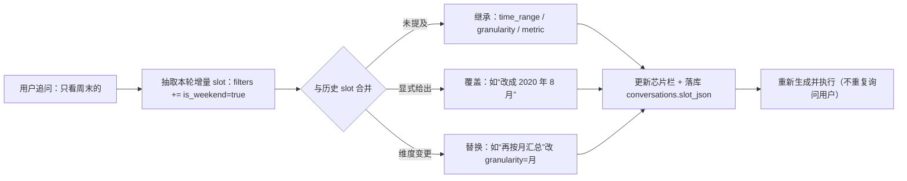
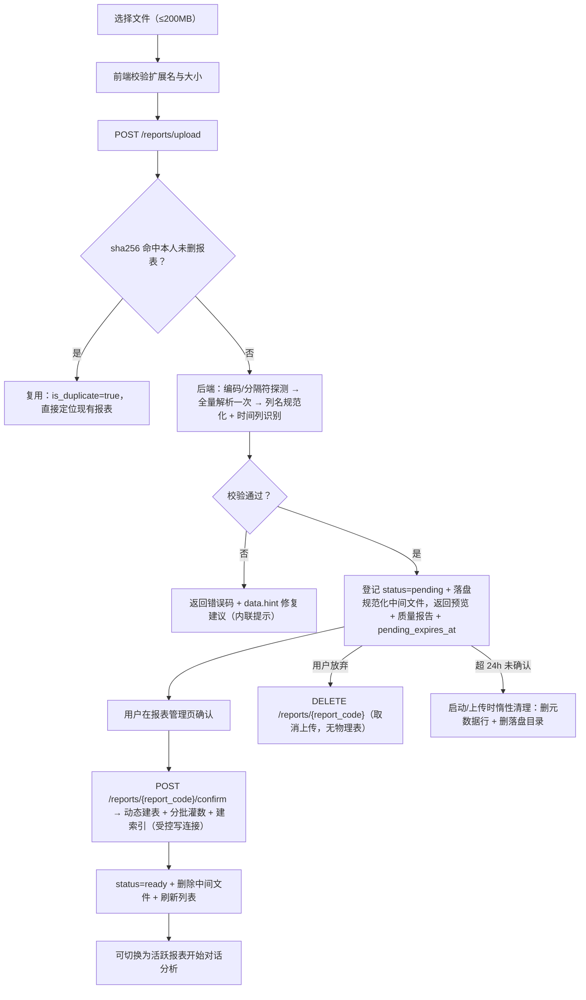

# 智电析报——基于LLM的能源电力报表智能分析Agent UI/UX 设计文档

| 项目名称 | 智电析报（PowerReport Agent） |
| --- | --- |
| 文档版本 | v1.15.2（实现注记：澄清卡由图的 `interrupt()`/`resume` 驱动；**解读永不空白**——超时改用「自动摘要」） |
| 文档状态 | 待评审 |
| 编写日期 | 2026-09-19 |
| 对应 PRD | 《智电析报_PRD文档》**v1.19.31**（第 4/5/6/9 章） |
| 线框图目录 | `04.实训指导书/images2/`（SVG 源码 + PNG 导出） |
| 所属交付物 | 任务书任务 1「需求分析与系统设计」→ 实训 2「AI 共创 UI/UX 界面设计文档」 |

---

## 目录

1. [文档说明](#1-文档说明)
2. [设计原则](#2-设计原则)
3. [页面清单](#3-页面清单)
4. [全局设计规范](#4-全局设计规范)
5. [关键页面原型](#5-关键页面原型)
6. [条件芯片（SlotChip）设计](#6-条件芯片slotchip设计)
7. [图表与表格联动](#7-图表与表格联动)
8. [流式状态展示](#8-流式状态展示)
9. [错误提示样式](#9-错误提示样式)
10. [响应式规则](#10-响应式规则)
11. [体验细节与可访问性](#11-体验细节与可访问性)
12. [关键交互流程](#12-关键交互流程)
13. [组件清单与前端目录映射](#13-组件清单与前端目录映射)
14. [前端落地记录（第一批 / 第二批）](#14-前端落地记录第一批--第二批)
15. [交付物与变更记录](#15-交付物与变更记录)

---

## 1. 文档说明

### 1.1 目的

定义智电析报 Web 端的**信息架构、界面布局、交互规则与视觉规范**，作为前端开发、后端联调与验收的依据，同时作为「AI 共创」流程中喂给 AI 编程助手的界面上下文。

### 1.2 范围

| 范围 | 说明 |
| --- | --- |
| 包含 | 5 个路由的界面结构、全局视觉规范、条件芯片、图表与表格联动、流式状态展示、错误提示样式、响应式规则、交互流程、组件清单 |
| 不包含 | 具体组件代码、后端接口实现（见 API 接口文档）、动效动画细节（按需补充） |
| 设计形态 | 低保真线框（已产出 SVG + PNG），视觉规范以本文字号/色彩表为准 |

### 1.3 线框图清单

| 序号 | 页面/组件 | SVG 源码 | PNG 导出 |
| --- | --- | --- | --- |
| ① | 对话工作台（主界面） | `01_workbench.svg` | `01_workbench.png` |
| ② | 登录 / 注册 | `02_login.svg` | `02_login.png` |
| ③ | 报表管理 | `03_reports.svg` | `03_reports.png` |
| ④ | 评测中心 | `04_eval.svg` | `04_eval.png` |
| ⑤ | 个人中心 | `05_profile.svg` | `05_profile.png` |
| ⑥ | 条件芯片组件规格 | `06_chip_states.svg` | `06_chip_states.png` |
| ⑦ | 错误提示与异常态样式 | `07_error_states.svg` | `07_error_states.png` |

> **PNG 导出方式**：源 SVG 是唯一事实源，执行
> `.venv\Scripts\python.exe 01.code\tools\svg2png.py "04.实训指导书\images2"`
> 即可批量重新生成 PNG（调用本机 Edge 无头截图，2 倍图）。

---

## 2. 设计原则

| 编号 | 原则 | 落地方式 |
| --- | --- | --- |
| P1 | **对话即主界面** | 主链路全部在对话工作台完成：提问 → 看结果 → 追问；管理类功能收进独立页面，不干扰分析流 |
| P2 | **口径可见** | 当前生效条件以芯片常驻展示、数据来源与口径随结论一同展示，用户永远知道"这个数字是怎么来的" |
| P3 | **过程可见** | 流式阶段时间线实时展示「解析 → 生成 → 执行 → 画图 → 解读」，等待期间不出现无反馈空白 |
| P4 | **失败不静默、不编造** | 执行失败必须给出错误块（原因 + 已尝试路径 + 下一步按钮），并明确声明"本次未生成结果" |
| P5 | **一次点击可纠正** | 条件芯片可点选修改、错误块带重试、拒答带推荐问法，避免用户重新组织语言 |
| P6 | **语义色全站一致** | 峰/平/谷/未计量/异常/缺采六种语义色在图表、表格、标签、提示中统一 |
| P7 | **浅色优先、暗色可选** | 亮色为默认主题，暗色跟随系统并可手动切换；导出图片始终使用亮色底 |
| P8 | **移动端可用但克制** | 手机端保证"提问 + 看结论 + 看图表"三件事可用，复杂管理功能提示在桌面端使用 |

---

## 3. 页面清单

| 路由 | 页面 | 权限 | 承载功能（PRD 编号） | 线框图 |
| --- | --- | --- | --- | --- |
| `/login` | 登录 / 注册 | 匿名 | F6.1 注册、F6.2 登录 | `02_login.png` |
| `/`（`/chat/:conversationId?`） | **对话工作台** | 登录用户 | F1.6 报表切换、F2 全部分析能力、F3 可视化、F4 多轮追问 | `01_workbench.png` |
| `/reports` | 报表管理 | 登录用户 | F1.1 上传、F1.2 类型推断、F1.3 动态建表、F1.4 Schema、F1.5 质量报告、F1.6 管理与删除 | `03_reports.png` |
| `/eval` | 评测中心 | 登录用户 | F5.1 问题集、F5.2 批量评测、F5.3 报告、F5.4 bad case 归因 | `04_eval.png` |
| `/profile` | 个人中心 | 登录用户 | F6.3 会话与记录管理、F6.4 数据隔离与删除 | `05_profile.png` |

**页面级全局元素**：顶部栏（Logo + 主导航 + 当前报表选择器 + 主题切换 + 用户菜单）在所有登录后页面共享；左栏导航仅在对话工作台出现（会话列表语义）。

---

## 4. 全局设计规范

### 4.1 栅格与布局

| 项 | 规范 |
| --- | --- |
| 基准画布 | 1440 × 900（设计基准），内容区最大宽度 1440，居中 |
| 栅格 | 12 列 / 间距 16px；页面左右留白 24px |
| 顶部栏 | 高 56px，固定吸顶 |
| 对话工作台三栏 | 左 240px（会话列表，可折叠至 0）+ 中 flex（对话流，最小 560px）+ 右 408px（图表与表格，可折叠） |
| 卡片 | 圆角 10px，边框 1px `#D9DEE7`，白底，无投影（用描边代替阴影，保持"工程感"） |
| 内边距 | 卡片内 20px；表单项间距 24px；区块间距 16px |

### 4.2 色彩规范

**主色与中性色**

| 用途 | 色值 | 说明 |
| --- | --- | --- |
| 主色 | `#1D4ED8` | 深蓝，按钮/选中/链接/主数据线 |
| 主色浅底 | `#E8EFFD` | 芯片底色、选中态背景 |
| 主色悬停 | `#D6E2FF` | 芯片与按钮悬停 |
| 品牌区深底 | `#1D4ED8` → `#0B3AA8` 渐变 | 登录页左栏 |
| 文字主色 | `#1F2937` | 正文与表格数值 |
| 文字次色 | `#6B7280` | 说明、单位、辅助信息 |
| 文字禁用 | `#ADB5BD` | 占位符、禁用态 |
| 分隔线 | `#D9DEE7` / `#EEF1F5` | 卡片边框 / 表格行线 |
| 页面底色 | `#F5F7FA` | 全站背景 |
| 卡片底色 | `#FFFFFF` | 内容容器 |
| 弱底 | `#F1F3F5` / `#F8FAFC` | 表头、只读块、次级卡片 |

**语义色（全站统一，严禁混用）**

| 语义 | 色值 | 使用场景 |
| --- | --- | --- |
| 峰段 peak | `#E8590C` 橙红 | 峰段电量、峰段占比、峰值标记 |
| 平段 flat | `#1D4ED8` 蓝 | 平段电量、主趋势线 |
| 谷段 valley | `#0CA678` 青绿 | 谷段电量、成功态 |
| 未计量 unmetered | `#7048E8` 紫 | 未计量用电、"其他电器" |
| 异常 anomaly | `#E03131` 红 | 异常标记、错误、危险操作 |
| 缺采 missing | `#ADB5BD` 灰 | 缺失分钟、不完整周期、禁用 |

**用途色板（按用途拆分专用，与上表时段语义色**互不共用**）**

PRD 红线 R3 要求"按用途"与"按时段"两套拆分不可混加；视觉层同样必须区分——**时段色板与用途色板不得共用颜色**，否则用户会把"谷段电量"与"洗衣房电量"看混。

| 用途 | 色值 | 说明 |
| --- | --- | --- |
| 厨房（SM1） | `#0B7285` 深青 | 仅用于按用途拆分的图表与标签 |
| 洗衣房（SM2） | `#15AABF` 亮青 | 同上 |
| 热水器与空调（SM3） | `#4C6EF5` 靛蓝 | 同上 |
| 未计量（其他电器） | `#7048E8` 紫 | 与语义色中的"未计量"同义，可共用 |

> 使用约束：按用途拆分时**只允许**使用用途色板；按时段拆分时**只允许**使用语义色板（峰/平/谷）。UI 在选择拆分维度时给出提示，禁止同一张图混合两套色板。

**时段口径（供图例与提示文案使用）**：谷 `00:00–07:59` / 平 `08:00–17:59` / 峰 `18:00–23:59`（左闭右开，覆盖 24 小时无缝无重叠，与 PRD 8.4 一致）。

> 暗色模式：语义色与用途色板均保持色相不变，亮度提升 8–12%（如 `#E8590C` → `#FF7A33`），底色替换为 `#141821` / 卡片 `#1C2230` / 文字 `#E5E9F0`。

### 4.3 字体与排版

| 层级 | 字号 / 行高 | 字重 | 用途 |
| --- | --- | --- | --- |
| H1 | 20px / 28px | 600 | 页面标题 |
| H2 | 16px / 24px | 600 | 卡片标题、区块标题 |
| H3 | 14px / 22px | 600 | 小节标题 |
| 正文 | 12px / 20px | 400 | 对话文本、说明 |
| 表格 / 标签 | 11px / 18px | 400 | 表格内容、芯片文字 |
| 大数值 | 22–26px / 32px | 600 | 指标卡主数值 |
| 代码 | 11–12px / 18px | 400 | SQL / pandas 代码（等宽字体） |

字体族：`"Microsoft YaHei", "PingFang SC", system-ui, sans-serif`；数字使用等宽数字（`font-variant-numeric: tabular-nums`）保证表格对齐。

### 4.4 间距、圆角与图标

| 项 | 规范 |
| --- | --- |
| 间距序列 | 4 / 8 / 12 / 16 / 20 / 24 / 32（px），统一取序列值 |
| 圆角 | 卡片 10px、按钮 8px、输入框 6px、芯片 13px（全高胶囊）、标签 4px |
| 图标 | 统一 16px 线性图标；语义图标：✓ 成功、⚠ 警告、✕ 失败、⛔ 拦截、⚡ 品牌 |
| 动效 | 仅用于状态切换与骨架屏（150–200ms ease-out）；不做装饰性动画 |

### 4.5 组件取值约定

| 组件 | 规范 |
| --- | --- |
| 按钮 | 主按钮：主色实心白字，高 32/36/44px（小/中/大）；次按钮：白底 + 描边；危险按钮：仅"删除/删除账号"使用红描边 |
| 输入框 | 高 40px，描边 `#D9DEE7`，聚焦时主色 2px 描边 |
| 校验错误 | 输入框红描边 2px + 下方 11px 红字（详见第 9 章） |
| 表格 | 表头弱底 `#F1F3F5`、行高 36px、斑马纹关闭、行线 `#EEF1F5`、数值右对齐、文字左对齐 |
| 卡片 | 见 4.1 |
| 空状态 | 居中文案 + 主行动按钮（如"上传第一份报表"） |
| 加载 | 骨架屏（灰块）优先于转圈；超过 5s 补充文字提示"正在执行沙箱查询…" |

### 4.6 Ant Design 与 Tailwind 分工

| 层次 | 技术 | 说明 |
| --- | --- | --- |
| 交互组件 | **Ant Design** | Button、Input、Select、DatePicker、Table、Tabs、Drawer、Modal、Toast、Form、Pagination、Popover、Skeleton |
| 布局与视觉 | **Tailwind CSS** | 栅格、间距、颜色、圆角、响应式断点、自定义卡片与芯片 |
| 冲突处理 | `StyleProvider layer` | 用 `@layer` 降低 AntD 样式优先级，避免 Tailwind preflight 覆盖 AntD 基础样式。<br>**落地替代（v1.13.0）**：直接**关闭 Tailwind preflight**（`corePlugins.preflight=false`）——AntD 自带 reset，关掉后两者不再争基础样式，配置更少且无需 `StyleProvider`（见 14.1） |
| 图表 | **Plotly.js** | 后端直传 figure JSON，前端 `Plotly.react` 渲染；样式通过 figure `layout` 注入语义色 |

---

## 5. 关键页面原型

### 5.1 对话工作台（主界面）



**区域拆解**

| 编号 | 区域 | 内容与行为 |
| --- | --- | --- |
| 1 | 顶部栏 | Logo + 副标题；**当前报表选择器**（显示 `report_daily（日报）`，点击下拉切换，切换后新提问作用于新报表）；主题切换；用户菜单（个人中心 / 退出） |
| 2 | 左栏 · 会话列表 | 「+ 新建会话」主按钮；会话历史（标题 = 首问摘要、时间、消息数），当前会话高亮；**悬停显示操作：重命名 / 置顶 / 删除**（置顶会话独立成组排在顶部）；底部三个入口：报表管理 / 评测中心 / 个人中心；栏位可折叠 |
| 3 | 条件芯片栏 | 常驻展示当前生效口径（时间 / 粒度 / 指标 / 筛选 / 对比）+「+」添加入口；点击芯片就地编辑，点 × 清除（详见第 6 章） |
| 4 | 阶段时间线 | 每条回答顶部展示执行阶段与耗时（✓ 已完成 / ● 进行中），让 8 秒等待过程可见 |
| 5 | SQL / 代码折叠块 | 默认折叠一行摘要（可展开、可复制、可查看字段字典）；执行路径（SQL / pandas）可见 |
| 6 | 输入区 | 多行输入框 + 发送按钮；提示"会继承上方当前口径"；空状态时展示 8 个示例问题（点击即问） |
| 7 | 右栏 · 图表 | 图表类型切换（折线 / 柱状 / 饼图 / 表格）+ 导出图片；图例固定语义色；点击数据点高亮 |
| 8 | 执行信息 | 路径、重试次数、耗时、模型与 token、报表口径版本、免责声明 |

**关键交互**

| 场景 | 行为 |
| --- | --- |
| 首次进入（无会话） | 中部展示欢迎语 + 8 个示例问题 + 上传入口；右栏展示当前报表的概览缩略图 |
| 发送问题 | 输入框清空并禁用（可点"停止"）；立即插入用户气泡与助手占位卡片（骨架屏）；SSE 事件驱动逐项填充 |
| 追问 | 继承上方芯片中的口径，只更新被修改的部分；回答顶部标注"已继承：时间=全期，粒度=月" |
| 点击图表数据点 | 下方表格滚动定位并高亮对应行；反之悬停表格行时图上对应点加粗 |
| 一键沿用口径 | 回答底部提供「沿用本次口径」「重新生成」「复制 SQL」「导出图片」快捷操作 |
| 切换报表 | 顶部选择器切换后，输入框上方提示"已切换到 report_monthly（月报）"，历史消息保留原报表标记不予重算 |
| 会话管理 | 悬停会话项显示「重命名 / 置顶 / 删除」；重命名就地编辑标题；置顶后进入列表顶部「置顶」分组（最多 5 条）；删除需二次确认，提示"将同时删除该会话的消息与分析记录，安全日志保留"（对应 PRD F6.3）。**数据来源与落地行为**：列表取 `GET /conversations`（置顶组在前，支持 `?q=` 与时间范围筛选）；置顶超 5 条时后端自动取消最早置顶的那条并在响应 `evicted_pinned_code` 回显 → 前端 Toast 提示"已取消最早置顶的会话"（不弹错误）；删除走 `DELETE /conversations/{conversation_code}`，响应回显级联删除的消息数，用于二次确认文案 |

**状态清单**

| 状态 | 展示 |
| --- | --- |
| 空会话 | 欢迎语 + 8 个示例问题 + 上传引导 |
| 分析中 | 阶段时间线推进 + 骨架屏；输入区禁用；芯片禁用编辑并提示"生成中，请稍候" |
| 成功 | 图表 + 表格 + 解读 + 关键数值标签 + 执行信息 |
| 失败 | 错误块（原因 / 已尝试路径 / 下一步按钮），明确声明"本次未生成结果" |
| 拒答 | 中性灰卡片 + 字段范围说明 + 2 个推荐问法 |
| **需澄清** | 主色描边卡片：一句确认问题 + **2–3 个可点选选项** + 「都不是，我重新描述」；点选后按原 slot 继续执行，已解析条件不丢失（对应 PRD F2.6 / F4.4，接口 `POST /analysis/clarify`） |
| 结果过大 | 表格顶部提示"结果已截断（上限 1000 行），请细化条件"，提供快捷"按月汇总"按钮 |

### 5.2 登录 / 注册页



| 编号 | 区域 | 说明 |
| --- | --- | --- |
| 1 | 左栏品牌区（720px） | 深蓝底；项目名「智电析报」+ 副标题；三条核心能力；底部标注**数据来源：UCI #235 公开数据集** |
| 2 | 右栏表单卡片（480px） | 登录态：用户名 + 密码 + 登录按钮 + 「立即注册」切换；注册态：增加"确认密码"与密码强度提示 |
| 3 | 内联错误 | 登录失败提示"连续失败 5 次将锁定 5 分钟"（红色内联） |

**规则**：登录成功后跳转 `/`（若 URL 带 `next` 参数则跳回原页）；**注册成功即自动登录**（后端直接返回 token，与登录同一套后续流程），同样跳转 `/`；Token 过期时以 Toast 提示并保留未发送的输入（见 9.4）；页面底部固定免责声明。

### 5.3 报表管理



| 编号 | 区域 | 说明 |
| --- | --- | --- |
| 1 | 上传区 | 拖拽 / 点击选择；限制说明（`.csv`/`.txt`、≤200MB、需含时间列）；**两步确认**：选择文件 → 预览与质量校验 → 确认入库 |
| 2 | 报表列表 | 报表名（类型）/ 数据时间范围 / 行数 / **上传时间**（预置报表显示"系统预置"）/ 状态 / 操作（预览、质量、Schema、**切换**、删除）；当前活跃报表高亮；预置 5 张报表不可删除。**高亮来源**：会话内取 `conversations.active_report_id`，会话外回落到**系统默认活跃报表**（接口 `is_active = 1`，当前为 `r_daily`）。**删除按钮由 `is_deletable` 驱动**（预置 `false` → 置灰并提示原因），前端不自行拼 `is_preset` 规则 |
| 3 | 数据质量报告 | 缺失行数与占比、时间轴缺口、越界值警告（黄底提示，不删除数据）；数据来自 `GET /reports/{report_code}/quality`（`dataset` 段 + 与本报表相关的 `checks`） |
| 4 | Schema 数据字典（抽屉） | 字段名 / 类型与单位 / **可否 SUM**（比率列显式标"否"）/ **派生列标注**（`derived=true` 的 `dt`、`year`… 加"派生"角标，提示不是用户自己的列）；数据来自 `GET /reports/{report_code}/schema` 的 `structured.columns`；底部「查看完整口径与红线规则」渲染同接口的 `text` 字段——**该文本即完整注入文本**（全局头 + 字段清单 + 口径红线 + SQLite 可用函数 + 常用问题示例 + 使用提示），与模型收到的说明**逐字一致**。<br>上传报表走生成路径（文本含 **U1 口径未知声明**，抽屉顶部提示"本表为用户上传数据，未应用系统口径"）；接口另回显 `est_tokens` / `truncated`，若 `truncated=true` 则抽屉底部提示"字段说明已压缩" |
| — | 上传流程条 | 步骤可视化，明确「入库后自动生成 Schema 描述并可直接对话分析」 |

**交互**：删除需二次确认（输入报表名或勾选确认），提示"将级联清理该报表的分析记录，安全日志保留"；上传解析中显示进度与已耗时（207 万行文件预期 ≤60s，**对应 PRD N4**）；报表列表加载与活跃报表切换 ≤1s（**对应 PRD N5**）。

**上传两步的前端契约（v1.5.0 回填）**：

| 步骤 | 前端动作 | 后端返回要点 |
| --- | --- | --- |
| ① 解析 | `POST /reports/upload`（`multipart`，字段 `file`） | `report_code`（后续确认用）/ `row_count`（**真实值**，非估算）/ `encoding` / `delimiter` / `column_mapping`（原始列名 → 安全列名，用于「字段映射」小表）/ `columns[]`（含 `origin_name` 与可否 SUM）/ `preview`（前 20 行）/ `quality`（缺失、缺口、越界体检）/ `pending_expires_at` |
| ② 确认 | `POST /reports/{report_code}/confirm` | `inserted_rows` / `indexes[]` / `elapsed_ms`；**幂等**：重复点击返回 `already_confirmed=true`，UI 直接切到「已入库」态 |
| 放弃 | `DELETE /reports/{report_code}` | 未确认的报表可直接删除（取消上传），`dropped_table=null` |

- **重复上传提示**：若 `is_duplicate=true`，不进入预览步骤，直接 Toast「该文件已上传过，已为您定位到现有报表」并高亮列表中的该行（后端按 sha256 复用，不会生成第二张表）；
- **耗时提示**：207 万行文件解析约 30s、入库约 20s，属**长等待**——解析与入库期间按钮进入 loading 并显示已耗时（对齐 8.2「>5s 追加进度说明」的规范，文案如"数据集较大，正在解析 207 万行明细…"）；
- **待确认态**：`pending` 报表**不出现在列表**（避免列表出现"半成品"）；用户若中途关闭页面，24h 内重传同一文件即可找回该 `pending` 报表继续确认，超期由后端惰性回收；
- **删除回显**：删除成功后用 `affected_conversations` 提示「已同步重置 N 个会话的活跃报表」（N > 0 时），`freed_pages` 仅记日志，不向用户展示。

### 5.4 评测中心



| 编号 | 区域 | 说明 |
| --- | --- | --- |
| 1 | 发起评测 | 模型（显示 `.env` 配置的厂商标识与主力模型名，如 `dashscope / qwen-max`；**系统只支持 OpenAI 兼容厂商**，换厂商由后端配置决定，页面不提供在线切换）、**温度固定 0（只读）**、题量（120 题 / 抽样）、含陷阱题提示；「开始评测」/「导出报告」 |
| 2 | 指标卡 | 执行正确率（目标 ≥85%）、结论关键数值命中率（≥90%）、平均响应时间（≤8s，附 P95 与首字）、**陷阱题正确率**（单列，便于定位口径类问题） |
| 3 | 分类正确率 | 按 6 类题型横向条形图；低于 85% 的用橙色标注 |
| 4 | bad case 归因 | 4 类归因卡片（口径理解错误 / SQL 语法与函数 / slot 继承错误 / 执行失败未重试成功），每类给出"→ 下一步动作"；底部展示与上一批次的差值 |
| — | 逐题结果 | 题号 / 问题 / 题型 / 路径 / 结果 / 耗时 / 错误类型；可筛选（全部 / 错误 / 陷阱题 / 多轮）；点击行展开生成 SQL、代码与结果对照 |

**进度展示**：评测运行中显示总进度（`已完成 68 / 120`）、实时正确率、预计剩余时间；支持中断；大批量运行时按配置并发度与退避重试执行（PRD TBD2）。

> **后端契约已落地（v1.12.0，交付物 8 / M5；前端待实现）**：
> - **发起是异步的**：`POST /eval/runs` 立即返回 `run_code`（`status=pending`），**没有评测进度 SSE 事件**
>   → 页面按 2–5s 间隔轮询 `GET /eval/runs/{run_code}`，用 `metrics` 已有字段刷新指标卡；
>   **总进度/预计剩余时间需前端自行推算**（`question_total` 已知，逐题结果要等批次结束才下发，
>   因此"实时正确率"本版本只能显示为"运行中"，或由后端后续补进度端点）；
> - **模式选择**（区域 1）：`impl=real`（真实模型，无 Key 时接口 400 且 `hint` 提示改用自检）/
>   `selfcheck`（gold 回放自检，用于验证链路，**报告会置顶标注"不代表模型能力"，页面需同步提示**）；
> - **指标卡数据源**：`exec_correct_rate`（≥85%）/ `narrative_hit_rate`（≥90%）/ `avg_elapsed_ms` 与
>   `p95_elapsed_ms`（≤8000ms）/ 陷阱题正确率（`metrics.trap.rate`）；**首字延迟本版本无数据**
>   （`first_token_avg_ms` 恒 NULL，客户端为单次 POST 非流式）→ 该项显示"—"并加说明，不要显示 0；
> - **分类正确率**：`metrics.by_type` / `by_difficulty` / `metrics.tiers`（判分档命中分布，
>   用于判断正确率里有多少靠宽松档兜住）；
> - **bad case 归因**（区域 4）：直接用 `metrics.attribution` 的五个分类计数
>   （口径理解错误 / SQL 语法与函数 / slot 继承错误 / 执行失败未重试成功 / 结果口径偏差）；
>   **"与上一批次差值"需前端拉两次 `GET /eval/runs` 自行对比**（后端未提供基线接口）；
> - **逐题结果**（区域 逐题结果）：`questions[]` 每项含 `generated_sql_or_code` / `matched_tier` /
>   `diff_type` / `diff_detail` / `key_hit_rate` / `key_missed` / `elapsed_ms` / `retries` /
>   `error_code` → 行展开的"生成 SQL vs 标准 SQL"对照由 `generated_sql_or_code` 与 `gold_sql` 渲染；
> - **导出报告**：`GET /eval/runs/{run_code}/report` 直接返回 Markdown 文件（带
>   `Content-Disposition`），前端只需触发下载，不必自行拼报告。

### 5.5 个人中心



| 编号 | 区域 | 说明 |
| --- | --- | --- |
| 1 | 账号信息 | 头像、用户名、显示名、最近登录（标注本机/局域网）、密码状态（已 bcrypt 加密）；操作：修改密码、编辑资料 |
| 2 | 我的数据统计 | 会话数、分析记录数、上传报表数、平均耗时；近 7 天分析次数迷你柱状图 |
| 3 | 我的分析记录 | 列表（时间 / 问题 / 报表 / 状态 / 耗时 / 操作：查看、重跑、删除）；支持关键词搜索与时间筛选。<br>**数据来源与落地行为（v1.8.0）**：`GET /analysis/records`（offset 分页，`page`/`page_size` + `total`，antd Table 直接对接）；**状态页签**用 `status` 参数，各页签右侧数字直接取响应里的 `status_count`（**切换页签数字不跳变**）；「重跑」需记录 `can_replay=true` 才可点（原报表已删除时记录已随之级联消失，不会出现该情况；报表状态异常时置灰并提示）；重跑成功后**新增一条记录**并在顶部提示「由 a_000xxx 重跑」，不覆盖历史（便于并排比较 prompt 改动前后）；「删除」确认后提示"已删除 N 条模型调用记录，对话文本保留"（取响应 `deleted_llm_calls`） |
| 4 | 数据与隐私（危险区） | 红描边卡片：清空历史记录、删除账号（级联删除报表与记录，需二次确认并输入用户名）；说明"安全日志不随记录清空而删除" |

---

## 6. 条件芯片（SlotChip）设计



### 6.1 结构与状态

| 状态 | 样式 | 行为 |
| --- | --- | --- |
| 默认 | 底 `#E8EFFD`、描边 1px 主色、文字主色 12px、高 26px 全圆角 | 点击 → 弹出编辑气泡；点 × → 清除该条件 |
| 悬停 / 聚焦 | 底 `#D6E2FF`、描边 2px | 鼠标 pointer；键盘 Tab 可聚焦（`aria-label` 为"编辑条件：粒度"） |
| 编辑中 | 主色实心白字 + 气泡展开 | 气泡内应用/取消；回车提交、Esc 取消 |
| 不可用 | 灰底 `#F1F3F5`、灰字 | 分析执行中禁用，悬浮提示"生成中，请稍候" |

### 6.2 文本格式

- 统一格式：**「字段名：值」**，如 `时间：全期`、`粒度：月`、`筛选：仅周末`；
- 值超过 10 个中文字符时省略中间：`时间：2006-12-16 → 20…`，悬浮 tooltip 显示完整值；
- 多值条件合并为一个芯片：`筛选：仅周末、排除不完整周期`；
- 芯片顺序固定：时间范围 → 粒度 → 指标 → 过滤 → 对比 → 「+」。

### 6.3 字段与编辑控件映射

| 字段（slot） | 控件 | 取值示例 | 清除后行为 |
| --- | --- | --- | --- |
| `time_range` | 日期区间选择器 + 快捷标签（全期 / 今年 / 近 30 天 / 自定义） | 全期、2020-07、2006-12-16 → 2010-11-26 | 回到默认「全期」 |
| `granularity` | 下拉单选 | 小时 / 日 / 月 / 年 | 由问题自动重新推断 |
| `metric` | 下拉单选（选项带单位） | 总电量 kWh、峰段电量 kWh、未计量用电 kWh | **不可清除**（必填，清除按钮隐藏） |
| `filters` | 多选标签 + 开关 | 仅周末、仅工作日、排除不完整周期、电压 > 250V | 移除该条过滤器 |
| `compare` | 下拉单选 | 无 / 同比 / 环比 | 回到「无对比」 |

> **芯片编辑的落地方式（v1.10.0）**：芯片就地编辑后，前端把变更字段以 `slot_patch` 随下一次
> `POST /analysis/chat` 提交（后端先合入会话条件再抽取合并，UIUX 6.3「编辑后重算」即刻可用）；
> 「清除」条件 = 该字段不传（后端暂无显式清除语义，`metric` 缺失会触发澄清，`time_range` 缺省「全期」）。
> 切换活跃报表时后端会清空会话条件，芯片栏应随之清空并提示「条件已重置」。

### 6.4 校验与异常

| 情形 | 处理 |
| --- | --- |
| 结束日期早于起始日期 | 气泡内红字提示，禁用「应用」 |
| 时间区间超出报表数据范围 | 气泡内黄字提示"已自动截断到 2006-12-16 ~ 2010-11-26"，应用后按截断值执行 |
| 修改后结果为空 | 结果区展示空状态："该条件下没有数据"，并提供「清除筛选」按钮 |
| 报表切换导致条件失效 | 自动清除不适用字段，并在输入区上方提示"已根据新报表重置条件：粒度=日" |

### 6.5 与后端的数据契约

芯片与 `conversations.slot_json` 一一对应，`filters` 为对象数组：

```json
{
  "time_range": { "type": "all" },
  "granularity": "month",
  "metric": "consumption_kwh",
  "filters": [{ "field": "is_weekend", "op": "=", "value": true }],
  "compare": "none"
}
```

前端渲染规则：每项 `filters` 生成一个可移除标签，`op` 与 `value` 决定展示文案（`is_weekend = true` → "仅周末"）。

---

## 7. 图表与表格联动

### 7.1 联动规则矩阵

| 用户动作 | 图表 | 表格 | 说明 |
| --- | --- | --- | --- |
| 点击折线上的数据点 / 柱状图某柱 | 该点放大并加描边 | 自动滚动到对应行并高亮（2s 后淡出） | 高亮色使用主色浅底 `#E8EFFD` |
| 悬停表格某行 | 对应数据点加粗、tooltip 常显 | 该行悬停底色 | 双向联动 |
| 切换图表类型（折线/柱状/饼图/表格） | 用**已返回的数据**重绘，不调用大模型 | 表格数据不变 | 重绘走 `POST /charts/rerender` 或纯前端重排。**落地行为（v1.9.0）**：请求体 `{record_code, chart_type, top_n?, sort?}`；成功后后端**回写该记录的 `chart_json`**（详情页与右栏一致）；显式指定的类型画不出来 → 400 `E_CHART_UNSUPPORTED`，`data.supported` 列出可改用的类型，前端据此提示 |
| 调整聚合粒度 | 重新聚合已返回明细（若数据足够） | 同步更新 | 若后端未返回明细，则提示"需要重新聚合，点击执行"。**落地行为（v1.9.0）**：同一 `rerender` 接口传 `granularity`（只能由细变粗）；不可重聚合 → 400 `E_GRANULARITY_UNAVAILABLE`，提示"当前结果无明细，请重新提问"；重聚合的口径由后端保证（kWh 求和 / 功率电压取均值 / 比率列不参与） |
| 切换 topN / 排序 | 同步 | 同步 | 表格排序优先。**落地行为（v1.9.0）**：分类数 > 12 由后端合并为「其他」（避免占比失真），figure `layout.meta` 带 `top_n`/`merged_count`，图上标注"其余 N 项已合并" |
| 导出图片 | `Plotly.toImage()` 输出 PNG（2 倍图，亮色底） | 可选"图片 + 表格"一起导出 | 后端 kaleido 作为兜底。**落地行为（v1.9.0）**：本版本**前端 `toImage()` 是唯一导出入口**；`GET …/chart.png` 返回 501 `E_NOT_IMPLEMENTED`（kaleido 预留未装，装上后自动生效），前端收到 501 时不弹错误、走本地导出即可 |
| 无数据 | 空状态插图 + "该条件下没有数据" | 空表格 | 同时给出「清除筛选」按钮 |

### 7.2 图表规范

| 项 | 规范 |
| --- | --- |
| 折线图 | 主趋势线用平段蓝 `#1D4ED8`；峰值点用峰段橙红加标注；缺采区间用灰色虚线断开（不插值） |
| 柱状图 | 单系列用主色；按时段分组时严格使用峰/平/谷语义色 |
| 饼图 | **按用途拆分**时使用 4.2 节的**用途色板**（厨房 `#0B7285`、洗衣房 `#15AABF`、热水空调 `#4C6EF5`、未计量 `#7048E8`）；**按时段拆分**时使用语义色板（峰/平/谷）；**禁止同时展示用途与时段两套拆分，也禁止两套色板混用**（PRD 红线 R3），界面在选择拆分维度时给出提示 |
| 坐标轴 | Y 轴单位标注在轴顶部（如"单位：kWh"）；时间轴按粒度自适应刻度 |
| 交互 | 默认开启 hover tooltip（值 + 单位 + 口径）；框选缩放（zoom）默认关闭，避免误操作 |
| 暗色模式 | 图表随主题切换；导出图片固定亮色底 |

> **后端落地约定（v1.9.0，交付物 4 第三批）**：figure 由后端生成，但**只写语义色与文案**——
> `paper_bgcolor` / `plot_bgcolor` / `font.color` / 网格色一律不写（plotly 内置 `template` 已剔除），
> 亮/暗主题由前端在 `Plotly.react` 时覆盖（这样"图表随主题切换、导出固定亮色底"只需一套前端代码）。
> 语义色注入规则：峰/平/谷系列用语义色板、用途系列用用途色板、**无语义归属的多系列用青灰色阶**
> （刻意避开全部语义色，防止"总用电量"被读成"平段"）；单系列折线用平段蓝；折线自动标注峰值点
> （峰段橙红）。**缺采断开已由后端实现**：相邻时间间隔 > 粒度基准 × 1.5 处插入 `y=null`（plotly 不插值）
> + 缺采灰虚线连接段，前端无需再处理。口径标记（类型/单位/TopN/合并数/R3 收敛/抽稀）在
> `figure.layout.meta` 与 `chart` 事件载荷里都有，图上"其余 N 项已合并""已按 R3 只展示一套"据此渲染。

### 7.3 表格规范

- 列顺序：维度列 → 度量列 → 占比列 → 标记列（异常 / 不完整）；
- 数值统一右对齐并保留与口径一致的小数位（电量 6 位、比率 6 位、功率 3 位，界面按精度格式化展示为 2–3 位）；
- 比率列在表头显示"（比率，不可相加）"提示，鼠标悬浮说明"跨周期汇总需分子分母分别求和"；
- `is_partial_period = 1` 的行加灰色"不完整"标签（如 `2010-11`）；
- `is_anomaly = 1` 的行加红色"异常"标签，悬浮显示 `anomaly_reason`；
- 默认分页 20 行，提供"每页 50 / 100"切换；结果超过 1000 行时顶部显示截断提示。

---

## 8. 流式状态展示

### 8.1 SSE 事件 → 界面映射

| SSE 事件 | 界面反应 | 目标时延 | 对应指标 |
| --- | --- | --- | --- |
| `status`（parsing） | 插入助手占位卡片，阶段时间线第 1 项变为进行中，输入区禁用 | **≤2s（首字）** | **N1** |
| `slot` | 更新顶部条件芯片栏（新增/变更的芯片做 0.3s 高亮闪动） | ≤2.5s | — |
| `clarify` | 渲染澄清卡片（确认问题 + 2–3 个可点选选项）；点选后前端回填 slot 并调用 `POST /analysis/clarify` 继续执行，已解析条件不丢失 | ≤3s | — |
| `code` | 展示 SQL/代码折叠块（默认折叠，显示路径标签 SQL/pandas） | ≤4s | — |
| `status`（executing） | 阶段时间线推进到"沙箱执行"，骨架屏保持 | — | — |
| `table` | 渲染数据表格（先渲染首屏 20 行） | ≤6s | — |
| `chart` | 渲染图表（Plotly.react），表格与图表同时就绪 | ≤7s | — |
| `narrative` | 逐段追加文字解读（打字机效果，每段 40ms/字以内） | ≤8s | **N2** |
| `meta` | 填充右侧执行信息（耗时、重试、模型、token、口径版本） | — | — |
| `done` | 阶段时间线全部变绿，控件恢复可用（发送、芯片编辑） | — | — |
| `error` | 替换占位卡片为错误块（见第 9 章） | — | — |

> 时延口径说明（与 PRD 6.1 一致）：N1 指 SSE 首个 `status` 事件到达浏览器；N2 指**简单问数**端到端平均（**不含**澄清轮次与重试），N3 为单轮 P95 ≤15s。上表"≤8s"即 N2 的落地位置。
>
> `clarify` 事件为本次自查补入项：PRD 9.1 已有 `POST /analysis/clarify` 接口，但 9.2 事件表原先缺失对应事件，已在 **PRD v1.4.0 同步补齐**。
>
> **落地进度与事件契约细化（v1.7.0，交付物 4 第一批）**：分析链路第一批（单轮问答）已实现
> `status` / `slot` / `code` / `table` / `narrative` / `meta` / `done` / `error` 八类事件，
> **`clarify` 属后续批次**（与多轮继承同批），前端需对未到事件保持占位。
>
> **chart 事件已接入（v1.9.0，交付物 4 第三批）**：事件顺序为 `table → chart → narrative`；
> 载荷含 `figure`（Plotly figure JSON，**可能为 null**）与口径字段（`chart_type`/`unit`/`series`/
> `top_n`/`merged_count`/`r3_adjusted`/`dropped_columns`/`excluded_columns`）。**`figure=null` +
> `fallback="table"` + `reason` 表示"该结果不适合可视化"**——阶段时间线的"生成图表"照常变绿、
> 右栏显示降级提示条，**不视为失败**（`status` 仍为 success）。
>
> **clarify 事件已接入（v1.10.0，交付物 4 第四批）**：多轮 slot 继承上线后，触发澄清时事件序列为
> `status → slot(部分条件) → clarify → meta → done(record_id=null)`——**澄清轮不产生分析记录**；
> `clarify` 载荷含 `question` / `options`（规则生成，`value=null` 表示自定义/不限，前端弹出输入框
> 收集后再以 `slot_patch` 提交）/ `missing_slot` / `partial_slot`（芯片据此显示已解析条件与空位）；
> 点选后调 `POST /analysis/clarify`（带原问题与 `slot_patch`）就地继续执行，事件序列与 chat 相同；
> 历史消息里的澄清卡为 **JSON 形态**（`content.type="clarify"`），刷新后可完整还原、选项可再次点选。
> 芯片编辑后重算：`POST /analysis/chat` 请求体新增可选 `slot_patch`（编辑值先合入会话条件）。
> 四条契约细节：
> ① **失败时 `error` 之后仍会收到 `done`**——先用 `error` 渲染错误块、收到 `done` 后再解除 loading 并用
> `record_id` 提供"查看详情"入口（避免"报错了但界面还在转"）；
> ② `code` 事件里的 SQL 是**已过安全守卫并补过 `LIMIT` 的最终执行语句**，可原样展示（含 `LIMIT 1000`），
> 不要在前端二次改写；
> ③ `table` 事件的 `rows` 已是完整结果（守卫强制上限 1000 行），`truncated=true` 时按 7.3 显示截断提示；
> ④ **澄清的"回填即继续"由图的 `interrupt()` / `resume` 实现**（v1.15.1 实现注记，**前端零改动**）：
> 澄清轮在服务端**挂起**（图停在 `clarify_wait` 节点，中断状态写入会话检查点），
> 用户点选后 `POST /analysis/clarify` 以 `Command(resume=…)` **从断点续跑**——不再"第二跳把整轮重跑一遍"。
> 对界面而言：事件序列、`clarify` 载荷、跳转与呈现**全部不变**；可见收益是**回填不再重复调用 slot 模型**
> （少一次模型往返，回填更快）。实现细节见 PRD 6.6 与架构文档 ADR-021。
> ⑤ **解读永不空白（v1.15.2 实现注记）**：`narrative` 事件**始终带文本**——
> 模型解读在 `NARRATIVE_TIMEOUT_SECONDS`（8 s）内返回时是模型写的；
> 超时或输出无法解析时，服务端用**结果表能直接算出来的事实**生成「**自动摘要**」
> （正文以"自动摘要："开头、结尾注明生成方式；比率按百分比、带列名中文标签），
> 并在 `anomalies` 里如实说明原因（"模型解读超时……已改用自动摘要"）。
> **前端无需任何改动**（照旧渲染 `text`/`key_numbers`/`anomalies`）；
> 演示时若看到"自动摘要"字样，即表示该轮走的是兜底路径。

> **双工具路由已接入（v1.11.0，交付物 5）**：`code` 事件载荷更新为
> `{"route": "sql", "sql": "…"}` 或 `{"route": "pandas", "code": "…"}`——折叠块按 `route` 显示
> 路径标签（SQL / pandas）；重写与换路时 `code` 事件会**多次出现**，以最后一次为准。
> `error` 事件新增 `retries`（自愈重试次数）与 `path_switched`（是否换路）：错误块的
> "已尝试路径"行据此渲染（如"已自动重写 1 次，并已切换到 pandas 路径"），用户无需感知即可理解延迟。
> 沙箱超时（`E_SANDBOX_TIMEOUT`）与代码执行失败（`E_CODE_EXEC`）的呈现沿用 9.2 映射表，
> `data.error_type`/`line_no` 展示在错误详情里。

### 8.2 阶段时间线

固定 5 个阶段：`解析问题` → `生成 SQL/代码` → `沙箱执行` → `生成图表` → `生成解读`。

> 与 PRD 3.3 的阶段差异说明：PRD 算法流程写作 6 步（`Schema 注入 → 问题解析 → 代码生成 → 沙箱执行 → 图表绘制 → 文字解读`），其中 **Schema 注入属于前置步骤**（会话创建或报表切换时完成，单次提问内不重复），因此不在用户可见的阶段时间线中单独展示。

| 状态 | 样式 |
| --- | --- |
| 已完成 | 青绿色圆点 + ✓ + 阶段名 + 耗时（如 `解析问题 0.4s`） |
| 进行中 | 主色圆点 + 脉冲动画 + 阶段名 + "…" |
| 未开始 | 灰色圆点 + 阶段名（灰字） |
| 跳过 | 灰点 + 阶段名 + "（跳过）"，如仅取数不需画图 |
| 重试 | 阶段名后追加橙字"重试 1 次"，悬浮展示失败原因 |

### 8.3 等待体验规则

| 时长 | 展示 |
| --- | --- |
| 0–2s | 骨架屏 + "正在解析问题…" |
| 2–5s | 阶段时间线推进；若进入执行阶段，附加"正在执行沙箱查询…" |
| >5s | 追加进度说明（如"数据集较大，正在聚合 200 万行明细…"） |
| >15s | 提示"耗时较长，可先查看已生成的部分结果"，并提供「取消」按钮 |
| 用户取消 | 中断 SSE，保留已生成内容，标注"已取消（结果可能不完整）" |

---

## 9. 错误提示样式



### 9.1 呈现层次（五种）

| 层次 | 使用场景 | 样式 | 位置 |
| --- | --- | --- | --- |
| 内联校验 | 表单 / 上传字段错误 | 输入框红描边 2px + 下方 11px 红字，可含修复提示 | 就地 |
| 卡片错误块 | 分析执行失败（SQL/代码/沙箱超时） | 红描边卡片：错误码标题 + 原因 + 已尝试路径 + 明确"本次未生成结果" + 操作按钮（重试 / 查看代码 / 查看字段字典 / 复制错误） | 对话流内 |
| Toast | 鉴权失效、限流、网络异常、成功提示 | 右上角，4s 自动消失，可手动关闭；带 `request_id` | 全局浮层 |
| 拒答卡片 | 超出报表范围、预测类问题 | **中性灰**（非红色）：说明为什么不能回答 + 字段范围 + 2 个推荐问法 | 对话流内 |
| 澄清卡片 | 歧义问题（时间 / 指标 / 报表 / 粒度未明确） | **主色描边**（非错误色）：一句确认问题 + 2–3 个可点选选项 + 「都不是，我重新描述」 | 对话流内 |

> 澄清与拒答的语义区别：**澄清**是"信息不足以执行"，属正常交互，用主色；**拒答**是"超出数据或能力范围"，用中性灰。两者都不使用红色——红色只保留给真正的执行失败与安全拦截。

### 9.2 错误码 → 呈现映射

| 错误码 | 呈现 | 主色 | 可重试 | 文案要点 |
| --- | --- | --- | --- | --- |
| `E_NO_TIME_COLUMN` | 表单内联 | 红 | 改文件后重试 | 说明缺少时间列并给出示例表头 |
| `E_ENCODING` | 表单内联 | 红 | 改文件后重试 | 建议另存为 UTF-8 |
| `E_FILE_TOO_LARGE` | 表单内联 | 红 | 改文件后重试 | 「文件 312.4MB 超过 200MB 上限」+ 建议按月/年拆分（413） |
| `E_FILE_TYPE` | 表单内联 | 红 | 改文件后重试 | 「仅支持 .csv / .txt」+ 提示 Excel 先另存为 UTF-8 CSV |
| `E_HEADER_INVALID` | 表单内联 | 红 | 改文件后重试 | 指明重复/空列名（`data.duplicate_columns`），提示加序号区分 |
| `E_NO_NUMERIC_COLUMN` | 表单内联 | 红 | 改文件后重试 | 提示检查千分位、单位后缀等文本污染 |
| `E_PARSE` | 表单内联 | 红 | 改文件后重试 | 回显首个出错行号（`data.line_no`） |
| `E_INGEST_FAILED` | 卡片错误块 | 红 | 是 | 「入库失败，动态表已回滚」+ 可重新上传；提示检查磁盘空间 |
| `E_SQL_FORBIDDEN` | 卡片错误块 | 红 | 是 | 说明被拦截的规则，强调只支持只读查询 |
| `E_SQL_EXEC` | 卡片错误块 | 红 | 是（最多 2 次） | 展示失败原因与已尝试路径，提供字段字典入口 |
| `E_SANDBOX_TIMEOUT` | 卡片错误块 | 红 | 是 | 建议缩小时间范围或改用聚合提问 |
| `E_OUT_OF_SCOPE` | 拒答卡片 | 灰 | 否 | 给出可问的相近指标建议 |
| `E_AUTH` | Toast + 跳登录 | 红 | 登录后重试 | 保留未发送输入 |
| `E_FORBIDDEN` | Toast | 红 | 否 | 越权访问提示（不泄露他人资源信息） |
| `E_LLM` | Toast + 自动退避 | 橙 | 自动重试 3 次 | 展示重试进度与 `request_id` |
| `E_CREDENTIALS` | 登录表单内联 | 红 | 修改后重试 | 「用户名或密码错误」——**不提示账号是否存在** |
| `E_AUTH_LOCKED` | 登录表单内联 + Toast | 红 | 等待后重试 | 「连续登录失败次数过多，账号已锁定，请在 N 分钟后重试」（按 `data.locked_seconds` 显示倒计时） |
| `E_USERNAME_TAKEN` | 注册表单内联 | 红 | 换用户名 | 「该用户名已被占用」，建议追加数字 |
| `E_ACCOUNT_DISABLED` | Toast | 红 | 否 | 「账号已停用，请联系管理员」 |
| `E_VALIDATION` | 表单内联 | 红 | 修改后重试 | 指明不合法字段（用户名 4–20 位字母数字下划线；密码 8–64 位且含字母与数字；密码过长） |
| `E_NOT_FOUND` | Toast | 橙 | 否 | 「资源不存在或已被删除」，不泄露资源详情 |
| 结果截断（非错误） | 表格顶部提示条 | 橙 | — | "结果已截断（上限 1000 行）"，提供细化条件按钮 |

> **修复建议的呈现（v1.5.0）**：所有上传类错误的响应在 `data.hint` 中带一句**可执行的下一步**，前端按
> 9.4「说清原因 + 给出下一步」渲染为**两行**——第一行取 `message`（原因，11px 加粗），第二行取
> `data.hint`（下一步，11px 常规灰）。定位信息（`duplicate_columns` / `line_no` / `size_mb` / `found_columns`）
> 直接拼进第一行，让用户不必回看文件就能改对。

### 9.3 安全拦截样式

危险请求（如 `DROP TABLE`、文件访问、提示词注入）**必须显著阻断**：

- 红描边 2px 卡片 + ⛔ 图标；
- 展示被拦截内容摘要（代码形式）+ 命中规则（如 `sqlglot:non_select`）+ 动作（blocked）；
- 说明"已写入安全审计日志"，并强调系统仅提供只读分析能力；
- 不提供「重试」按钮（重试无意义），提供「换个问法」引导。

### 9.4 文案规范

| 原则 | 正例 | 反例 |
| --- | --- | --- |
| 说清原因 | 未识别到时间列，请确保表头包含 Date/日期/时间戳 | 上传失败 |
| 给出下一步 | 已自动重试 2 次仍失败，可点击「查看字段字典」确认字段名 | 执行错误 |
| 不编造 | 本次未生成任何结果，系统不会给出推测数据 | （静默返回空结果） |
| 不甩锅 | 数据集较大，正在聚合 200 万行明细… | 系统繁忙 |
| 保留用户输入 | 未保存的输入已保留在输入框中，登录后可继续发送 | （清空输入框） |

---

### 9.5 安全相关界面表现（对应 PRD S1–S8）

| PRD 安全项 | 界面表现 |
| --- | --- |
| S1 生成代码沙箱 | 代码块上展示"已通过只读白名单校验"标签；超时或越权代码进入 9.3 安全拦截样式，不展示执行细节 |
| S2 提示词注入防护 | 命中注入规则时，回复整体替换为拦截卡片（见 9.3），**不展示模型原文与完整 system 提示词** |
| S3 危险操作拦截 | 见 9.3；不提供「重试」按钮，改为「换个问法」引导 |
| S4 鉴权与隔离 | 未登录 → Toast + 跳登录（保留输入）；越权访问 → Toast「无权访问该资源」（403 文案不泄露资源是否存在） |
| S5 数据保护 | 上传文件显示"仅你可见"标识；错误信息与页面中**不展示文件绝对路径、token**；日志脱敏由后端保证 |
| S6 内容安全 | 解读文本过敏感词过滤，命中词以 `***` 占位替换，不中断整体回答 |
| S7 免责声明 | 登录页底部 + 对话工作台右栏底部固定展示（见 5.2 / 5.1 区域 8） |
| S8 报表库只读 | 界面**不提供任何"编辑数据 / 修改报表内容"入口**；报表操作仅：预览、质量、Schema、切换、删除 |

---

## 10. 响应式规则

### 10.1 断点定义

| 断点 | 宽度 | 目标设备 | 布局策略 |
| --- | --- | --- | --- |
| XL | ≥1366px | 桌面主力（设计基准） | 三栏：240 / flex（≥560）/ 408 全部展开 |
| LG | 1024–1365px | 小笔记本、平板横屏 | 左栏折叠为图标条（64px）；右栏折叠为**标签页**（图表 / 表格 / 条件）置于对话下方，可通过按钮展开为抽屉 |
| MD | 768–1023px | 平板竖屏 | 单栏：对话流为主；图表与表格通过顶部标签切换；会话列表进抽屉 |
| SM | <768px（**最小支持宽度 375px**，与 PRD 6.4 一致） | 手机 | 单栏窄边距（12px）；顶部栏精简为 Logo + 菜单；图表高度压缩至 240px；表格横向滚动；示例问题一列展示 |

### 10.2 各断点的关键变化

| 元素 | XL | LG | MD | SM |
| --- | --- | --- | --- | --- |
| 顶部栏 | 完整（含副标题、当前报表全名） | 隐藏副标题 | 隐藏副标题，报表选择器改为图标 + 名称缩写 | 仅 Logo + 汉堡菜单 |
| 会话列表 | 固定左栏 | 图标条（悬浮展开） | 抽屉（点汉堡打开） | 抽屉 |
| 条件芯片栏 | 一行全部展示，超出横向滚动 | 允许换行 | 折行为 2 行，超出折叠为"+2" | 单行横向滚动 |
| 图表 | 右栏固定 408px 宽 | 对话下方标签页 | 标签页，高度 280px | 高度 240px，图例折叠 |
| 数据表格 | 右栏完整表格 | 标签页内，分页 10 行 | 标签页内，横向滚动 | 横向滚动，仅保留 2 个关键列 + "查看全部" |
| 示例问题 | 4 列 × 2 行 | 3 列 | 2 列 | 1 列 |
| 评测/报表/个人中心 | 多列卡片 | 两列 | 单列 | 单列，表格转卡片列表 |

### 10.3 移动端取舍

| 功能 | 移动端策略 |
| --- | --- |
| 提问 / 查看结论 / 查看图表 | **完整可用**（三大核心） |
| 条件芯片编辑 | 可用（气泡改为底部抽屉） |
| 上传报表 | 可用（选择文件；拖拽不支持） |
| 评测中心 | 可查看结果，发起评测提示"建议在桌面端执行 120 题评测" |
| 报表 Schema 字典、质量报告 | 可查看，表格横向滚动 |
| 导出图片 | 可用（下载 PNG） |

---

## 11. 体验细节与可访问性

| 项 | 规范 |
| --- | --- |
| 键盘操作 | 输入框 `Ctrl/Cmd + Enter` 发送；`Esc` 关闭气泡/抽屉/弹窗；芯片间 `Tab` 顺序为 时间→粒度→指标→过滤→对比 |
| 焦点可见 | 所有可聚焦元素聚焦时显示 2px 主色描边，禁止 `outline: none` |
| 对比度 | 正文文字对比度 ≥4.5:1；语义色仅用于图形与标签，长文本一律使用文字主色 |
| 屏幕阅读器 | 图表提供同源数据表格作为替代文本（`aria-label` 描述图表类型与关键值）；阶段时间线使用 `aria-live="polite"` 播报 |
| 空状态 | 每个列表/图表/表格均有空状态文案与主行动按钮（无会话→示例问题；无记录→去提问；无数据→清除筛选） |
| 危险操作 | 删除类操作一律二次确认；「删除账号」需输入用户名 |
| 免责声明 | 对话工作台右栏底部与登录页固定展示，措辞与 PRD 6.1 一致 |
| 数据来源标注 | 报表管理页与登录页标注"数据来源：UCI Machine Learning Repository #235" |
| 主题切换 | 默认跟随系统；切换后立即生效并记忆（localStorage）；导出图片固定亮色 |
| 并发表现 | ≥5 用户并发会话不降级（对应 PRD N6）：前端不做轮询，SSE 按需建立、`done`/`error` 后即断；同一会话同时只允许一个进行中的分析（输入区禁用即为其表现形式） |

---

## 12. 关键交互流程

### 12.1 主分析链路



### 12.2 多轮追问状态流



### 12.3 上传入库流程



### 12.4 评测流程


---

## 13. 组件清单与前端目录映射

| 组件 | 类型 | 说明 | 对应目录（规划） |
| --- | --- | --- | --- |
| `SlotChip` | 基础 | 条件芯片（4 态 + 编辑气泡） | `components/SlotChip/` |
| `SlotBar` | 复合 | 芯片栏（排序、溢出折叠、添加入口） | `components/SlotBar/` |
| `StageTimeline` | 基础 | 5 阶段时间线 | `components/StageTimeline/` |
| `ChatMessage` | 复合 | 用户气泡 / 助手卡片（含代码块、解读、关键数值、快捷操作） | `components/ChatMessage/` |
| `CodeBlock` | 基础 | SQL / pandas 折叠块（复制、字典跳转） | `components/CodeBlock/` |
| `ResultChart` | 复合 | Plotly 容器（类型切换、导出、点击联动） | `components/ResultChart/` |
| `ResultTable` | 复合 | 数据表（排序、分页、标记列、联动高亮） | `components/ResultTable/` |
| `ErrorBlock` | 基础 | 卡片错误块（错误码、原因、按钮组） | `components/ErrorBlock/` |
| `RefuseCard` | 基础 | 拒答卡片（灰底 + 推荐问法） | `components/RefuseCard/` |
| `ClarifyCard` | 基础 | 澄清卡片（主色描边 + 2–3 个可点选选项 + 「重新描述」入口） | `components/ClarifyCard/` |
| `UploadPanel` | 复合 | 拖拽上传 + 两步确认 + 质量报告 | `components/UploadPanel/` |
| `QualityPanel` | 基础 | 质量指标卡与警告条 | `components/QualityPanel/` |
| `SchemaDrawer` | 复合 | Schema 数据字典抽屉（含可否 SUM） | `components/SchemaDrawer/` |
| `EvalMetrics` / `EvalTable` | 复合 | 评测指标卡与逐题结果表 | `pages/Eval/` |
| 状态管理 | — | `chatStore`（会话/消息/流式状态）、`reportStore`（报表与活跃报表）、`slotStore`（条件） | `stores/` |
| API 层 | — | 统一 axios 实例 + SSE 封装（`fetchEventSource`） | `api/` |

**页面目录**：`pages/{Login, Workbench, Reports, Eval, Profile}/`；布局 `layouts/MainLayout.tsx`（顶部栏 + 内容区）。

---

## 14. 前端落地记录（第一批 / 第二批 / 后续迭代）

> 本记录分两段：**14.1–14.9 = 第一批**（工程骨架 + 登录/注册 + 对话工作台，v1.13.0/1）；
> **14.10–14.14 = 第二批**（报表管理 / 评测中心 / 个人中心三页，v1.14.0）。
> 以下只记**与设计规格相关的实现决策**与**实测修正**，代码细节见各文件注释。

> 第一批的定位：由"设计"走向"实现"的第一份回填；当时报表管理 / 评测中心 / 个人中心建的是占位页。

### 14.1 工程与选型落地（对应 4.6）

| 项 | 设计规格 | 落地实现 |
| --- | --- | --- |
| 脚手架 | Vite + React + TS | Vite 6 / React 18.3 / TS 5.7，工程位于 `01.code/frontend/` |
| 交互组件 | Ant Design | antd 5.22 + `@ant-design/icons` 5.5；`ConfigProvider` 随主题切换 `darkAlgorithm` |
| 布局与视觉 | Tailwind CSS | tailwind 3.4，**关闭 preflight**（`corePlugins.preflight=false`）替代 `StyleProvider layer`——AntD 自带 reset，关掉 preflight 后两者不再争基础样式，配置更少 |
| 图表 | Plotly.js | `plotly.js-dist-min` + **自封装 `ResultChart`**（`Plotly.react`）；不引入 `react-plotly.js`（年久失修、类型停留 React 17） |
| 状态 | `chatStore` / `reportStore` / `slotStore` | 收敛为 `chatStore`（会话 + 消息 + 流式状态机 + 条件）、`reportStore`、`authStore`、`themeStore`；**条件芯片直接读写 `chatStore.slot`**，不单列 `slotStore`（单一数据源，避免两处状态打架） |
| API 层 | 统一 axios + SSE 封装 | `api/client.ts`（包络解包 + 401 拦截）、`api/sse.ts`（`fetchEventSource`）、各域模块；类型手写于 `api/types.ts`——后端端点返回 `dict`，OpenAPI 无响应 schema，故**逐字段对齐** `app/schemas/*.py` |
| 开发联调 | — | `vite.config.ts` 把 `/api` 代理到 `127.0.0.1:8000`（同源，不依赖后端 CORS），并**显式绑 IPv4**（默认只监听 `::1`，会让 `127.0.0.1:5173` 连不上） |

### 14.2 主题实现（4.2 / 7.2 的落地方式）

- 颜色全部走 **CSS 变量**（`styles/index.css` 的 `:root` 与 `:root[data-theme='dark']`），
  Tailwind 的 `colors` 映射到同一批变量 → 暗色模式**不需要**写 `dark:` 前缀，也不存在两套色值漂移；
- 切换方式：`themeStore` 写 `<html data-theme>`，AntD 侧由 `ConfigProvider` 同步换算法；
  默认跟随系统、切换后记忆（localStorage）并监听系统主题变化（11 章）；
- **Plotly 不认 CSS 变量**（figure 里的颜色必须是字面量），故 `theme/tokens.ts` 保留一份与变量
  一一对应的十六进制色板，`themedFigure()` 每次渲染注入纸面/绘图区/字体/网格色——后端 figure
  只写语义色，主题完全由前端接管；
- **导出固定亮色底**：`exportFigurePng()` 先 `relayout` 成亮色主题再 `toImage`（2 倍图）；
  后端 `GET …/chart.png`（kaleido 未装 → 501）作为后续兜底，前端收到也不弹错。

### 14.3 SSE 客户端三条约定（8.1 的落地）

| 约定 | 原因 |
| --- | --- |
| 用 `fetchEventSource` 而非原生 `EventSource` | 原生只支持 GET 且不能带 `Authorization`，而 `POST /analysis/chat` 需要 Bearer + JSON body |
| **不自动重连**，出错即抛 | 避免"已经报错、界面还在转"；失败一律渲染错误块，`error` 之后的 `done` 只用于解除 loading 与记录 `record_id` |
| `AbortController` 支持「停止」 | 8.3 的取消：中断 SSE、保留已生成内容并标注"已取消（结果可能不完整）" |

阶段时间线由事件驱动推进：`status(parsing)` → `slot`（解析完成）→ `code`（生成完成）→
`status(executing)` → `table`（执行完成，画图开始）→ `chart`（画图完成，解读开始）→ `narrative` → `done`；
单阶段耗时取相邻事件的时间差，**总耗时以 `meta.elapsed_ms` 为准**。
澄清轮把 `生成/执行/画图/解读` 四阶段标为「（跳过）」——事件序列本就是
`status → slot → clarify → meta → done`，不能让用户以为"卡住了"。

### 14.4 刷新后的结果回放（5.1 区域 7/8 的补强）

实测发现的缺口：历史消息只存**解读文本**，刷新后右栏（图表 / 表格 / 执行信息）必然是空的。
补法（已同步 PRD 9.1 契约）：助手消息带 `record_code` → 前端取**最后一条有记录的消息**调
`GET /analysis/records/{record_code}` 回放；口径标记从 figure 内部的 `layout.meta` 读回
（类型 / 单位 / TopN / 合并数 / R3 收敛 / 抽稀 / 缺口），因此**不需要为回放新增任何字段**。
回放失败（记录已被删除）时降级为"文本已还原、结果不回放"，不打扰用户。

### 14.5 与设计的两处修正（实测倒逼）

| 现象 | 原因 | 处理 |
| --- | --- | --- |
| 无轴的单行多指标（`SELECT SUM(peak), SUM(flat), SUM(valley)`）被画成**散点单点** | 类型兜底的"无轴 → 散点"分支只考虑了"两个数值列可做相关分析" | 兜底顺序补一条：**无轴 + 多指标 → 柱状**（指标列本身当分类做横向对比，且逐柱用语义色）；散点仍保留给真正两列相关的场景 |
| 页面上直接出现 `共 {{row_count}} 个月份。` | 离线脚本模型返回的是**模板文本** | 脚本模型按提示词里的【结果行数】与首行同名列回填占位符——真实模型不会输出模板，这是离线链路自己的责任 |

### 14.6 组件清单落地状态（13 章对照）

| 组件 | 状态 | 说明 |
| --- | --- | --- |
| `SlotChip` / `SlotBar` | 已实现 | 四态 + 编辑气泡（时间 / 粒度 / 指标 / 筛选 / 对比）、`metric` 不可清除、执行中禁用并提示；`+ 添加` 入口；改动以 `slot_patch` 随下次提问提交，并提供「按新条件重算」 |
| `StageTimeline` | 已实现 | 5 阶段 + 已完成耗时 / 进行中脉冲 / 跳过 / 重试标注，`aria-live="polite"` |
| `ChatMessage` / `CodeBlock` | 已实现 | 用户气泡、助手卡片（阶段 → 代码 → 解读 → 关键数值 → 异常 → 快捷操作）；代码块默认折叠 + "只读校验通过"标签 + 复制 + 字段字典入口 |
| `ResultChart` | 已实现 | 自封装 Plotly 容器、类型与粒度切换走 `rerender`、导出 PNG、点击数据点回调 |
| `ResultTable` | 已实现 | 数值右对齐 + 等宽数字、比率列提示、异常 / 不完整标签、分页 20/50/100、截断提示 +「按月汇总」 |
| `ErrorBlock` / `RefuseCard` / `ClarifyCard` | 已实现 | 安全拦截（红 2px + ⛔ + 不提供重试）与执行失败（可重试）区分；拒答灰卡 + 2 条推荐问法；澄清主色卡 + 自定义输入 |
| `SchemaDrawer` | 已实现（入口） | 由代码块 / 右栏「字段字典」打开，渲染 `structured.columns`（可否 SUM、派生角标）与完整注入文本 |
| `UploadPanel` / `QualityPanel` | 第二批 | 报表管理页 |
| `EvalMetrics` / `EvalTable` | 第二批 | 评测中心页 |

### 14.7 响应式落地差异（对应 10.1）

| 断点 | 设计规格 | 第一批落地 |
| --- | --- | --- |
| XL ≥1366px | 三栏全展开（240 / flex / 408） | **完全一致** |
| LG 1024–1365px | 左栏图标条（64px）+ 右栏折叠为标签页 | 左栏可手动折叠为图标条（`MenuFold`）；**右栏收进底部抽屉**（输入区上方「查看图表与表格」按钮，抽屉内占满宽度）——比"标签页"更省一次跳转，行为与右栏一致（联动/重绘/导出都可用） |
| MD / SM <1024px | 单栏：对话流为主，会话列表进抽屉 | 单栏已生效（右栏进抽屉）；**会话列表进抽屉、芯片"+N"折叠、示例问题 1 列**留第二批细化——当前会话列表仍占 240px，窄屏下由用户手动折叠 |

> 取舍说明：第一批聚焦"提问 → 看结论 → 看图表"这条主链路在三类屏宽下都**可用**（P8 的底线），
> 图标条悬浮展开、断点自动折叠等**手感细节**留第二批。

### 14.8 实测缺陷修复（v1.13.1，用户试用手记）

前端第一批交付后由用户实际试用，反馈 5 个交互缺陷——**全部为"状态同步/入口可见性"类问题，
不影响后端契约**，修复方式与断言如下（已固化为 `tools/ui_flow_check.mjs` 的 12 条断言）：

| # | 现象 | 根因 | 修复 |
| --- | --- | --- | --- |
| 1 | 删除会话后再提问：**侧栏多了会话、主区不同步** | `MainLayout` 的"自动进入最近会话"依赖 `activeCode` 为空，删除后它同样为空 → 自动跳进另一条会话；而 `selectConversation` 一开始就把 `turns` 清空，恰好覆盖掉刚发出去的那一轮 | 自动选择**只做一次**（`autoSelectDone`）；删除当前会话后停在空态不跳走；`selectConversation` 加**序号守卫**（并发切换只认最后一次），并跳过进行中的会话 |
| 2 | 连点「新建会话」会堆出多条未命名会话 | 创建期间没有互斥，也无"已在新会话中"的判定 | 加 `creating` 状态（按钮 loading + 忽略重复点击）；**当前已是空会话时直接复用**，不再新建 |
| 3 | 字段字典不随会话/报表切换更新 | 抽屉的 `schema` 只在"打开且编号变化"时重新拉取，关闭期间残留旧数据，报表切换后可能先显示上一张表 | 打开/切换报表时**先清空再拉取**，并用 `alive` 标记丢弃过期响应 |
| 4 | 新建会话后看不到"上传报表"入口 | 空态里"上传"按钮只在**没有任何报表**时才渲染，而演示库有 5 张预置报表 → 永远不显示 | 空态常驻上传入口：有报表时给「上传新报表 / 报表管理」，无报表时给主按钮「上传第一份报表」 |
| 5 | 退出登录后重新登录，被带回退出前那一页 | `RequireAuth` 对"主动退出"和"登录态失效"一视同仁地写入 `?next=`，登录页照单全收 | 语义拆分：`authStore.loggedOutByUser` 标记**主动退出** → 登录页忽略 `next` 回首页；**401 失效**仍保留 `next` 回原页（不丢用户正在做的事）。顺带在退出/登录时 `chatStore.reset()` 清干净上一位用户的数据 |

> 附带修掉的两个"看起来像前端 bug"的后端问题（详见 14.5）：无轴单行多指标被画成散点、
> 离线脚本模型把模板占位符原样展示。

### 14.10 第二批范围与决策（v1.14.0）

| 决策 | 结论 |
| --- | --- |
| D1 批次节奏 | 三页**一次做完**统一验收（不是分三次停靠） |
| D2 上传形态 | **报表管理页内步骤条向导**：选择文件 → 预览与质量校验 → 确认入库（与线框图区域 1 一致） |
| D3 个人中心范围 | 只做**有接口**的部分；修改密码 / 编辑资料 / 清空历史 / 删除账号 因**后端暂无接口**置灰并注明"后续版本"——**不伪造入口**，PRD F6.4 在本批不闭环（如实标注） |
| D4 评测进度 | **如实降级**：轮询 2.5s，运行期只显示"运行中 · 共 N 题 + 已耗时"，不推算 x/N、不显示假的实时正确率；"中断"= 停止前端轮询（服务端仍会跑完） |
| D5 评测模式 | 暴露 `real` / `selfcheck` 两个选项；自检批次的指标卡与报告**置顶标注"不代表模型能力"** |
| D6 第一批遗留项 | 不并入（会话列表图标条 / 芯片"＋N"折叠 / 图片+表格联合导出 留"收尾小批"） |

### 14.11 报表管理页落地（5.3）

- **上传向导三步**（`UploadWizard`）：① 拖拽/点击选择（前置校验扩展名与 200MB 上限）② 字段映射表 +
  前 20 行预览 + 质量体检 ③ 确认入库（显示 `inserted_rows` / 索引数 / 耗时 / 中间文件清理情况）；
  - `is_duplicate=true` **不进预览步骤**：直接 Toast「已为您定位到现有报表」并把该行高亮；
  - **长等待可见**：解析与入库期间按钮 loading + 已耗时计时器，>5s 追加"数据集较大，正在解析明细…"（8.2）；
  - **放弃上传**：确认前"放弃上传"会 `DELETE` 该 pending 报表（列表里本就不显示半成品，删掉不留垃圾）；
  - `already_confirmed=true` 时按幂等展示"已入库"。
- **列表**：报表名（类型标签 + 系统预置标签 + 当前报表绿标）/ 时间范围 / 行数列数 / 上传时间（预置显示"系统预置"）/
  状态（`table_exists=false` 时额外给"物理表缺失"红标，把元数据与实际不一致暴露在界面上）/ 操作五件套；
  - **活跃报表高亮规则**：会话内取 `conversations.active_report_code`，会话外回落系统默认活跃报表（`is_active=1`）
    ——与工作台顶部选择器同一真源；「切换」直接复用 `chatStore.setActiveReport`（内含"条件已重置"提示）；
  - **删除按钮由 `is_deletable` 驱动**（预置置灰 + 悬浮说明原因），前端不自行拼 `is_preset` 规则；删除成功后用
    `affected_conversations` 提示"已同步重置 N 个会话的活跃报表"。
- **三个抽屉**：预览（复用工作台 `ResultTable`，可切 20/50/200 行，附排序依据与"已过滤代理键"）、
  质量报告（`QualityPanel`）、Schema 字典（复用工作台 `SchemaDrawer`）。

### 14.12 评测中心页落地（5.4）

- **发起面板**：执行模式（real / selfcheck）、题量（全量 / 抽样 N）、是否生成解读、批次名称；
  「模型」一栏**只读**展示 `/system/health` 的厂商标识与主力模型名 + 协议 + 温度固定 0（不允许在线换厂商）；
  选 `real` 但未配 Key → 后端 400 的 `hint` **内联展示**并建议改用自检（不静默回落）。
- **进度如实降级**（D4）：`pending/running` 时只给一条 Alert「运行中 · 共 N 题 · 已耗时 x s」+「停止跟踪」按钮，
  文案明确写"逐题结果会在批次结束后一次性下发，因此不显示已完成 x/N"；批次结束自动停轮询并刷新列表指标。
- **指标卡**（区域 2）：执行正确率（≥85%）/ 结论命中率（≥90%）/ 平均响应（≤8s，附 P95）/
  陷阱题正确率；**首字延迟恒 NULL → 显示"—"并说明"客户端为单次 POST 非流式"**（不显示 0）；
  「与上一批次差值」按 5.4 的说明由前端拉两次比对（取最近一条已完成的其它批次作基线）。
- **分类正确率**（区域 3）：`by_type` / `by_difficulty` 横向条形，低于 85% 用橙色；附判分档分布
  （第一档列位置 / 第二档列名归一 / 第三档单列数值集合）——用来说明正确率里"靠宽松档兜住"的成分。
- **bad case 归因**（区域 4）：五类计数卡 + 每类"→ 下一步动作"（启发式映射到排查方向）；
  另有折叠区展示差异类型 / 错误码 / 重试分布。
- **逐题结果**：筛选（全部 / 错误 / 陷阱题 / 多轮）+ 行展开「标准 SQL vs 生成 SQL/代码」对照、
  判分档与差异说明、漏掉的关键数值、模型解读；陷阱题在问题前加 ⚠ 标记。
- **报告导出**：`GET /eval/runs/{code}/report` 需要 Bearer 头，用 axios 取 **blob** 再触发下载
  （不能直接 `window.open`）；批次未完成时按钮禁用。

### 14.13 个人中心页落地（5.5）

- **账号信息（只读）**：用户名 / 显示名 / 邮箱 / 最近登录 / 密码状态（bcrypt 加密标识 + "安全日志不随记录清空而删除"）/
  注册时间；「修改密码」「编辑资料」置灰并说明"后端暂无该接口（后续版本）"。
- **统计取数（不新增后端接口）**：会话数取 `GET /conversations` 的 `total`；上传报表数取 `GET /reports` 中
  `is_preset=0` 的条数；分析记录数取 `/analysis/records` 的 `total`；本页平均耗时取当前页 `elapsed_ms` 均值；
  **近 7 天分析次数用 7 次 `date_from=date_to=当天 & page_size=1` 读 `total`**（比拉几百条记录更省且不受分页影响）。
- **我的分析记录**：状态页签（数字取响应里的 `status_count`，切换页签不跳变）+ 关键词搜索 + 时间范围筛选 +
  分页；「重跑」仅对成功记录可用（新记录 + Toast 提示血缘），「删除」二次确认并提示"已删除 N 条模型调用记录，对话文本保留"。
- **记录详情抽屉**（新增，兑现"查看"）：复用工作台的 `CodeBlock` / `ResultTable` / Plotly 容器，展示
  问题、状态、路径、耗时、tokens、prompt/口径版本、重试与换路、执行语句、结果表、图表、解读与异常、
  以及 `llm_calls` 流水。
- **时长显示自适应**：`<1s` 显示毫秒（如 `34ms`），否则显示秒——自检记录是几十毫秒，一律显示秒会出现"0.0s"这种误导读数。
- **危险区**：红描边卡片，"清空历史记录"与"删除账号"置灰并给出后续版本说明（D3），并指向"逐条删除"的可行路径。

### 14.14 第二批验收方式

- **静态**：`npx tsc -b --noEmit` 零错误；`npm run build` 通过（plotly / antd 独立 chunk）。
- **目视**：`node 01.code/tools/ui_shot.mjs` 产出 **7 张截图**（登录 / 工作台空态 / 出图 / 暗色 /
  报表管理 / 评测中心上下两屏 / 个人中心）；其中评测页会**真跑一次 3 题自检**（gold 回放，不消耗 token），
  因此截图里能看到指标卡、分类正确率、归因与逐题结果。
- **回归**：`node 01.code/tools/ui_flow_check.mjs` 扩到 **20 条断言**——第一批 12 条（5 类历史缺陷）+
  第二批 8 条（报表列表与删除置灰、质量/预览抽屉、评测面板与历史批次、个人中心统计与危险区置灰、记录详情抽屉）。

### 14.15 顶栏全局导航（v1.14.1，用户试用反馈）

**问题**：报表管理 / 评测中心 / 个人中心三个页面是独立路由，此前**只能通过用户下拉里的两项进入
（且没有评测中心入口），进去之后既没有互相跳转的入口、也没有"回首页"按钮**——用户实测反馈"不知道怎么回到对话工作台"。

**落地**（只动顶栏，不动页面结构）：

| 元素 | 行为 |
| --- | --- |
| Logo（⚡智电析报） | **可点击 → 回 `/`（对话工作台）**，键盘 Enter 同样生效；这是最直觉的"回家"入口 |
| 全局导航 | 四项：对话工作台 `/` · 报表管理 `/reports` · 评测中心 `/eval` · 个人中心 `/profile`；当前项高亮（主色浅底 + 主色文字 + `aria-current="page"`） |
| 响应式 | ≥1024px 显示图标 + 文字；<1024px 只留图标（`Tooltip` 给名称），避免挤压"当前报表"选择器 |
| 副标题 | 由 ≥1366px 改为 ≥1536px 显示（给导航让位） |
| 用户下拉 | 只留「个人中心」与「退出登录」，不再与顶栏导航重复 |

> 回归断言（`ui_flow_check.mjs` 第 24–27 条）：顶栏四个入口齐备且高亮当前页、个人中心 → 对话工作台、
> 对话工作台 → 评测中心、Logo 点击回首页。
>
> **顺带明确（PRD v1.19.3）**：本版本**不做角色/管理员权限**——`users` 表无 `role` 列，
> 评测中心对所有登录用户开放，账号级差异只有数据隔离。因此顶栏导航**不做按角色显隐**。

### 14.16 验收方式（第一批，保留原编号语义）

- **静态**：`npx tsc -b --noEmit` 零错误；`npm run build` 通过（plotly / antd 各自独立 chunk）；
- **契约**：接口冒烟核对 SSE 事件序列（`status → slot → code → status → table → chart → narrative → meta → done`）
  与图表边界（`E_CHART_UNSUPPORTED` 的 `data.supported` 返回**中文可用类型**、`E_GRANULARITY_UNAVAILABLE`）；
- **目视**：`node 01.code/tools/ui_shot.mjs`（无头 Edge + CDP 自动化：登录 → 注入 token → 新建会话 →
  点示例问题 → 等 SSE 出图 → 截图）产出 4 张截图（登录页 / 工作台空态 / 提问出图含刷新回放 / 暗色主题），
  落 `02.data/tmp/ui_shots/`。截图工具的两个坑已记在脚本注释里：调试端口要避开 Windows 保留段、
  主题切换后首帧可能是陈旧合成帧（需丢弃一帧再截）。

> **个人中心不放模型 / 密钥相关内容（v1.14.2 决策，需求方裁定）**：曾按"如实呈现"的思路试做过一张
> 只读卡片（展示当前实现 / 厂商 / 模型 / 端点 / 密钥来源），需求方裁定**不需要**——个人中心只承载
> "我的账号与我的数据"，模型口径由评测中心与 `/system/health` 呈现即可。**卡片已移除**，
> 页面回到 v1.14.1 的结构；理由与 P2 备选方案见 PRD 6.5。`ui_flow_check.mjs` 保留一条
> **守门断言**（"个人中心不含模型/密钥填写或展示入口"），防止后续又长回来。

### 14.17 个人中心两栏等高对齐 + 每页条数（v1.14.3，需求方反馈）

**问题**：右栏「我的分析记录」比左栏（账号信息 + 我的数据统计 + 危险区）矮一截，两栏**底部不齐**；
需求方要求"每页多展示几条，让右栏底部与危险区板块底部对齐"。

**做法（结构性对齐，不是凑数字）**：

| 措施 | 说明 |
| --- | --- |
| 每页 10 → **15 条** | 依据实测：左栏自然高 **719px**、表格行高 **37px**、3 行时右卡 303px → 15 行约 **747px**，与左栏基本齐平 |
| `Row align="stretch"` | 两列等高，行高由较高一栏决定（此前右列虽被拉伸，但**卡本身没撑满**，所以看到的是"卡比列矮"） |
| 右卡 `.zd-fill-card` | 卡片 `flex` 纵向撑满列；卡体内 `.ant-table-wrapper` 占满剩余空间，**分页贴卡片底部**（新样式在 4.6 之后追加，不改动 AntD 既有 token） |
| 左栏危险区贴底 | 危险区前插 `flex-1` 间隔（`min-h-4` 保住 16px 最小间距）：右栏更高时由这段间隔吸收，危险区始终落在左栏底部 |
| 窄屏（<1280px） | 两列上下堆叠，对齐规则自然失效（此时按区块顺序阅读），无需特殊处理 |

**为什么不用"把条数调到刚好"**：换窗口尺寸、记录条数变少（末页）都会再次错位。现在**对齐由布局保证**——
记录只有 3 条时右卡也撑满到与左栏齐平，满页时则由左栏让位（危险区贴底），两端都齐。

> 实测（1440×900，CDP 量 `getBoundingClientRect`）：危险区 `bottom = 860`，右卡 `bottom = 860` ——**完全齐平**。
> `ui_flow_check.mjs` 增补断言「右栏表格卡与左栏危险区底部对齐（±2px）」+「分页贴卡片底部（距底 ≤45px）」，
> 全量 **27 条**（导航 4 条现为第 24–27 条；v1.15.0 起为 **31 条**，见 14.18）。
> **2026-10-14 复跑：32 条全部通过**（0 失败；套件随个人中心/报表预览/评测中心落地扩到 32 条）。
>
> **踩坑记录**：第一版 `.zd-fill-card` 只 flex 了 `.ant-table-wrapper > .ant-spin-nested-loading` 两层，
> 分页仍紧跟表格（距卡片底 408px）——antd 的分页节点实际在
> `.ant-spin-container` **内部**，必须逐层 flex 下去并用 `margin-top: auto` 顶到底。断言把这处漏掉了的 CSS 抓了出来。

---

### 14.18 个人中心四件事闭环：四个弹窗（v1.15.0，用户实测反馈）

**背景**：F6.4 的「修改密码 / 编辑资料 / 清空历史记录 / 删除账号」此前**后端无接口**，按"不伪造入口"原则置灰并注明"后续版本"。v1.19.12 接口补齐后，四个入口全部可用，且危险操作必须**够贵**。

| 弹窗 | 关键交互 | 防误触 / 如实说明 |
| --- | --- | --- |
| 修改密码 | 当前密码 + 新密码 + 确认，**三个密码框**；前端先按"≥8 位且含字母数字 + 两次一致"拦一道（后端同一套规则再校验） | 成功后如实提示"**JWT 无服务端会话 → 其它设备不会自动退出**"（不假装把别处踢下线） |
| 编辑资料 | **用户名只读**（账号标识）；显示名 / 邮箱可改；**只提交改动过的字段**（显式空串=清空该字段） | 无改动时提示"没有需要保存的改动"并直接关闭，不做无意义请求 |
| 清空历史记录 | 两种口径单选：**只清分析记录**（会话与对话文本保留）/ **清空全部会话与对话历史**；下方固定"**此操作不可撤销**"警示 | 主按钮 `danger`；完成后**按后端返回的数字回显**（删了多少条记录 / 会话 / 消息 / 模型调用流水），不写"已全部清空"这类模糊说法 |
| 删除账号 | 当前密码 + **输入用户名** + 勾选确认；说明将删什么、保留什么（安全审计日志保留） | **未勾选"我已了解"时主按钮禁用**；成功后前端登出 → 路由守卫回登录页 |

**位置与文案**：危险区仍在左栏并贴底（14.17 的对齐规则不变）；两个危险入口的说明文案改为写"后果"（"上传报表（含物理表）、会话、记录与评测批次一并删除"）而不是写"后端暂无接口"。

**回归**：`ui_flow_check.mjs` 把这条契约钉成 **5 条断言**（会真的点开弹窗核对字段与按钮状态，用"取消"关闭、**绝不提交**）：
① 四个入口齐备且可用；② 三个密码框 + token 说明；③ 用户名只读；④ 清空历史两种口径 + 不可撤销；⑤ 删号双确认且未勾选时主按钮禁用。
> 原断言「危险区与改密入口**如实置灰**（缺接口不伪造）」**已过期**（它钉的是已修好的缺口），本轮替换为上表 5 条。

### 14.19 页头统一（`PageHeader`）：排版对齐 + 实现注脚收进悬浮提示（v1.15.0）

**问题**（用户实测两条）：① 三个页头各自手写一行 `flex items-center`，标题行高 28px、副标题只有 12px 且没有显式行高 → **基线不齐，看着"没对齐"**；② 页头里混着"数据来源 UCI #235""温度固定 0""判分由后端自动完成"这类**开发期说明**——上线界面不该出现实现细节。

**做法**：新增 `layouts/PageHeader.tsx`——图标 / 标题 / 副标题**统一 28px 行高**（任何字号组合都齐），右侧统一放操作按钮；实现注脚移到标题旁的 **ⓘ 悬浮提示**（`note` 参数），界面干净但评审要的口径信息一条不丢。

| 页面 | 副标题（用户视角，保留） | ⓘ 悬浮提示（实现/口径细节，撤出正文） |
| --- | --- | --- |
| 个人中心 | 账号信息 · 数据统计 · 分析记录 | —（无需注脚） |
| 报表管理 | 预置 5 张报表全用户共享；你上传的报表仅自己可见 | 数据源 UCI #235、由 `03_init_db.py` 导入并按 R1–R7 聚合、删除会级联清理分析记录 |
| 评测中心 | 120 题题库 · 统一口径自动判分 | 6 类题型与陷阱题、温度固定 0 保证同题可复现、判分与归因由后端完成（结果集逐值比对、列序/行序无关、允许展示级舍入） |

> 上线若想完全不显示注脚：删掉对应页面的 `note` 属性即可（一处一改，不影响布局）。

### 14.20 新建会话空态统一（v1.15.0）

**问题**（用户实测）：有报表 / 无报表的**空态是两套排布**（信息行与按钮组位置、主次都不同），"把报表删了之后又换了一个页面，不妥当"。

**做法**：**同一张卡**——标题（你好，我是智电析报）+ 说明 + **一行"当前数据源"**（有报表就报文件名/编号/时间范围/行数；没有就说明"先上传一份带时间列的 CSV"）+ **同一按钮组**（`上传新报表` + `报表管理`；无报表时上传按钮提升为主要操作）。
好处：用户视角只有一个空态，**状态差异只在信息行**，按钮位置永远不变（肌肉记忆不被打断）。

### 14.21 报表管理 · 预览抽屉三处调整（v1.15.0）

| 调整 | 说明 |
| --- | --- |
| **关闭方式与其它抽屉统一** | 撤掉底部多余的「关闭」按钮，统一用抽屉右上角 **×**（Schema 抽屉与质量报告抽屉本就如此） |
| **默认只显示日期列** | 小时报预览曾是 `小时｜年｜月｜日｜小时｜星期｜周末`——首列是时间，后面 6 个都是**由时间列派生的维度**；现在默认**折叠** `year/month/day/hour/weekday/is_weekend`，工具栏给「**显示派生列（已折叠 N 列）**」开关。**派生列不从数据表删除**：题库 gold 大量 `GROUP BY year/month/hour/weekday`，删列会让 120 题基准作废——这里只收敛**展示口径** |
| **表高由「每页条数」决定** | 一次取满接口上限（200 行），行数只由**表格分页器**控制（10/20/50/100 条每页、默认 20）；表体**不设高度上限、不套内部纵向滚动条**（`maxBodyHeight={null}`），超出抽屉时由抽屉自身滚动。此前"按视口撑开 + 内部滚动条"与工具栏的"前 20/50/200 行"**取数**开关混在一起，一屏内两套"行数"语义 |
| 撤掉「冻结列」 | v1.19.13 加的冻结列在预览场景里多余（用户反馈），控件与 `ResultTable.freezeColumns` 参数一并移除（自适应高度保留） |

### 14.22 评测中心：查看改浮窗 + 导出改 PDF + 历史批次分页（v1.15.0）

| 项 | 问题 | 做法 |
| --- | --- | --- |
| **详情改浮窗** | 详情原先固定在**页面底部**：历史批次一多，点「查看」后要翻到最底部才看得到，**第一眼以为没反应** | 改为 **浮窗**（Modal，92% 宽、内容区 `maxHeight: calc(100vh - 220px)` 内滚），导出按钮移入浮窗底部；页面底部那块详情**整块删除** |
| **导出改 PDF（主）** | 导出的是 Markdown："还得拿工具打开才看得出排版" | 后端 `report_pdf` 用 `reportlab` 把**同一份 Markdown 报告**渲染成 **A4 横向 PDF**（CID 中文字体 `STSong-Light` + `UniGB-UCS2-H`，**不需要外部字体文件**），`GET /eval/runs/{code}/report.pdf`；按钮顺序改为「导出 PDF」（主）+「导出 Markdown」（次，便于二次处理/归档） |
| **历史批次真分页** | 批次一多把页面撑长（用户还要滚动才找到底部内容） | 每页 **5/10/20** 条（默认 10，可切），底部显示"第 x–y 条 / 共 N 个批次"；**表高随每页条数自然变化**，不再套内部滚动条 |

### 14.23 全局修复：浮层不再把文档撑高（滚动归外壳，v1.15.0）

**现象**（用户实测）：鼠标悬停在「导出 PDF」这类**带 Tooltip 的按钮**上再快速滚轮 → 页面**抖一下**、右侧滚动条**闪现即消失**。

**根因**：Tooltip 默认渲染到 `body`，当触发元素贴近视口底部时，浮层会把**文档高度撑大** → 文档滚动条出现 → 视口宽度变化 → 页面横向抖动；滚轮一停浮层归位、滚动条又消失。

**修法（结构性）**：**文档层锁死**——`html, body { overflow: hidden }`；滚动交给应用外壳自身：`MainLayout` 的 `<main>` 承担滚动（`.zd-scroll` 细滚动条），登录页在外壳之外、自己当滚动容器（`h-screen + .zd-scroll`）。
效果：浮层无论如何都不会再让文档产生滚动条；**后续新增浮层不需要各自处理这件事**。

---

## 15. 交付物与变更记录

### 15.1 交付物

| 类型 | 文件 | 位置 |
| --- | --- | --- |
| 设计文档 | `智电析报_UIUX设计文档.md` | `04.实训指导书/AI共创过程文档/` |
| 线框图源文件 | `01_workbench.svg` ~ `07_error_states.svg` | `04.实训指导书/images2/` |
| 线框图导出 | `01_workbench.png` ~ `07_error_states.png` | `04.实训指导书/images2/` |
| 导出工具 | `svg2png.py`（线框图）/ `ui_shot.mjs`（页面截图验收）/ `ui_flow_check.mjs`（交互流程自检） | `01.code/tools/` |
| 前端工程 | `01.code/frontend/`（**全量五页**：登录 / 对话工作台 / 报表管理 / 评测中心 / 个人中心） | `01.code/frontend/` |
| 回归断言 | `01.code/tools/ui_flow_check.mjs`（**32 条**，含个人中心四个弹窗的字段与按钮状态；2026-10-14 复跑 32/32 通过） | `01.code/tools/` |

### 15.2 待确认与待回填

| 编号 | 事项 | 说明 |
| --- | --- | --- |
| ~~U1~~ | ~~前端依赖实际版本~~ | **已回填（v1.13.0）**：见 14.1 与 PRD 10.3 的前端技术栈表 |
| ~~U2~~ | ~~图表库最终版本与 Plotly 主题定制细节~~ | **已回填（v1.13.0）**：`plotly.js-dist-min` + 自封装容器 + `themedFigure()` 注入主题（见 14.2） |
| ~~U3~~ | ~~移动端是否提供"上传报表"入口~~ | **已落地（v1.14.0）**：报表管理页内向导，移动端可用"选择文件"（拖拽在触屏上天然不适用，页面文案提示桌面端拖拽） |
| ~~U4~~ | ~~评测页是否开放"抽样题量"~~ | **已落地（v1.14.0）**：发起面板提供"全量 / 抽样 N 题"，抽样走 `limit` 参数 |

> 编号说明：U1–U4 为本文档的 UI 侧专项待确认项；其中 **U1 对应 PRD v1.4.0 的 TBD1**，U2 / U3 / U4 属纯 UI 决策（PRD 无对应编号），不与 PRD 的 `TBD` 编号体系冲突。

### 15.3 变更记录

| 版本 | 日期 | 变更内容 |
| --- | --- | --- |
| v1.15.2 | 2026-10-14 | **实现注记：`narrative` 事件永不空白**——模型解读超过 8 s 上限或输出无法解析时，服务端改用「**自动摘要**」（只用结果表能算出的数字：首末 / 极值 / 占比，比率按百分比、列名走中文标签），正文以"自动摘要："开头并在 `anomalies` 里如实说明原因。**前端零改动**（仍渲染 `text`/`key_numbers`/`anomalies`）；解读失败**不再**让整题失败。配套：`analysis_service._rule_narrative()` + 7 条用例；顺带修掉"千分位被误判为编造"的检测器缺陷（问题 `P-034`）。详见 `大修工作进度/提速实验-20261014.md` §5。 |\n| v1.15.1 | 2026-10-13 | **实现注记：澄清卡改由 LangGraph 的 `interrupt()` / `resume` 驱动（Human-in-the-loop）**——**交互、文案、事件契约与页面结构零变化**，仅新增一条实现说明（8.1 契约细节 ④）：澄清轮在服务端**挂起**（图停在 `clarify_wait` 节点，中断状态存入会话检查点 `checkpoints` / `writes`），用户点选后 `POST /analysis/clarify` 以 `Command(resume=…)` **从断点续跑**（不再"第二跳重跑整轮"）；对界面而言事件序列、`clarify` 载荷与呈现方式全部不变，可见收益是**回填不再重复调用 slot 模型**（少一次模型往返）。头部「对应 PRD」更新为 **v1.19.31**；编排形态见 PRD 6.6 与架构文档 **ADR-021**。**页面契约与接口契约均未变更**。 |
| v1.15.0 | 2026-09-19 | **用户实测两轮反馈落地：个人中心四弹窗闭环 + 页面一致性 6 项 + 全局滚动修复**（同步 PRD v1.19.12–v1.19.14）：① **新增 14.18**——个人中心四件事（改密 / 编辑资料 / 清空历史 / 删号）接口补齐后，四个此前置灰的入口改为**可用**，并统一为"**危险操作够贵**"的弹窗（改密：当前+新+确认三个密码框，且如实说明"token 不回收"；编辑资料：用户名只读、**只提交改动字段**；清空历史：两种口径 + "不可撤销"警示 + 按后端数字回显；删号：密码 + 用户名 + 勾选三重确认，**未勾选时主按钮禁用**）；② **新增 14.19**——页头统一为 `layouts/PageHeader`：图标 / 标题 / 副标题**同 28px 行高**（修掉用户反馈的"没对齐"），并把"数据来源 UCI #235""温度固定 0"等**实现注脚从正文收进 ⓘ 悬浮提示**（**上线界面不再出现实现细节**）；③ **新增 14.20**——新建会话空态**统一为同一张卡**（状态差异只在"当前数据源"一行，按钮组恒定，避免"删了报表像换了个页面"）；④ **新增 14.21**——报表预览三处：关闭方式与其它抽屉统一（撤掉底部按钮）、**默认只显示日期列**（时间派生维度折叠 + 「显示派生列」开关；**派生列不从数据表删除**，题库分组口径依赖它们）、**表高由每页条数决定**（取满 200 行、行数只由分页器控制、不套内部滚动条），并撤掉上一轮加的「冻结列」；⑤ **新增 14.22**——评测中心：详情**改浮窗**（此前固定在页面底部，"批次一多，点了查看以为没反应"）、导出**改 PDF 为主**（后端 `report_pdf` 把同一份 Markdown 渲染成 A4 横向 PDF、CID 中文字体；Markdown 保留为次要入口）、历史批次**真分页**（5/10/20，表高随每页条数）；⑥ **新增 14.23**——全局修复"悬停 Tooltip + 滚轮 → 页面抖动、滚动条闪现"（根因：浮层渲染在 `body`，贴近视口底部时撑大文档高度；修法：**文档层锁死滚动**，滚动归应用外壳 <main>，登录页自管）；⑦ **回归断言 27 → 31 条**（新增 5 条弹窗契约断言、替换 1 条已过期的"必须置灰"断言；并修掉脚本自身的**状态依赖**——开头先清理演示账号的空会话，使"新建会话 +1"断言与运行顺序无关）。**接口契约新增 5 条**（个人中心 4 + 评测 PDF 报告 1，见 PRD 9.1）。 |
| v1.14.3 | 2026-09-16 | **个人中心两栏等高对齐 + 每页条数 10→15**（需求方反馈）：新增 **14.17**——右栏「我的分析记录」比左栏矮、底部不齐，做法是 *`Row align="stretch"` + 右卡新增 `.zd-fill-card` 撑满并让分页贴底 + 左栏危险区用 `flex-1` 间隔贴底*，**对齐由布局保证**（记录只有 3 条或满页时都齐平），不靠"凑每页条数"；每页条数按实测（左栏 719px / 行高 37px / 3 行时右卡 303px）取 **15**（约 747px）。实测两栏 `bottom` 均为 **860px**。踩坑：antd 分页节点在 `.ant-spin-container` 内，flex 链要逐层到底并用 `margin-top:auto`，否则分页仍在表格下方（断言抓出）。`ui_flow_check.mjs` 增至 **27 条**（新增对齐与分页贴底两条）。**接口契约未变更**。 |
| v1.14.2 | 2026-09-16 | **个人中心不放模型 / 密钥内容**（PRD v1.19.4 同步）：需求方提出"是否让用户在个人中心填自己的 AI API Key"——裁定为**不做**（密钥属部署级 `.env` 配置，理由见 PRD 6.5），且**也不做只读展示**（试做卡片后按要求移除，页面结构回到 v1.14.1）。`ui_flow_check.mjs` 保留一条守门断言"个人中心不含模型/密钥填写或展示入口"，全量 **26 条**（导航 4 条现为第 23–26 条）。**接口与页面契约未变更**。 |
| v1.14.1 | 2026-09-16 | **顶栏导航补全 + 管理员口径明确**（PRD v1.19.3 同步）：新增 **14.15「顶栏全局导航」**——用户实测反馈"进入报表管理/评测中心/个人中心后回不了首页"，落地为 *可点击 Logo 回首页 + 四个页面的全局导航（当前项高亮、窄屏只留图标）*，用户下拉收敛为账号与退出；并明确本版本**不做角色/管理员权限**（`users` 无 `role` 列、评测中心对所有登录用户开放），导航因此不做按角色显隐。原 14.15「验收方式」顺延为 **14.16**；`tools/ui_flow_check.mjs` 增补 4 条导航断言（共 24 条）。**接口契约未变更**。 |
| v1.14.0 | 2026-09-16 | **前端第二批落地回填**（PRD v1.19.2 同步）：第 14 章扩为「前端落地记录（第一批 / 第二批）」，新增 **14.10–14.14**——① **14.10** 第二批六项决策（三页一次做完 / 上传用页内步骤条 / 个人中心只做有接口的部分 / 评测进度如实降级 / 评测模式暴露 real+selfcheck / 遗留项不并入）；② **14.11 报表管理**（上传三步向导与重复文件定位、pending 放弃即删、活跃报表高亮真源、删除由 `is_deletable` 驱动、预览/质量/Schema 三抽屉）；③ **14.12 评测中心**（发起面板只读模型信息、轮询 2.5s 与"不显示已完成 x/N"的如实降级、指标卡字段映射与首字"—"、分类正确率与判分档、五类归因+下一步动作、逐题 SQL 对照、报告走 blob 下载）；④ **14.13 个人中心**（只读账号、四项统计的取数方式含"7 次 `page_size=1` 读 total"、状态页签不跳变、记录详情抽屉兑现「查看」、时长自适应显示、危险区如实置灰）；⑤ **14.14 验收**（tsc/build + 7 张截图 + 自检扩到 20 条断言）。15.2 的 **U3、U4 标记为已落地**；原 14.9「验收方式」顺延为 **14.15**（编号语义保留）。**接口契约未变更**（个人中心缺 4 个接口按 D3 置灰，PRD F6.4 本批不闭环）。 |新增 **14.8「实测缺陷修复」**——用户试用前端第一批后反馈的 5 个交互缺陷（删除会话后主区不同步 / 连点新建会话堆重复会话 / 字段字典不随切换更新 / 空态缺上传入口 / 退出登录再登录被带回原页）逐条给出根因与修复方式；验收方式（原 14.8）顺延为 **14.9** 并补 `tools/ui_flow_check.mjs`（12 条断言，把上述 5 类缺陷固化成可重跑的回归检查）；15.1 交付物补该工具。**接口契约未变更**（属纯前端状态同步问题）。 |
| v1.13.0 | 2026-09-16 | **前端第一批落地回填**（PRD v1.19.0 同步）：新增**第 14 章「前端第一批落地记录」**——① 工程与选型落地（Vite 6 / React 18.3 / AntD 5.22 / Tailwind 3.4 **关 preflight** / plotly.js-dist-min 自封装 / 状态收敛为 4 个 store）；② 主题实现方式（CSS 变量 + Plotly 主题注入 + 导出固定亮色底）；③ SSE 客户端三条约定（`fetchEventSource` / 不重连 / `AbortController`）与阶段推进规则；④ 刷新后的结果回放（消息带 `record_code` + 从 `layout.meta` 读回口径标记）；⑤ **两处实测修正**（无轴单行多指标改柱状、脚本模型回填解读模板占位符）；⑥ 13 章组件清单的落地状态表；⑦ 验收方式（tsc / build / 契约冒烟 / 4 张截图）。15.2 的 **U1、U2 标记为已回填**；交付物表补 `ui_shot.mjs` 与前端工程。 |
| v1.12.0 | 2026-09-16 | **评测模块契约回填**（PRD v1.17.0 同步）：**5.4 评测中心**新增「后端契约已落地」注记——① 发起是**异步**的（无进度 SSE，前端轮询 `GET /eval/runs/{run_code}`，总进度/剩余时间需前端推算）；② `impl` 三模式（real 无 Key 返回 400 且 hint 指向 selfcheck；自检报告置顶标注"不代表模型能力"，页面需同步提示）；③ 指标卡字段映射（含陷阱题正确率、判分档分布），**首字延迟恒 NULL → 显示"—"**；④ bad case 归因直接取 `metrics.attribution` 五类计数，"与上批次差值"需前端拉两次对比；⑤ 逐题明细字段清单（生成 SQL/代码、判分档、diff_type、命中率、重试、错误码）与"生成 vs 标准"对照渲染方式；⑥ 导出报告由后端直接返回 Markdown（`Content-Disposition` 下载）。头部「对应 PRD」更新为 **v1.17.0**。 |
| v1.11.0 | 2026-09-16 | **双工具路由 + 自愈重试回填**（PRD v1.16.0 同步）：① **8.1** 补「双工具路由已接入」——`code` 事件载荷改为 `route`+`sql`/`code`（折叠块按 route 显示路径标签，重写/换路时多次出现以最后一次为准）；`error` 事件新增 `retries`/`path_switched`（错误块"已尝试路径"行据此渲染）；`E_CODE_FORBIDDEN`/`E_CODE_EXEC`/`E_SANDBOX_TIMEOUT` 呈现沿用 9.2 映射（`error_type`/`line_no` 进错误详情）。头部「对应 PRD」更新为 **v1.16.0**。 |
| v1.1.0 | 2026-09-15 | **自查修订版**（以 PRD v1.5.0 为基准逐章自查，共 14 项）：① 4.2 新增**用途色板**并明确"与时段色板互不共用"，修正 7.2 饼图色板冲突（原用途拆分复用峰/平/谷色）；② 4.2 补时段口径说明；③ 5.1 补"需澄清"状态与澄清卡片交互（对应 PRD F2.6 / F4.4）；④ 5.1 补会话**重命名 / 置顶 / 删除**交互（对应 PRD F6.3）；⑤ 5.3 报表列表补**上传时间**列（线框图 `03_reports.svg` 同步重绘并重出 PNG）；⑥ 8.1 事件表补 `clarify` 事件与"对应指标"列（N1 / N2）；⑦ 8.2 说明与 PRD 3.3 的阶段差异（Schema 注入为前置步骤）；⑧ 9.1 新增澄清卡片层级并写明澄清与拒答的语义区别；⑨ 新增 **9.5 安全相关界面表现（S1–S8 全覆盖）**；⑩ 10.1 补最小支持宽度 375px；⑪ 11 章补并发表现（N6）；⑫ 5.3 补 N4 / N5 指标标注；⑬ 13 章补 `ClarifyCard` 组件；⑭ 14.2 补 U1–U4 与 PRD 编号的对应说明 |
| v1.1.1 | 2026-09-15 | **引用同步**：头部「对应 PRD」由 v1.3.0 更新为 **v1.5.1**，v1.1.0 条目中的自查基准同步写为 v1.5.1（PRD 自 v1.5.0 起仅追加数据实测回填与配套文档版本标注，功能章节未变）。**文档正文内容未变更。** |
| v1.1.2 | 2026-09-15 | **引用同步**：头部「对应 PRD」由 v1.5.1 更新为 **v1.6.0**。PRD v1.6.0 的改动为 6.4 服务端运行环境、10.3 后端依赖（`passlib[bcrypt]` → `bcrypt`）、12.2 配套文档版本，本文档引用的第 4/5/6/9 章功能与界面规格未变，故**本文档正文内容未变更**。 |
| v1.10.0 | 2026-09-16 | **slot 继承 + 澄清回路回填**（PRD v1.15.0 同步）：① **8.1** 补「clarify 事件已接入」——澄清轮序列 `status → slot(部分) → clarify → meta → done(record_id=null)`、不产生分析记录；点选后调 `POST /analysis/clarify` 就地继续；历史澄清卡为 JSON 形态可还原；芯片编辑走 chat 的可选 `slot_patch`。② **6.3** 「清除后行为」与「编辑后重算」的落地方式确认为 `slot_patch`（时间缺省「全期」、metric 必填缺失会触发澄清）。头部「对应 PRD」更新为 **v1.15.0**。 |
| v1.9.0 | 2026-09-15 | **图表批次回填**（PRD v1.14.0 同步）：① **7.1** 四行补落地行为——切类型走 `POST /charts/rerender` 且**后端回写 chart_json**（详情页一致）、类型不符返回 `E_CHART_UNSUPPORTED` 并给出可改类型；粒度切换为快照真重聚合（只能由细变粗），不可重聚合返回 `E_GRANULARITY_UNAVAILABLE`；TopN>12 由后端合并「其他」（`layout.meta` 带 `top_n`/`merged_count`）；导出以**前端 `toImage()` 为唯一入口**（`chart.png` 返回 501，kaleido 预留）。② **7.2** 新增「后端落地约定」——figure 只写语义色与文案、主题交前端（亮/暗一套代码）；无语义多系列用青灰色阶；缺采断开后端已实现（前端无需处理）。③ **8.1** 补「chart 事件已接入」：顺序 `table → chart → narrative`，`figure=null + fallback + reason` 表示降级而非失败。头部「对应 PRD」更新为 **v1.14.0**。 |
| v1.8.0 | 2026-09-15 | **分析记录接口回填**（PRD v1.13.0 同步）：5.4 区域 3「我的分析记录」补数据来源与落地行为——antd Table 直接对接 `page`/`page_size`/`total`；**状态页签数字取 `status_count` 且切换页签不跳变**；重跑需 `can_replay` 且**新增记录并提示血缘**（不覆盖历史）；删除提示"已删除 N 条模型调用记录，对话文本保留"。头部「对应 PRD」更新为 **v1.13.0**。 |
| v1.7.0 | 2026-09-15 | **分析链路回填**（PRD v1.12.0 同步）：8.1 补「落地进度与事件契约细化」——第一批已实现 8 类事件（`clarify`/`chart` 属后续批次，前端需对未到事件保持占位）；明确三条细节：① **失败时 `error` 后仍收 `done`**（先渲染错误块，收到 done 再解除 loading 并提供"查看详情"）；② `code` 事件的 SQL 是**过守卫并补过 LIMIT 的最终语句**，前端原样展示；③ `table.rows` 已是完整结果（上限 1000 行），`truncated=true` 时按 7.3 提示截断。头部「对应 PRD」更新为 **v1.12.0**。 |
| v1.6.0 | 2026-09-15 | **Schema 模块回填**（PRD v1.11.0 同步）：5.3 区域 4 明确「数据字典底部的 `text` 就是**完整注入文本**（含口径红线、SQLite 函数清单、常用问题示例）」，新增**派生列角标**、上传报表的**U1 口径未知提示**与 `truncated` 的"字段说明已压缩"提示。头部「对应 PRD」更新为 **v1.11.0**。 |
| v1.5.0 | 2026-09-15 | **报表写路径回填**（PRD v1.10.0 同步）：① **5.3 区域 2** 明确删除按钮由 `is_deletable` 驱动（预置置灰，前端不自行推断规则）；② **5.3 交互**新增「上传两步的前端契约」表（upload / confirm / 放弃三态、`is_duplicate` 提示、长等待耗时提示文案、pending 不入列表、删除回显 `affected_conversations`）；③ **9.2** 新增 6 个上传错误码行（含 `E_FILE_TOO_LARGE` 413、`E_INGEST_FAILED`）与「`data.hint` 两行呈现」说明；④ **12.3** 上传入库流程图补 sha256 复用分支、`pending` 登记、放弃与超期回收三条支路，URL 同步为 `{report_code}`。头部「对应 PRD」更新为 **v1.10.0**。 |
| v1.4.0 | 2026-09-15 | **会话模块回填**（PRD v1.9.0 同步）：5.1「会话管理」行补数据来源与落地行为 —— 列表取 `GET /conversations`（置顶组在前）；置顶超 5 条时后端自动取消最早置顶并在 `evicted_pinned_code` 回显，前端以 Toast 提示（不弹错误）；删除接口响应回显级联删除的消息数。头部「对应 PRD」更新为 **v1.9.0**。 |
| v1.3.0 | 2026-09-15 | **报表读路径回填**（PRD v1.8.0 同步）：5.3 区域 3（数据质量报告）与区域 4（Schema 数据字典抽屉）补数据来源接口 —— 质量来自 `/quality` 的 `dataset` + `checks`；字典来自 `/schema` 的 `structured.columns`，底部「查看完整口径」渲染同接口 `text`（与模型注入文本逐字一致）。URL 标识改用 `report_code`。头部「对应 PRD」更新为 **v1.8.0**。 |
| v1.2.0 | 2026-09-15 | **鉴权与列表契约回填**（PRD v1.7.0 同步）：① **9.2** 错误码 → 呈现映射新增 6 行（`E_CREDENTIALS` / `E_AUTH_LOCKED`（含倒计时文案）/ `E_USERNAME_TAKEN` / `E_ACCOUNT_DISABLED` / `E_VALIDATION` / `E_NOT_FOUND`）；② **5.2** 登录规则补「注册成功即自动登录并跳 `/`」；③ **5.3** 报表列表补活跃高亮来源（会话 `active_report_id`，会话外回落系统默认活跃报表 `is_active=1`）。头部「对应 PRD」更新为 **v1.7.0**。 |
| v1.0.0 | 2026-09-15 | 初版：确立 5 页面信息架构、全局视觉与语义色规范、条件芯片组件规格、图表与表格联动规则、SSE 流式状态映射、四级错误呈现与错误码映射、四断点响应式规则、4 条关键交互流程图、组件清单与目录映射；配套产出 7 张线框图（SVG + PNG） |
