# 智电析报——基于LLM的能源电力报表智能分析Agent 系统架构设计文档

| 项目名称 | 智电析报（PowerReport Agent） |
| --- | --- |
| 文档版本 | v1.0.15（**LangGraph 状态图编排落地版**：13 节点 + 条件边 + 会话级检查点 + 澄清 HITL） |
| 文档状态 | 待评审 |
| 编写日期 | 2026-09-19 |
| 对应 PRD | 《智电析报_PRD文档》**v1.19.19** |
| 相关文档 | 《智电析报_UIUX设计文档》**v1.15.0**、《智电析报_数据库设计文档》**v1.13.0** |
| 架构图目录 | `04.实训指导书/images_arch/`（Mermaid 源码在本文件内 + PNG 导出） |
| 所属交付物 | 任务书任务 1「需求分析与系统设计 → 架构设计图」 |

---

## 目录

1. [文档说明](#1-文档说明)
2. [架构目标与约束](#2-架构目标与约束)
3. [四层系统架构](#3-四层系统架构)
4. [后端组件与 Agent 流水线](#4-后端组件与-agent-流水线)
5. [数据架构](#5-数据架构)
6. [部署架构](#6-部署架构)
7. [关键时序](#7-关键时序)
8. [非功能设计落点](#8-非功能设计落点)
9. [架构决策记录（ADR）](#9-架构决策记录adr)

---

## 1. 文档说明

### 1.1 目的

定义智电析报的**系统分层、组件划分、数据访问路径、部署形态与关键技术决策**，回答三类问题：

1. **系统怎么搭**：各层职责、层间契约、组件边界；
2. **数据怎么走**：一次提问从用户输入到图表输出，经过哪些组件与数据存储；
3. **为什么这么选**：关键技术选型的取舍与代价（见第 9 章 ADR）。

### 1.2 读者与用途

| 读者 | 用途 |
| --- | --- |
| 开发者（本人） | 作为编码时的结构依据与模块边界约束 |
| 评审/答辩 | 讲清架构与选型逻辑，支撑"技术方案"部分的问答 |
| AI 编程助手 | 作为"AI 共创"上下文的架构约束（配合 `05.RAG语料`） |

### 1.3 架构图清单

| 编号 | 图名 | 位置 | PNG |
| --- | --- | --- | --- |
| 1 | 四层系统架构图 | 3.1 | `images_arch/arch_layers.png` |
| 2 | 后端组件图 | 4.1 | `images_arch/arch_components.png` |
| 3 | Agent 流水线节点图 | 4.2 | `images_arch/arch_agent_pipeline.png` |
| 4 | 数据访问路径图 | 5.1 | `images_arch/arch_data_access.png` |
| 5 | 部署拓扑图 | 6.1 | `images_arch/arch_deploy.png` |
| 6 | 时序图：一次提问全链路 | 7.1 | `images_arch/seq_chat.png` |
| 7 | 时序图：上传入库 | 7.2 | `images_arch/seq_upload.png` |
| 8 | 时序图：批量评测 | 7.3 | `images_arch/seq_eval.png` |
| 9 | 上传数据生命周期图 | 5.4 | `images_arch/arch_upload_lifecycle.png` |

> PNG 由 Mermaid 源码离线渲染生成（本地 `01.code/tools/vendor/mermaid.min.js` + 浏览器无头截图）：
> `.venv\Scripts\python.exe 01.code\tools\mermaid2png.py "04.实训指导书\AI共创过程文档\智电析报_系统架构设计文档.md" "04.实训指导书\images_arch"`

---

## 2. 架构目标与约束

### 2.1 架构目标

| 编号 | 目标 | 与 PRD 的对应 |
| --- | --- | --- |
| A1 | 分析对象不可被生成代码篡改 | S8、6.2 内容安全 |
| A2 | 口径单一来源，杜绝量纲/拆分混算 | 第 8 章红线 R1–R7 |
| A3 | 单轮响应可控（首字 ≤2s、平均 ≤8s） | N1、N2 |
| A4 | 组件可替换（模型、图表、数据源） | 6.6 可扩展性 |
| A5 | 全链路可审计、可回放 | G4（可审计可回放） |
| A6 | 单机可运行、可局域网共享 | 部署形态（本机演示） |

### 2.2 硬约束（架构必须服从）

| 编号 | 约束 | 来源 | 架构含义 |
| --- | --- | --- | --- |
| C1 | `reports.db` 只放报表数据，应用侧只读（`mode=ro`） | PRD 7.4 / S8 | 数据层权限隔离，生成代码只能读 |
| C2 | LLM 生成的 SQL 只允许 SELECT 且表名白名单 | PRD F2.2 | 执行前必须过 sqlglot 校验层 |
| C3 | LLM 生成的 pandas 代码必须在沙箱执行 | PRD F2.3 / S1 | 独立沙箱组件，禁网/禁文件写/超时 |
| C4 | 多轮条件以结构化 slot 持久化 | PRD F4.1 | 会话状态存库，不依赖聊天历史 |
| C5 | 时间字段统一 TEXT ISO8601、主键自增整数 | 数据库设计 1.3 | 数据层实现约束 |
| C6 | 大结果集默认 LIMIT 1000（聚合仅兜底） | PRD F2.2 / N7 | 执行层强制追加 |
| C7 | 评测温度固定 0、判分为结果集比对 | PRD F5.2 / TBD2 | 评测链路可复现 |
| C8 | 不引入 Docker / 服务端数据库 / 向量库 | 决策记录 | 部署与依赖最小化 |

### 2.3 架构原则

1. **单向数据流**：用户 → 前端 → API → Agent → 执行 → 结果回传；报表库不接受任何上行写入。
2. **控制面与数据面分离**：`power_agent.db` 是控制面（用户/会话/记录/评测），`reports.db` 是数据面（只读分析对象）。
3. **所有外部产物先过校验层**：SQL 过 sqlglot、代码过 AST、上传文件过结构与类型校验。
4. **状态集中**：会话状态（slot）与执行结果集中在数据库，前端只做呈现与轻交互。

---

## 3. 四层系统架构

### 3.1 分层架构图

<!-- mermaid: arch_layers -->
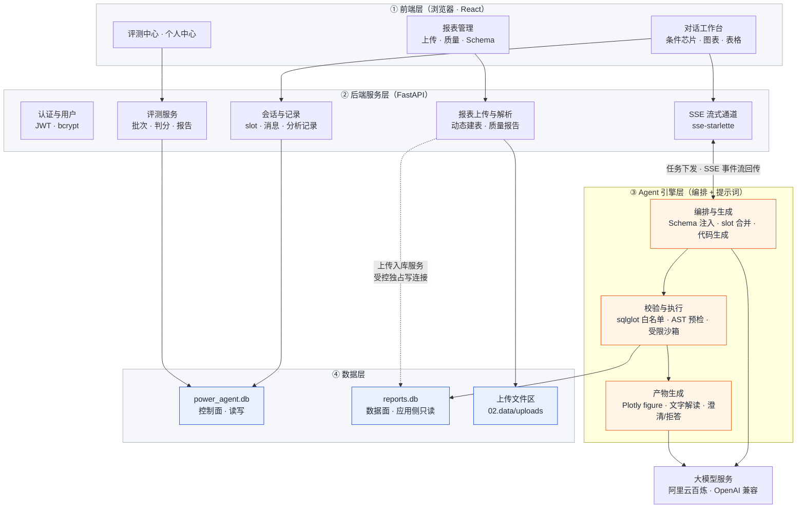

### 3.2 各层职责与层间契约

| 层 | 职责 | 对外契约 | 禁止事项 |
| --- | --- | --- | --- |
| ① 前端层 | 上传、对话、图表渲染、条件编辑、记录管理 | 只调用 `/api/v1` REST 与 SSE；不直连数据库、不持有模型密钥 | 不含分析与 SQL 拼接逻辑 |
| ② 后端服务层 | 认证、上传解析、会话与记录、SSE 编排、评测 | 统一响应包络 `{code,message,data,request_id}`；错误码见 PRD 9.3 | 不直接执行生成代码（必须经 Agent 与沙箱） |
| ③ Agent 引擎层 | slot 抽取、代码生成、校验、沙箱执行、图表、解读、澄清 | 输入：问题 + slot + Schema 文本；输出：表格数据 + figure JSON + 解读 | **不得写入 `reports.db`** |
| ④ 数据层 | 控制面读写；数据面只读；上传文件落盘 | 库表契约见《数据库设计文档》 | 数据面不接受应用侧写入 |

### 3.3 层间关键约定

| 约定 | 内容 |
| --- | --- |
| 前端 ↔ 后端 | 除注册/登录/健康检查外均需 JWT；分析链路走 SSE（`text/event-stream`），其余走 JSON |
| 后端 ↔ Agent | 以「分析任务」为单位传递：`conversation_id / report_id / question / slot / schema_text`；Agent 以事件流回调 |
| Agent ↔ 数据层 | 只读连接执行 SQL；pandas 路径由后端提供 DataFrame 视图（来自只读查询），沙箱内不给文件与网络 |
| Agent ↔ LLM | 统一 `LLMClient`（百炼 OpenAI 兼容模式），模型名与温度配置化，轻量模型做 slot、主力模型做代码与解读 |
| 后端 ↔ 上传文件区 | 落盘按 `{user_id}/{report_code}/` 隔离，路径入库仅存相对路径 |

---

## 4. 后端组件与 Agent 流水线

### 4.1 后端组件图

<!-- mermaid: arch_components -->
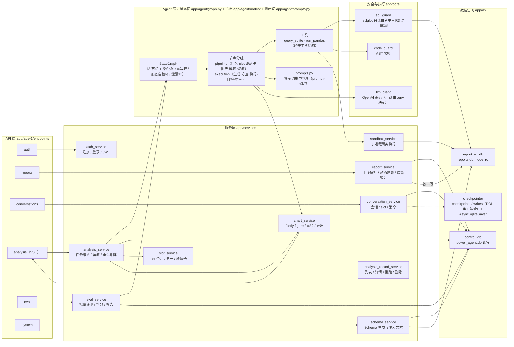

**组件清单**（v1.0.11 逐项对照代码核对，**落地状态以本表为准**）

| 组件 | 文件 | 职责 | 依赖 | 状态 |
| --- | --- | --- | --- | --- |
| `sql_guard` | `app/core/sql_guard.py` | sqlglot 解析、单语句校验、仅 SELECT、表白名单、强制 LIMIT、**R3 混加检测** | sqlglot | 已落地 |
| `code_guard` | `app/core/code_guard.py` | 生成代码的 AST 预检（禁 import / dunder / 危险调用），**未过预检不进沙箱** | ast | 已落地 |
| `llm_client` | `app/core/llm_client.py` | 统一模型调用（OpenAI 兼容，厂商标识仅展示）、模型分级、token 与耗时、`extract_json` 三层容错、无 Key 回落离线脚本模型 | httpx（**不引入 openai SDK**） | 已落地 |
| `sandbox_service` | `app/services/sandbox_service.py` | **子进程隔离执行**：常驻进程池 + 超时强杀 + 崩溃重建 + 结果体积上限 | subprocess / pandas | 已落地（RestrictedPython **未接入**） |
| `chart_service` | `app/services/chart_service.py` | 列语义识别、类型选择、语义色、TopN 合并、抽稀与缺采断点、粒度重聚合、figure JSON 与 `chart.png` 预留 | plotly | 已落地 |
| `slot_service` | `app/services/slot_service.py` | slot 增量合并 / 归一化 / patch 校验 / 澄清卡生成（**零 LLM**） | — | 已落地 |
| `analysis_record_service` | `app/services/analysis_record_service.py` | 记录列表（轻字段）/ 详情 / 整轮重跑 / 删除 | — | 已落地 |
| `eval_service` | `app/services/eval_service.py` | 题库加载、判分三级兜底、指标汇总、五类归因、Markdown 报告 | — | 已落地 |
| `analysis_service` | `app/services/analysis_service.py` | **流水线编排（本版实际形态）**：slot → 生成 → 守卫 → 执行 → 图表 → 解读 → 留痕，含澄清环与重试矩阵 | — | 已落地 |
| `prompts` | `app/agent/prompts.py` | 提示词集中管理（slot / SQL / pandas / 解读 / 重写），版本记入 `analyses.prompt_version` | — | 已落地 |
| `control_db` / `report_ro_db` / 写连接 | `app/db/session.py` | 控制面读写连接 / 数据面只读连接 / 报表库独占写连接 | SQLAlchemy、aiosqlite | 已落地 |
| `graph.py` / `nodes/` / `checkpointer` | `app/agent/graph.py`、`app/agent/nodes/*.py`、`app/agent/state.py`、`app/agent/checkpointer.py` | **LangGraph 状态图**（13 节点 + 条件边：重写环 / 形态自检环 / 澄清环）、双工具节点、会话级检查点（`AsyncSqliteSaver`，`thread_id = 会话编号`） | langgraph 1.2.14、langgraph-checkpoint-sqlite 3.1.2 | **已落地**（2026-10-13；`ORCHESTRATOR` 默认 `langgraph`，legacy 保留为回退，见 ADR-021） |

### 4.2 Agent 流水线（节点、条件环与事件出口）

<!-- mermaid: arch_agent_pipeline -->
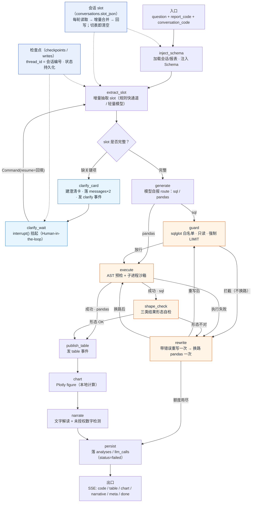

> **实现形态（v1.0.15 如实记录：已接入 LangGraph 状态图）**：上图**不再是手绘控制流**——
> 节点与条件边由 `app/agent/graph.py::_assemble()` 定义，本节图按 `graph_mermaid()` 的**导出边逐条对齐**：
>
> - **图上共 13 个节点**（`nodes/pipeline.py` 主干 + `nodes/execution.py` 执行环节点），
>   两个环都是**真正的条件边**而非函数内部的 while：
>   - **澄清环（HITL）**：`clarify_card`（建卡 / 落库 / 发事件）→ `clarify_wait`（`interrupt()` 挂起）
>     → 用户回填 → `Command(resume=…)` 从**断点续跑**回 `extract_slot` 合并补丁（不重复调模型）；
>     **副作用必须放在中断之前的节点**——LangGraph 恢复时会重跑被中断的节点；
>   - **重写环**：`rewrite` = 带错误重写一次 → 换路 pandas 一次 → 额度用尽则 `persist(status=failed)`；
>     **安全拦截不换路**（防止"删表"类请求换来一次无关的 pandas 成功结果）；
>   - **形态自检环**：`shape_check`（占比 / 极值 / 筛选型追问三类）命中即回到 `rewrite` 带原因重写。
> - **检查点**：`thread_id = 会话编号`，状态落控制面库 `checkpoints` / `writes`
>   （`AsyncSqliteSaver`；DDL **手工纳管**于 `scripts/sql/power_agent_langgraph.sql`，
>   不让框架自行建表——与"表结构唯一事实源"纪律一致）。
> - **事件出口**：节点内 `GraphContext.emit_event()` 发出 → LangGraph custom stream → 既有 SSE 回调
>   （**事件产生即推送**，首字实测 17–20ms，见 ADR-018）。
> - **两条编排并存**：`ORCHESTRATOR=langgraph`（**2026-10-13 起默认**）/ `legacy`
>   （`analysis_service.run_once` 的显式 async 编排，保留为回退路径）；
>   `tests/test_langgraph_parity.py`（9 条）逐字段 + 逐事件比对两条路径，全量 **323 条用例**在状态图下全绿。
> - **本节图与代码一致性可机检**：
>   `.venv\Scripts\python.exe -c "from app.agent.graph import graph_mermaid; print(graph_mermaid())"`
>   导出的边应与上图一一对应（PNG 由 `01.code/tools/mermaid2png.py` 离线渲染，见 1.3 节）。
>
> 本节表格已按实际实现逐条校正（**凡与本节冲突的历史描述，以本节为准**）。

**流水线设计要点**

| 要点 | 说明 |
| --- | --- |
| 状态结构 | 运行态对象（`AnalysisResult`）携带 `slot`、`question`、`report_id`、`schema_text`、`route`、`sql` / `code`、结果集、`retries`、`path_switched`、`error` 等字段，随请求在一次 `run_once()` 内流转（**非图状态**） |
| slot 权威来源 | **会话级 slot 存 `conversations.slot_json`**（控制面库）：每轮「读取 → 增量合并 → 回写」，切表即清空；**不依赖 checkpointer**（PRD C4 的落地方式） |
| 双工具路由 | LLM 在生成阶段**自报 `route`**（prompt-v3.7），提示词写明适用场景与反例（聚合/过滤 → SQL；统计/相关性/异常 → pandas） |
| 重试环 | 守卫拒绝或执行失败 → **带错误重写一次**（回灌错误原文 + 相关 Schema 片段）；**仅执行类失败**再**换路一次**（仅 SQL → pandas）。**安全拦截不重试、不换路**；`E_LLM` 等不参与重试；生成调用上限 3 次（`retries` / `path_switched` / `llm_calls.is_retry` 全留痕） |
| 失败即终止 | 重试耗尽后进入 `fail`，明确返回"本次未生成结果"，**禁止编造**（PRD F2.4） |
| 澄清回路 | `ask_clarify` 返回选项，用户点选后回到 `extract_slot` 合并，已解析条件不丢（PRD F4.4） |
| 阶段事件 | 每个节点向 SSE 推送 `status`，前端渲染阶段时间线（UI/UX 8.2） |
| **真流式推送（v1.0.12）** | 事件**产生即推送**（不再"跑完回放"）：`EventSink` 是 `list` 子类、覆盖 `append` 做同步回调，链路上十几处 `result.events.append(...)` 一行未改；端点把链路放 `asyncio.Task`、用 `asyncio.Queue` 边收边推，客户端断开即取消链路 |
| **slot 规则快通道（v1.0.12）** | 满足"**指标唯一 + 不含语义拦截词 + 会话条件干净 + 时间可规则确定**"四条时**跳过 slot LLM 往返**（省 1.5–2.0s）；任一条不满足即回落 LLM，澄清 / 多轮 / 分组语义不退化 |
| **阶段超时兜底（v1.0.12）** | slot 超 **6s** → 按**宽松规则**（`fallback_slot`）构造增量继续，拿不到指标才如实失败；narrative 超 **8s** → **跳过解读**（表格与图表照给、`status` 仍 success，异常提示如实说明）——两者都在压"单阶段最长 21s"的长尾 |

> **上述三项的实测与取舍（v1.0.12 追平）**：延迟拆解显示 **98% 耗时都在 3 次串行模型调用**上
> （slot 1.5–2.5s / gen_sql 3.0–3.2s / narrative 2.4–3.2s），本地计算几乎为零。因此优化只做三件事：
> ① 把"事件推送"与"链路执行"解耦（真流式，**首字 5,927ms → 10–16ms**，G3 达标）；
> ② 能规则化的 slot 抽取不调模型（端到端均值 **8,387ms → 7,937ms**，调用 3.1 → 2.9 次/题）；
> ③ 给单阶段设上限（把长尾压掉，避免个别请求拖到十几秒）。
> **两条如实说明**：G2 的达成与**问题构成**强相关（按"简单问数"口径 7.6–7.9s 达标，含多轮题的批次会到 9s 上下）；
> **P95 仍未达标**，属遗留项（见第 8.1 节与《测试报告》第 5 章）。
>
> **澄清策略的两次校正（值得记住的教训）**：v1.19.6 实测发现模型会把"指标写得很清楚"的问题
> （如「全期平均电压是多少伏？」）判成 `missing_slot=metric` 而只返回澄清卡（**120 题里 18 题、占 15%**）
> → 收紧提示词（问题含指标词即不得澄清）+ 规则侧**词面兜底**（`guess_metric_from_question`：模型仍报缺失时按词面构造指标继续）。
> 另一处是**评测工具自身的缺陷**：整批共用一个会话且首轮继承会话 slot → 题目之间串条件
> （q051 的 `is_weekend = 1` 串进 q052/q055）→ 改为**首轮显式 `slot_base={}`**（多轮题第 2 轮起照常继承）。
> **这提醒一件事：评测偏低不一定是模型差，先查评测工具是否忠实。**

### 4.3 双工具路由规则（供提示词与评测共用）

| 问题类型 | 首选工具 | 备选 | 说明 |
| --- | --- | --- | --- |
| 过滤 / 聚合 / 排序 / 分组 / 排行 | `query_sqlite` | `run_pandas` | SQL 表达简洁且可读，便于审查 |
| 同比 / 环比 / 滚动统计 / 标准差 | `query_sqlite` | `run_pandas` | SQLite 无 STDDEV，需用 `SQRT(AVG(x*x)-AVG(x)*AVG(x))`（Schema 中给出可用函数清单） |
| 相关性 / 分布 / 异常检测 / 多步变换 | `run_pandas` | `query_sqlite` | pandas 表达力更强 |
| 任意时间窗明细 | `query_sqlite` | — | 走 `report_minute.dt` 索引 |
| 结果过大 | — | — | 强制 LIMIT 1000，并通过解读提示细化条件 |

---

## 5. 数据架构

### 5.1 数据访问路径图

<!-- mermaid: arch_data_access -->
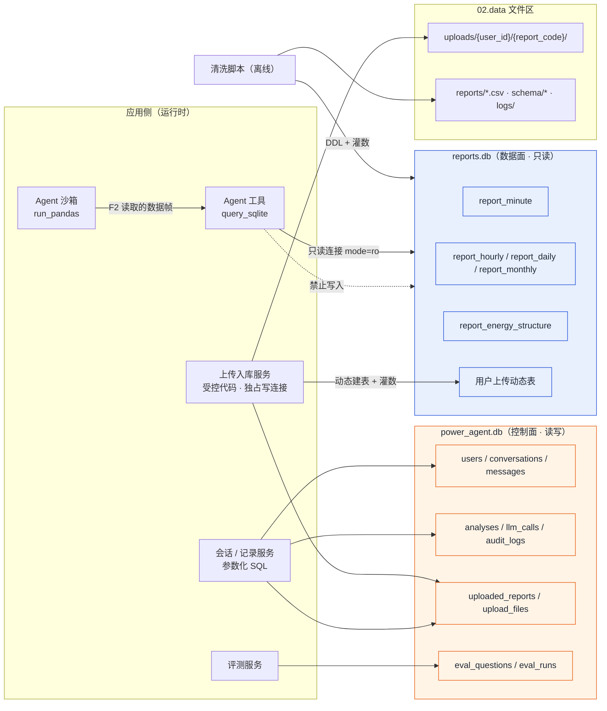

### 5.2 两库分离的架构含义

| 维度 | `power_agent.db`（控制面） | `reports.db`（数据面） |
| --- | --- | --- |
| 角色 | 用户、会话、消息、分析记录、评测 | 分析对象（报表数据） |
| 访问模式 | 读写（参数化 SQL / ORM） | 应用侧**只读**（`mode=ro`） |
| 写入方 | 后端服务；上传入库服务写元数据 | ① 清洗脚本（离线）② 上传入库服务（受控、独占写连接） |
| 外键与级联 | 全链路 `ON DELETE CASCADE`；安全日志 `SET NULL` | 表间无外键（平行产物） |
| 日志模式 | `WAL`（读写并发） | 默认（只读为主） |
| 失败影响 | 会话/记录不可用 | 分析不可执行（报错而非编造） |

### 5.3 只读的架构级保证（不止靠约定）

| 层次 | 措施 |
| --- | --- |
| 连接层 | 统一连接工厂：数据面连接串固定 `file:...?mode=ro`，任何写尝试由 SQLite 直接抛错 |
| 语句层 | `sql_guard` 仅放行 SELECT；多语句、DDL/DML、ATTACH、PRAGMA 一律拒绝（**v1.0.9 已落地**，见下） |
| 表名层 | 表白名单 = 当前会话已注册报表的表名集合（来自 `uploaded_reports.table_name`） |
| 结果层 | 强制 LIMIT 1000；结果行数上限 5000（沙箱内），超出截断并标记 |
| 审计层 | 所有拦截写入 `audit_logs`，可统计拦截率（TBD5） |

**语句层守卫的落地形态**（v1.0.9，`app/core/sql_guard.py`）：`sqlglot` 解析 SQLite 方言后**按语法树判定**
（不做关键字黑名单，注释/大小写/字符串内的关键字无法绕过），判定点与规则号：

| 规则号 | 判定 |
| --- | --- |
| `sqlguard:empty` / `too_long` / `parse_error` | 空语句 / 超长（>20k 字符）/ 语法不可解析 |
| `sqlglot:multiple_statements` | 语句数 ≠ 1 |
| `sqlglot:non_select` | 非 SELECT 语句，或 AST 中出现 INSERT/UPDATE/DELETE/DROP/ALTER/ATTACH/PRAGMA/事务等节点 |
| `sqlglot:forbidden_function` | 出现 `load_extension` / `readfile` / `writefile` 等扩展面函数 |
| `sqlglot:qualified_table` | 跨库限定名（如 `other_db.report_daily`） |
| `sqlglot:table_not_allowed` | 表不在白名单内（白名单 = **当前会话活跃报表的物理表名**） |
| `sqlglot:no_table` | 未引用任何报表表 |

通过时守卫**返回改写后的 SQL**（最外层缺 `LIMIT` 时自动补 `LIMIT 1000`，即 PRD N7），
该语句同时是 `code` 事件展示的文本与 `analyses.sql_text` 落库内容——**展示即所执行**，不存在"展示 A 执行 B"。

**唯一的写通道**（v1.0.7 落地，与 5.3 的只读保证互为闭包）：

| 项 | 设计 |
| --- | --- |
| 连接 | `app/db/session.py::report_write_conn()` —— 原生 `sqlite3`、`file:...?mode=rw`（库不存在即报错，不会静默建空库）、`BEGIN IMMEDIATE` 立即取写锁、`busy_timeout=10s`、`foreign_keys=ON`，**事务提交后立即关闭** |
| 调用范围 | **仅** `app/services/report_write_service.py`（`upload` / `confirm` / `delete` 三处）；LLM 生成代码永远走只读连接 |
| 串行化 | `app/core/locks.py` 的**进程内 `asyncio.Lock`**：解析、灌数、`DROP TABLE` 三者互斥，同一时刻只有一个写者（多 worker 部署需换文件锁，当前单 worker 不涉及） |
| 不阻塞事件循环 | 解析与灌数整体放入 `asyncio.to_thread(...)`；上传 30s 期间健康检查、列表、预览仍正常响应（N1/N5 不被上传拖垮） |
| 不长时间独占库 | 灌数**分批提交**（默认 5 万行/批）：`reports.db` 是回滚日志模式，写事务独占全库，分批把单次写锁持有时间压到 <1s，给只读查询留插入窗口；代价是放弃整表原子性，失败以 `DROP TABLE` 回滚 |
| 空间回收 | `DROP TABLE` 后**不 VACUUM**：空闲页留给后续上传复用（`freed_pages` 只报告），避免一次删除触发 400MB 级重写与长时间锁库 |

> 为什么写通道用原生 `sqlite3` 而不是 `aiosqlite`：207 万行灌数基准（20 万行 × 16 列）——
> SQLAlchemy `text()` + `to_dict(records)` **19.5µs/行**（外推 41s）；原生 `sqlite3` + `executemany` +
> `itertuples` **12.7µs/行**（外推 26s）。差距来自逐行字典构造与 SQLAlchemy 参数处理，而 N4 只有 60s 预算，
> 故取后者；两者连接参数完全一致，只读约束不受影响（见 ADR-011）。

### 5.4 上传数据的完整路径

<!-- mermaid: arch_upload_lifecycle -->
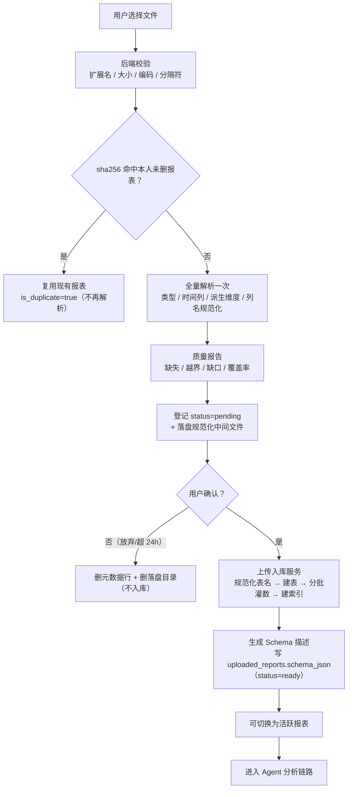

> 该图与 5.1 的差别：5.1 描述**运行时的权限边界**，此图描述**一次上传的数据生命周期**。
> 两段式的关键取舍：`upload` 阶段**全量解析一次**（不采样）换取"预览里的行数与质量报告是真实值"，
> 代价是解析产物要落一份中间文件（207 万行约 180MB，`confirm` 成功后即删）。

---

## 6. 部署架构

### 6.1 部署拓扑图

<!-- mermaid: arch_deploy -->
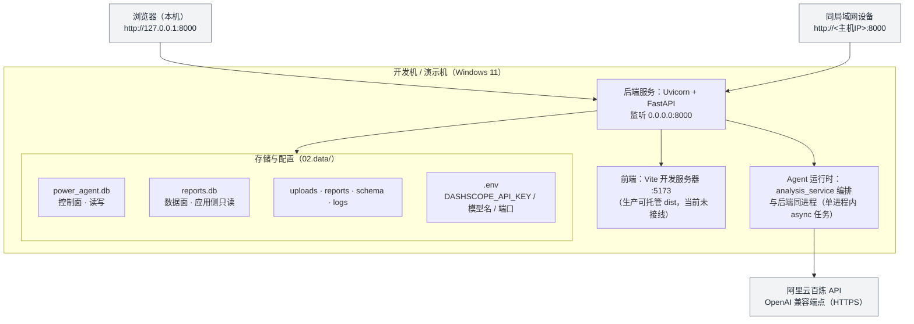

### 6.2 部署说明

| 项 | 方案 | 理由 |
| --- | --- | --- |
| 进程模型 | 后端单进程（Uvicorn）内嵌分析编排（`run_once` 的 async 任务）；前端开发期由 Vite 独立进程提供（`5173`，经代理访问 `/api`） | 单机演示，避免多进程状态同步复杂度 |
| 端口 | 后端 `8000`（对外），前端开发期 `5173` | 与 API 前缀 `/api/v1` 一致 |
| 访问范围 | 本机 `127.0.0.1` + 局域网 `http://<主机IP>:8000` | 演示需要手机/其他电脑查看（UI/UX 10.3） |
| 配置 | `.env` 管理 `DASHSCOPE_API_KEY`、模型名、端口、库路径；`.gitignore` 排除 | PRD 6.5 可维护性 |
| 数据落盘 | 全部在 `02.data/`（库、上传文件、报表、Schema、日志） | 便于整体备份与迁移 |
| 启动顺序 | ① `03_init_db.py` 建库 → ② 后端启动 → ③ 浏览器访问 | 首次部署必需，后续可跳过第 ① 步 |
| 不采用 | Docker / Nginx / HTTPS 证书 / 云服务器 | 决策见 ADR-010；HTTPS 仅在文档中作为生产建议 |
| 局域网访问前提 | Windows 防火墙放行 8000 端口；主机与设备同一网段 | 部署手册中给出排查步骤 |

### 6.3 环境与依赖

| 类别 | 内容 |
| --- | --- |
| 运行时 | Python 3.12+（当前 3.13.12）、Node 18+（当前实测 v26，前端构建）、SQLite 3 |
| 后端依赖 | FastAPI、Uvicorn、python-multipart、SQLAlchemy、aiosqlite、**bcrypt**（密码哈希，直调；替代已停更且与 bcrypt 5.x 不兼容的 `passlib[bcrypt]`，见 PRD v1.6.0）、PyJWT、sse-starlette、pandas、**plotly 7.0.0**（连带 narwhals 2.26.0）、sqlglot、json-repair、**httpx**（直调任意 OpenAI 兼容端点）、**RestrictedPython 8.5（已装、未接入**，沙箱实际执行为"AST 预检 + 子进程隔离"，见 ADR-005 与 v1.0.11 变更记录）、**kaleido（预留未装**，装上后 `chart.png` 无需改码即生效）。**不引入 `openai` SDK**——它会额外拖进 httpx2 / httpcore2 / jiter / truststore 四个包，而本项目只需一次普通 JSON POST（ADR-012 / ADR-015） |
| 前端依赖 | Vite 6、React 18.3、TypeScript 5.7、Ant Design 5.22、Tailwind CSS **3.4**（关 `preflight`）、`plotly.js-dist-min`（自封装容器）、axios、zustand、`@microsoft/fetch-event-source`、dayjs（**实测版本**，TBD1 已回填，见 PRD 10.3） |
| 工具链 | `01.code/tools/svg2png.py`（线框图）、`01.code/tools/mermaid2png.py`（架构图）、本地 `vendor/mermaid.min.js`、**`ui_shot.mjs`**（七页截图验收）、**`ui_flow_check.mjs`**（回归自检 **32 条**断言，端口可用 `UI_BASE` 覆盖）、`chart_preview.py`（图表离线预览）、`eval_run.py` / `eval_merge.py` / **`eval_rebuild.py`**（评测发起 / 跨批合并 / **中断批次结果本地重建**）/ `eval_gold_audit.py`（题库审计）、**`db_constraint_audit.py`**（**DB CHECK 约束 ↔ 代码取值一致性审计**：DDL↔实库 diff、默认值/字面量比对，含 `--selftest` 自证）、`latency_report.py` / `sse_probe.py`（延迟拆解 / 首字测量） |

> **✅ 依赖与实现的偏差（v1.0.15 更新：① 已消解）**：
> ① **LangGraph 已引入并成为默认编排**（`langgraph 1.2.14` + `langgraph-checkpoint-sqlite 3.1.2`，2026-10-13）——
> 分析流水线现由 `app/agent/graph.py` 的 **StateGraph** 编排（13 节点；重写环 / 形态自检环 / 澄清环都是**条件边**），
> 节点在 `app/agent/nodes/`（`pipeline.py` 主干 + `execution.py` 执行环节点），状态定义在 `app/agent/state.py`；
> 会话级持久化由 `app/agent/checkpointer.py`（`AsyncSqliteSaver`，`thread_id = 会话编号`）承担，
> **DDL 按项目纪律手工纳管**于 `scripts/sql/power_agent_langgraph.sql`（未采用框架自动建表）。
> 澄清改为官方 HITL 范式：`clarify_wait` 里 `interrupt()` 挂起 → 用户回填 → `Command(resume=…)` **断点续跑**。
> 两条编排并存：`ORCHESTRATOR=langgraph`（默认）与 `legacy`（`analysis_service.run_once`，保留为回退），
> 由 `tests/test_langgraph_parity.py`（9 条）逐字段 + 逐事件保证等价；全量 **323 条用例**在状态图下全绿。
> 决策与代价见 **ADR-021**（ADR-017 保留为历史记录并加实施修订标记）。
> ② `requirements.txt` 已按实测回填 `plotly` / `narwhals` / `RestrictedPython`（此前只存在于 `.venv` 与 PRD 表格中，
> 照 requirements 装完会缺包 → 属**可复现性缺陷**，已修）。
> ③ `kaleido` 未装（与 PRD 一致，`GET …/chart.png` 返回 501 预留）。

---

## 7. 关键时序

### 7.1 一次提问的全链路

<!-- mermaid: seq_chat -->
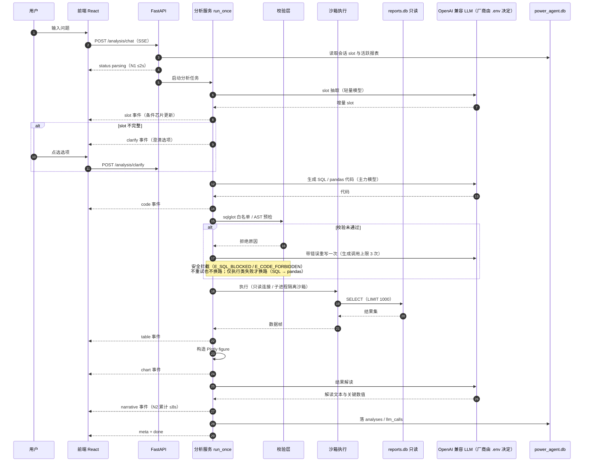

### 7.2 上传入库

<!-- mermaid: seq_upload -->
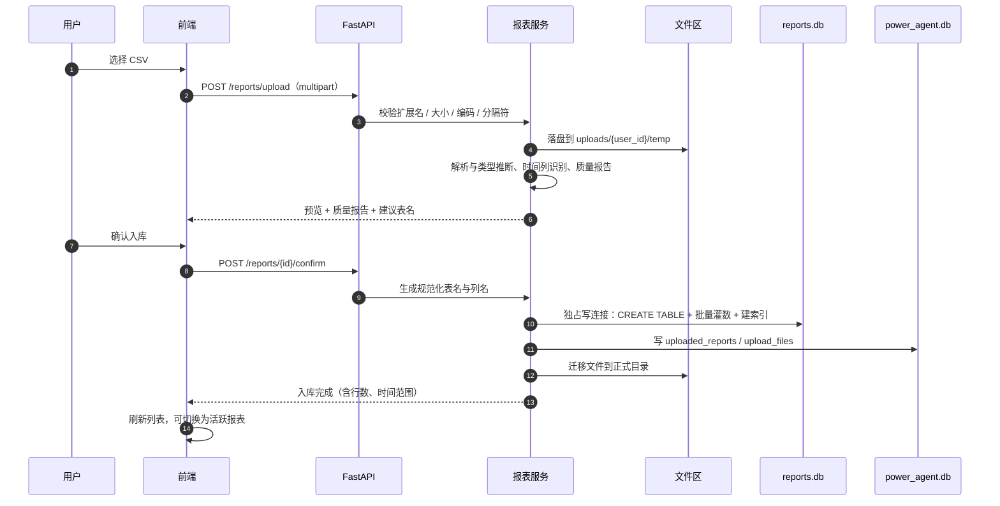

### 7.3 批量评测

<!-- mermaid: seq_eval -->
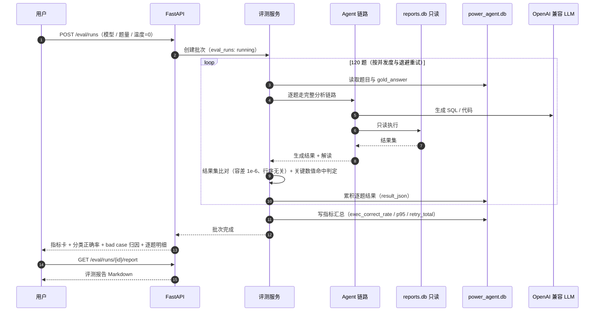

### 7.4 多轮澄清回路（两跳 SSE）

<!-- mermaid: seq_clarify -->
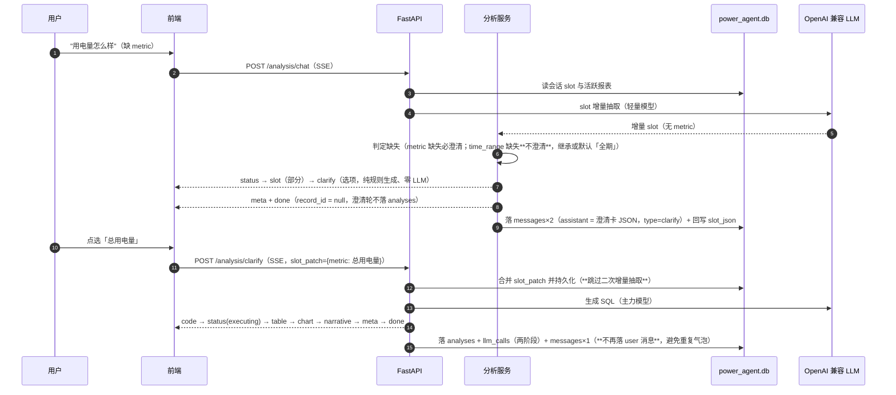

### 7.5 端到端回归自检（`tools/ui_flow_check.mjs`）

<!-- mermaid: seq_regression -->
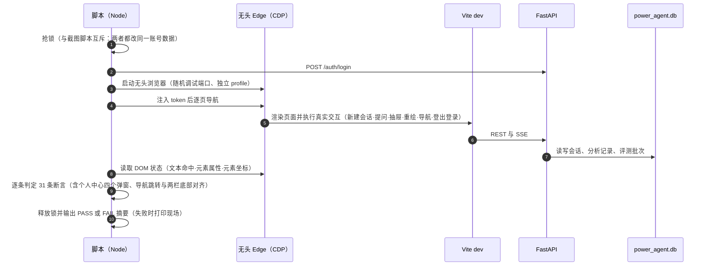

---

## 8. 非功能设计落点

### 8.1 性能（N1–N7 → 架构手段）

| 指标 | 目标 | 架构手段 |
| --- | --- | --- |
| N1 首字 | ≤2s | API 收到请求即推 `status`（不等待任何 LLM 调用）；Schema 文本与 slot 读库均走索引 |
| N2 单轮平均 | ≤8s | 模型分级（slot 用轻量模型）；图表与解读并行；会话级结果缓存（同问题+同 slot，5 分钟） |
| N3 P95 | ≤15s | 重试上限 2 次；超 15s 前端提示可取消；沙箱超时 10s 快速失败 |
| N4 上传解析 | 200 万行 ≤60s | 分块读取 + 指定 dtype + 只对必要列建索引；解析耗时写入质量报告 |
| N5 列表/切换 | ≤1s | 报表元数据直读 `power_agent.db`（含索引），不触发数据面扫描 |
| N6 并发 | ≥5 会话不降级 | 数据面只读连接可并发；控制面启用 WAL；SSE 长连接按需建立与断开 |
| N7 大结果集 | LIMIT 1000 | 执行层强制追加；聚合查询仅兜底，不改变语义；截断时显式标注 |

> **实测对照（v1.0.12 追平，数字取自《测试报告》第 5 章）**：
>
> | 指标 | 目标 | 实测 | 结论 |
> | --- | --- | --- | --- |
> | N1 / G3 首字 | ≤2s | **10–16ms**（真流式改造后；改造前 **5,927ms**） | **达标** |
> | N2 单轮平均 | ≤8s | **7,937ms**（10 题混合样本）；按"简单问数"口径 **7.6–7.9s**；单个简单问数 **3.9–5.5s**；**2026-10-14 新端点最好观测 11.7s**（gen 5.8s + 解读 5.1s） | 达标（**与问题构成相关**，含多轮题的批次会到 9s 上下） |
> | N3 P95 | ≤15s | 优化前 **12–16s**；新端点 120 题实测 **36.3s**（2026-10-13，当时 `.env`）、慢时段可达 2–3 倍 → **受供应商侧时段波动主导**，详见《测试报告》12 章与 `大修工作进度/提速实验-20261014.md` | **未达标（遗留项，如实登记）** |
> | **编排自身开销**（2026-10-14 新增） | 不计入 N1–N7 指标 | **avg 99ms / P95 188ms**（120 题 selfcheck，**0 次模型调用**）→ 说明 N2/N3 的耗时**几乎全在模型调用**，编排层（状态图 + 检查点 + 事件推送）无优化空间 | 达标 |
> | N4 上传解析入库 | 200 万行 ≤60s | 解析 + 灌数（207 万行 16 列）实测见《测试报告》第 5 章 | 达标 |
> | N7 大结果集 | LIMIT 1000 | 守卫层强制追加，截断显式标注 | 达标 |
>
> 达成手段（v1.0.12 新增，详见 4.2 节）：**SSE 真流式**（事件产生即推送）、**slot 规则快通道**（能规则化的不调模型）、
> **阶段超时兜底**（slot 封顶 6s、narrative 封顶 8s）。
> **一处口径说明**：评测报告里的 `first_token_avg_ms` 恒为 `NULL`——评测客户端是**单次 POST（非流式）**，
> 采不到首字；首字只能用 `01.code/tools/sse_probe.py` 走真实 SSE 测量（该工具还能识别"攒批回放"假流式）。

### 8.2 安全（S1–S8 → 架构落点）

| 编号 | 需求 | 架构落点 |
| --- | --- | --- |
| S1 | 生成代码沙箱 | `code_guard`（AST 预检，未过不进沙箱）+ `sandbox_service`（**子进程隔离**：常驻进程池 + 超时强杀 + 崩溃重建 + 结果体积上限；禁网禁写由 AST 白名单与只读库路径共同保证）。**import 白名单口径（v1.0.12 校正）**：`math`/`statistics`/`datetime` + **沙箱本就预置的 `pandas`/`numpy`/`plotly`**——后三者放行是因为"模型多写一句 `import pandas as pd` 拿到的是**同一个已预置的模块对象**，属**冗余而非新增能力**"，而原先一律拒绝的后果是**整题以守卫拦截失败**（用户实测在"重跑"里踩到）；危险面仍由 `os`/`sys`/`subprocess`/相对导入禁止 + 双下划线 + 危险调用三道拦住 |
| S2 | 提示词注入防护 | 提示词分区（系统 / Schema / 用户输入）；输入过规则与关键词拦截；`securityLevel` 与输出过滤 |
| S3 | 危险操作拦截 | `sql_guard` 拒绝非 SELECT；沙箱拒绝危险 AST；拦截落 `audit_logs`（`event_type` 为 **17 类 CHECK 白名单**，见数据库设计 5.10；`action` 仅 `blocked`/`warned`/`allowed`） |
| S4 | 鉴权与隔离 | JWT 校验中间件 + 资源归属校验（`user_id` 过滤）；越权返回 403 |
| S5 | 数据保护 | bcrypt 存储；文件按用户目录隔离；日志脱敏（不记 token/绝对路径）；生产建议 HTTPS。**账号级防护（v1.0.12）**：改密需校验**当前密码**、删号需**密码 + 用户名双确认**、清空历史需选口径并二次确认；三类操作的成功与失败路径都落审计，`payload` **只写计数与 `rule_id`，绝不写密码** |
| S6 | 内容安全 | 解读文本过敏感词过滤后回传 |
| S7 | 免责声明 | 前端固定展示（UI/UX 5.2 / 5.1-8） |
| S8 | 数据库职责与访问隔离 | 数据面只读连接 + sqlglot 白名单 + 表名白名单（5.3 节三重保证） |

### 8.3 可维护性与可测试性

| 手段 | 说明 |
| --- | --- |
| 提示词外置 | `app/agent/prompts/*.md`，版本化并在 `analyses.prompt_version` 记录 |
| 口径外置 | 口径规则集中在 Schema 生成器与 `sql/reports.sql` 注释；变更需同步三处并跑 A1–A5 |
| 统一 LLM 客户端 | 模型名/温度/base_url 全部配置化，切换只改 `.env` |
| 全链路可观测 | `request_id` 贯穿；`llm_calls` 记录阶段/耗时/token；`analyses` 记录重试与失败原因 |
| 可测试性 | **审计层可单独测试**（sql_guard / code_guard 纯函数，安全用例集 **53 项**（恶意 40 + 合法 13，2026-10-15 用 AST 计数核实）且拦截通过率实测 100%）；`sandbox_service` 可离线单测（含超时强杀、崩溃重建、恶意样例）；**评测链路不依赖人工**（自检模式逐题回放，120 题约 4 秒跑完）；前端另有 **32 条**端到端回归断言（`tools/ui_flow_check.mjs`，含个人中心四个弹窗的字段与"未勾选时主按钮禁用"；2026-10-15 复跑 32/32 通过）；后端全量 **342 个用例**（`pytest`，临时库 + 真实 DDL，零回归） |
| 可回放 | 分析记录保存问题、slot、SQL/代码与结果快照，可一键重跑 |

### 8.4 可扩展性

| 扩展方向 | 现有设计如何支撑 |
| --- | --- |
| 新增报表类型 | 实现解析器并注册 Schema，Agent 无需改动（表名白名单来自元数据） |
| 更换/升级模型 | `LLMClient` 抽象 + 配置化；轻/重模型可分别替换 |
| 新增分析工具 | 在生成阶段的提示词中增加 `route` 取值与工具描述，并在状态图里加一个节点 + 条件边（守卫与沙箱复用）；新节点会**自动出现在 `graph_mermaid()` 导出与 4.2 配图**里（见 ADR-021） |
| 接入其他数据源 | 预留数据源适配器（只读库视图），Agent 侧只依赖 Schema 文本与只读执行接口 |
| 前后端形态变化 | 前端仅依赖 REST + SSE 契约；GUI/移动端可复用同一后端 |

---

## 9. 架构决策记录（ADR）

| 编号 | 决策 | 备选方案 | 选择理由 | 代价与缓解 |
| --- | --- | --- | --- | --- |
| ADR-001 | **前后端分离（FastAPI + React）+ B/S 形态** | 单体模板渲染（Jinja）/ 桌面 GUI | 任务书要求 Web 形态；前后端分离便于图表交互与 SSE 流式；后端契约可被多端复用 | 需要维护 API 契约与 CORS/代理配置 |
| ADR-002 | **Agent 编排用 LangGraph（不用 LangChain Agent 黑盒）**（**↑ v1.0.15：已按本决策落地为 LangGraph 状态图；v1.0.11–v1.0.14 期间曾为显式 async 编排，见 ADR-017 的实施修订**） | LangChain AgentExecutor / 自研状态机 | 任务书指定 LangGraph；显式状态图便于控制重试环、澄清回路与阶段事件；节点边界清晰可测 | 需自行定义状态结构与节点，初版开发量略大；**实施偏差见 ADR-017** |
| ADR-003 | **Text2SQL 与 pandas 双工具，由 LLM 自主路由** | 固定规则路由 / 只用 SQL / 只用 pandas | 任务书要求"SQL 与 pandas 代码转译"；自主路由能覆盖两类问题并按失败原因换路径，鲁棒性最好 | 路由可能选错 → 工具描述中给出场景与反例；失败自动换路径 |
| ADR-004 | **SQL 安全用 sqlglot 只读白名单（而非正则黑名单）** | 关键字正则过滤 / 直接执行 | sqlglot 真实解析语法树，可严格判定"单条 SELECT"，避免注释绕过与多语句注入；同时强制追加 LIMIT | 引入依赖；个别方言函数需提示词配合（如 SQLite 无 STDDEV） |
| ADR-005 | **代码沙箱用 RestrictedPython + AST 预检 + 超时**（**↑ v1.0.11：实施改为「AST 预检 + 子进程隔离」，RestrictedPython 未接入，见 ADR-013**） | 子进程隔离 / Docker 沙箱 / 仅提示词约束 | 单机 Windows 环境无 Docker；RestrictedPython 纯 Python 可用、启动开销小；叠加 AST 预检可覆盖 `__` 属性与危险内建 | 沙箱不是内核级隔离 → 叠加超时、禁网禁写、结果上限；安全用例集回归（TBD5 **35 条，实测拦截通过率 100%**） |
| ADR-006 | **两库物理分离 + 报表库应用侧只读** | 单库多表 + 权限约定 | 从存储层杜绝生成代码篡改分析对象（S8）；控制面与分析对象生命周期、备份策略不同 | 跨库无法建外键 → 明确删除顺序与补偿（数据库设计 6.3） |
| ADR-007 | **图表用后端 Plotly figure JSON 直传，前端 `Plotly.react` 渲染** | 前端 ECharts 组装 option / 后端出图片 | 图表数据与表格同源，联动天然一致；前端零图表映射层；`toImage` 可导出，kaleido 兜底 | 图表类型受 Plotly 能力约束（不做日历热力图）；figure JSON 体积需控制（截断 topN） |
| ADR-008 | **多轮上下文用结构化 slot（非聊天历史）** | 拼接最近 N 轮对话 | slot 可显示、可编辑、可持久化，追问"改一个条件"不会丢其他条件；上下文长度可控、token 成本稳定 | 需维护 slot 合并规则与澄清回路（已在 4.2 落地） |
| ADR-009 | **选 SQLite（单文件）而非服务端数据库** | MySQL / PostgreSQL | 演示环境零安装、单文件便于备份与迁移；只读数据面在下述规模下性能充足（200 万行 + 索引，ms 级查询） | 无内置 STDDEV 等函数 → Schema 给出可用函数清单；并发写入弱 → 控制面启用 WAL 且写入集中在后端 |
| ADR-010 | **仅本机 + 局域网部署，不用 Docker/Nginx/HTTPS** | Docker Compose / Nginx 反代 + 自签证书 | 交付形态是本机演示；Docker 在 Windows 上额外引入虚拟化开销与不确定性；省下的时间用于数据口径与评测 | 生产化需补 HTTPS 与反向代理 → 部署手册给出"生产建议"章节 |
| ADR-012 | **LLM 走可注入抽象（`llm_client`），无 Key 时用离线脚本模型** | ① 直接调 `openai` SDK；② 硬编码判断"无 Key 就报错";③ 只写真实模型、测试靠打桩 monkeypatch | ① 本机尚未拿到百炼 Key，而**模型是"能不能写对 SQL"这个最大未知的所在**——必须让整条链路（slot/守卫/执行/解读/留痕）在今天就能端到端跑通并有 33 个用例覆盖；② 抽象层同时解决了模型分级（轻量模型抽 slot、主力模型生成 SQL 与解读）与"是否已配置"的可观测性（`/system/health` 如实回报 `llm.configured`）；③ `openai` SDK 会额外拖进 httpx2/httpcore2/jiter/truststore，而百炼端点只需一次 JSON POST，改用已装的 httpx | 无 Key 时**真实 SQL 正确率无法评估**（prompt 调优推迟到 Key 到位后）；`ScriptedLLM` 的默认 SQL 模板与真实模型行为无关，不能作为质量依据 → 已在文档中明确"仅用于跑通链路与回归" |
| ADR-011 | **报表库写通道用原生 `sqlite3` + 进程内写锁 + 分批提交** | ① 全部走 `aiosqlite`/SQLAlchemy 事务；② 改 `reports.db` 为 WAL 模式；③ 上传改后台任务（202 + 轮询进度） | ① 实测：207 万行灌数用 SQLAlchemy + `to_dict` 约 19.5µs/行（外推 41s），原生 `sqlite3` + `executemany` + `itertuples` 约 12.7µs/行（外推 26s），N4 只有 60s 预算；② WAL 模式下 SQLite 要求只读连接能写 `-shm` 影子文件，与 5.3 的 `mode=ro` 三重只读保证冲突，Windows 下还易被文件占用卡死；③ 后台任务需新增任务态与进度接口，改动 PRD 9.1 的同步契约 | 引入了"第二种写连接实现"→ 与只读引擎并列放在 `app/db/session.py` 同一模块，PRAGMA 参数完全一致；分批提交放弃整表原子性 → 失败以 `DROP TABLE` 回滚并将元数据置 `failed`（动态表本身可丢弃）；仅适用单 worker 部署 → 多 worker 需换文件锁（当前部署形态不涉及） |
| ADR-013 | **沙箱执行改「子进程隔离」（进程内超时不可强制）** | 进程内 RestrictedPython + 线程超时 / Docker 沙箱 / 只做 AST 预检 | Windows 下 Python 无法强制中断线程、也无法限制内存：进程内"超时"只能靠代码协作式检查（`while True` 与恶意代码会挂住 API 进程）。子进程可**真超时强杀**、崩溃后重建，安全边界更硬 | 每次执行多一次 IPC（毫秒级，实测可接受）；常驻池需处理崩溃重建与僵尸清理；`RestrictedPython` 保留未接入（见 ADR-005） |
| ADR-014 | **评测提供 `selfcheck`（gold 回放）模式，并在报告与页面置顶声明"不代表模型能力"** | 只允许 `real`（无 Key 就只能等）/ 打桩只在测试里用 | 无 Key 阶段必须能验证"题库 → 链路 → 判分 → 指标 → 报告"全通（**120 题自检 ≈4s、≈100%**）；但自检数字绝不能当验收结论 → **报告首段、前端指标卡、PRD/UIUX 三处固定文案** | 存在"自检数字被误引"的风险 → 三处标注 + `impl` 三模式（`real` 无 Key 返回 400 **不静默回落**） |
| ADR-015 | **只实现 OpenAI 兼容一种协议，不做多厂商 adapter 分支** | 每厂商一个 adapter（Anthropic Messages / Gemini 原生）/ 引入 LiteLLM 之类聚合层 | 百炼 / DeepSeek / Moonshot / 智谱 / OpenAI / 本地 vLLM·Ollama 都提供 OpenAI 兼容端点 → 换厂商**只改 `.env`、代码零改动、零厂商分支**；聚合层会拖进大量与本项目无关的依赖 | Anthropic / Gemini **原生协议不支持**（P2，需要时新增独立 adapter）；厂商差异靠两处兜底（`json_mode` 去参重试、模型分级能力位） |
| ADR-016 | **前端状态收敛为 4 个 store（zustand）+ SSE 事件驱动，不引入 Redux / React Query** | Redux Toolkit / React Query + Context / 逐组件 `useState` | 页面只有 5 个、状态域清晰（auth / chat / reports / theme）；SSE 事件到 UI 的映射是"追加式"的，简单 store 足够且无样板代码；401 拦截、草稿保留等跨页逻辑集中在一处 | 复杂缓存与失效策略要自己写 → 已把"列表刷新"收敛为 store 内 action（避免散落在组件里） |
| ADR-017 | **流水线用显式 async 编排（`analysis_service.run_once`）而非 LangGraph 状态图** | LangGraph StateGraph + checkpointer / LangChain AgentExecutor / 自研状态机类 | ① 控制流是**线性 + 两处条件环**（澄清环、重试环），`async/await` 直写可读性更高、调试更直接；② SSE 阶段事件要在每个节点精确控制顺序与载荷，显式编排最省事；③ 状态持久化的真实需求是**会话级 slot**（已落 `conversations.slot_json`），不需要图级 checkpointer；④ 少一层框架依赖与心智负担 | **与任务书 / ADR-002 的口径不一致，必须如实标注**（本节 + 6.3 偏差说明 + 附录 A）；如需状态图，节点边界与 4.2 图一致、可平滑映射，现有 **293 个后端用例**可作接入回归；`langgraph` / `langchain` 当时**未安装**（**↑ v1.0.15：本决策已被 ADR-021 取代——LangGraph 状态图已接入并成为默认编排**） |
| ADR-018 | **SSE 采用「事件产生即推送」，不做"跑完回放"** | ① 跑完一次性回放 `result.events`；② 前端轮询批次状态；③ WebSocket 双向通道 | G3 要求**首字 ≤2s**，而"回放"式的"首字"等于**整条链路耗时**（实测 5,927ms，**硬指标不达标**），且用户看不到"正在解析问题→执行→出图"的过程；实现上不需要改链路：`EventSink` 是 `list` 子类、覆盖 `append` 即完成"事件产生→入队"的挂钩（链路上十几处 `events.append` 一行未改） | 端点复杂度上升：链路要放 `asyncio.Task`、异常映射成 `error` 帧、**客户端断开要取消链路**（否则空烧 token）；SSE 是单向的，澄清回路仍走"第二跳请求"（7.4 节） |
| ADR-019 | **沙箱 import 白名单按"是否新增能力"判定：放行预置库 `pandas` / `numpy` / `plotly`** | ① 维持"仅 `math`/`statistics`/`datetime`"（原口径）；② 执行前直接删掉冗余 import 行 | 模型（尤其轻量模型）习惯写 `import pandas as pd`，而 `pd` **已在沙箱命名空间里**——该 import 拿到的是**同一个模块对象**，属**冗余而非新增能力**；而原口径的后果是**整题以守卫拦截失败**（`E_CODE_FORBIDDEN`，用户实测在"重跑"里踩到）。判定标准从"**出现 import 就拒**"改为"**是否新增能力**" | 白名单由"最小面"扩展为"最小面 + 预置库"→ 需在文档写明判定依据（本节 + 4.2 + 数据库设计无关）；危险面（`os`/`sys`/`subprocess`/相对导入）仍禁止，且提示词同时要求"不要写 import"（**两道保险**） |
| ADR-020 | **账号级数据删除 = 逐资源显式清理 + 依赖外键级联 + 审计"置空保留"** | ① 软删除（`users.is_active = 0`）；② 只删 `users` 行、其余全靠外键；③ 级联删审计日志 | 上传报表的**物理表在另一个库**（`reports.db`），跨库无法靠外键 → 必须显式逐张 `DROP TABLE` 并删落盘目录；`eval_runs.user_id` 是 `ON DELETE SET NULL`（不跟着用户走）→ 需显式删；而**安全审计必须保留**（PRD F6.4）→ `audit_logs.user_id` 置 NULL | 删除路径长、任一环节失败都要可恢复或可解释（单张报表清理失败**不阻断**删号，只记日志）；必须有单测覆盖"错密码 / 错用户名 / 级联结果 / 审计保留"四类分支 |
| ADR-021 | **按选题技术栈接入 LangGraph 状态图编排（并改为默认）** | ① 维持显式 async 编排（ADR-017）；② 只引入 LangGraph 但让 legacy 继续当默认；③ 全量重写为状态图 | ① 选题技术栈要求 LangGraph → 从"如实标注未接入"转为"真正用上"；② 状态图把**两处环变成条件边**（重写环 / 形态自检环），失败分类路由显式可见、可单独测试；③ checkpointer（`thread_id = 会话编号`）+ `interrupt()` 让澄清成为**真正的 Human-in-the-loop**（挂起 → 回填 → 断点续跑），不再"第二跳重跑整轮"；④ 图可由代码导出 Mermaid → 架构文档配图与代码结构**再无脱节风险** | ① 引入框架依赖（连带 `httpx2`/`httpcore2`、`websockets` 降级）→ 已记入 6.3 依赖表与 `requirements.txt`；② 事件推送须桥接 `stream_mode="custom"`，否则丢掉"事件产生即推送"（ADR-018）→ `GraphContext.emit_event` 双通道；③ 检查点使状态**跨轮累积** → 每轮以 `DEFAULT_STATE` 显式重置，并有专门用例守护"不串轮"；④ 检查点表**手工纳管 DDL**（不让框架建表，守"DDL 唯一事实源"纪律）；⑤ 迁移风险用**两条编排并存 + 逐字段/逐事件等价性用例（9 条）+ 既有 323 条用例在状态图下全绿**兜底，回退只需 `ORCHESTRATOR=legacy` |

> **ADR-005 / ADR-013 的实施结论（v1.0.11 汇总）**：沙箱最终形态 = `code_guard`（AST 预检，未过不进沙箱）
> **+ `sandbox_service`（子进程隔离：常驻进程池 + 超时强杀 + 崩溃重建 + 结果体积上限）**；
> `RestrictedPython 8.5` 已装入环境但**未接入代码**，保留为"进程内第三道防线"的候选；
> Docker 沙箱仍不做（本机无 Docker、交付形态为本机演示，见 ADR-010）。

### 9.1 与本次决策相关的红线继承

| 红线 | 架构层如何继承 |
| --- | --- |
| R1 量纲 | Schema 文本显式标注单位；数据物化为 `_kwh` 字段，模型无需自行换算 |
| R2 未计量公式 | 数据层已实体化为列，禁止模型推导 |
| R3 两套正交拆分 | Schema 红线段落 + 评测陷阱题 + 前端色板互斥（UI/UX 4.2） |
| R4 自然时间 | `expected_minutes` 物化列 |
| R5 日均折算 | `daily_avg_kwh` 与 `active_minutes` 物化，0 时置 NULL |
| R6 比率不可 SUM | Schema 逐列标注 `agg: none`；前端表头提示 |
| R7 全期行 | `report_energy_structure.is_total_row` 标记，Schema 明确"不可与年份行一起求和" |

---

## 附录 A：代码结构规划（`01.code/`）

```
01.code/
├── backend/                         # 后端工程（虚拟环境统一复用项目根 .venv，不另建）
│   ├── app/
│   │   ├── main.py                  # FastAPI 入口、request_id 中间件、lifespan（启动回收过期 pending）、异常处理器、访问日志
│   │   ├── api/v1/
│   │   │   ├── router.py            # v1 路由聚合（main.py 只挂载此对象）
│   │   │   ├── deps.py              # 公共依赖：CurrentUser（JWT 鉴权）、client_ip / user_agent / request_id
│   │   │   └── endpoints/           # auth / reports / conversations / analysis（chat + clarify，SSE）/ charts / eval / system
│   │   ├── core/                    # config（.env 驱动）/ errors（错误码双轨）/ security（bcrypt + JWT）/ locks（进程内写锁）
│   │   │                            #   / llm_client（OpenAI 兼容抽象 + 离线 ScriptedLLM + extract_json 三层容错）
│   │   │                            #   / sql_guard（只读白名单 + 强制 LIMIT + R3 混加检测）/ code_guard（AST 预检）
│   │   ├── agent/                   # state.py（图状态）/ adapters.py（state ⇄ AnalysisResult）
│   │   │                            #   / graph.py（StateGraph 编排，默认）/ nodes/（pipeline 主干 + execution 执行环）
│   │   │                            #   / checkpointer.py（AsyncSqliteSaver + 级联清理）/ dispatch.py（ORCHESTRATOR 开关）
│   │   │                            #   / prompts.py（提示词集中管理，prompt-v3.7）
│   │   │                            #   ※ 流水线编排在 **app/agent/graph.py（LangGraph 状态图，默认）**；
│   │   │                            #     legacy 编排仍在 services/analysis_service.py::run_once（一行回退，见 ADR-021）
│   │   ├── db/                      # session.py（控制面读写 / 数据面只读 / 报表库独占写 三连接）+ models/（11 张表映射）
│   │   ├── schemas/                 # common.py（统一响应包络 {code, message, data, request_id}）+ 七组 Pydantic 模型
│   │   └── services/                # 15 个服务（按职责分组）：
│   │                                #   数据：report（读）/ report_write（上传·确认·删除）/ upload_parse（解析引擎）
│   │                                #   口径：schema（注入文本与预算）
│   │                                #   对话：conversation / slot（合并·归一·澄清卡·**规则快通道与超时兜底**）
│   │                                #   分析：analysis（run_once 编排与留痕，**EventSink 真流式**）/ analysis_record（列表·详情·重跑·删除）
│   │                                #   执行：chart（figure JSON·重绘·导出）/ sandbox（子进程隔离）
│   │                                #   报告：report_pdf（评测报告 Markdown → PDF，reportlab + CID 中文字体）
│   │                                #   其他：eval（判分·指标·报告）/ auth（登录·注册·**个人中心四件事**）/ audit
│   ├── requirements.txt             # 后端依赖清单（实测版本；含 plotly / narwhals / RestrictedPython；kaleido 预留未装）
│   ├── .env.example                 # 环境变量样例（四厂商示例；复制为 .env 使用，.env 已入 .gitignore）
│   ├── requirements-dev.txt         # 开发/测试依赖（pytest、httpx）
│   ├── tests/                       # pytest：临时库（真实 DDL）+ httpx AsyncClient（与 API 同事件循环）
│   │                                #   17 个文件 / **303 用例**：conftest / test_auth / test_profile（v1.19.12 个人中心四接口）/
│   │                                #   test_reports / test_report_detail / test_report_write / test_schema / test_analysis /
│   │                                #   test_analysis_records / test_conversations / test_chart /
│   │                                #   test_clarify_slot / test_prompt_iteration（提示词迭代回归）/
│   │                                #   test_sandbox / test_eval / test_llm_provider / test_security
│   └── .gitignore
├── frontend/                        # 前端工程（Vite 6 + React 18.3 + TS + AntD 5.22 + Tailwind 3.4 + zustand）
│   └── src/
│       ├── pages/                   # Login / Workbench（14 个组件）/ Reports（含 UploadWizard 与三个抽屉）/ Eval / Profile（含 AccountDialogs 四个弹窗）
│       ├── layouts/                 # MainLayout（**外壳自管滚动**，文档层不滚）/ TopBar / PageHeader（页头统一：图标+标题+副标题同 28px 行高）
│       ├── stores/                  # auth / chat（SSE 事件驱动的状态机）/ reports / theme
│       ├── api/                     # client（axios + 401 拦截）/ sse / token（草稿保留）/ 七组接口模块 / types / errors
│       ├── theme/tokens.ts          # 设计令牌 → CSS 变量与 AntD token（后端只写语义色，主题交前端）
│       ├── utils/                   # format（条件芯片 / 时长 / 数值）/ toast
│       ├── types/plotly.d.ts        # `plotly.js-dist-min` 类型声明
│       └── styles/index.css         # 令牌、AntD 层叠处理、`.zd-card` / `.zd-fill-card` / `.zd-num`
├── scripts/
│   ├── _common.py                   # 路径常量 + 解析清洗函数（01 / 03 共用）
│   ├── 01_build_reports.py
│   ├── 02_build_schema.py
│   ├── 03_init_db.py
│   ├── 04_build_eval_set.py         # 评测题库构建（gold 对真实库反算 + JSON 快照 + 幂等入库）
│   ├── 05_migrate_audit_events.py   # audit_logs 事件白名单扩展（SQLite 无法 ALTER CHECK → 重建表；幂等、单事务）
│   └── sql/                         # reports.sql / power_agent.sql（DDL 事实源）
└── tools/                           # svg2png.py / mermaid2png.py / vendor/mermaid.min.js
                                     #   / chart_preview.py（图表离线预览，自包含 HTML）
                                     #   / eval_run.py（发起评测并轮询）/ eval_merge.py（跨批次合并 120 题口径）/
                                     #     eval_gold_audit.py（题库 gold 审计：NULL 与不可执行题扫描）
                                     #   / latency_report.py（按批次拆解各阶段耗时占比，自动判 G2）/
                                     #     sse_probe.py（真实 SSE 首字测量，识别"攒批回放"）
                                     #   / ui_shot.mjs（七页截图验收）/ ui_flow_check.mjs（**32 条**端到端回归断言）
```

> **虚拟环境**：全项目统一复用**项目根 `.venv`**（与交付物 2 的数据层清洗脚本共用），`backend/` 下不另建虚拟环境。原因：Agent 的 pandas 执行路径在 API 进程内运行，后端本就需要 pandas；另建环境会造成重复安装与版本漂移。
>
> **库路径解析**：`app/core/config.py` 以**项目根**为基准解析 `.env` 中的库路径（不依赖启动时的当前工作目录），故从任意目录启动 uvicorn 或由 IDE 直接运行均可正确连接两库。

## 附录 B：变更记录

| 版本 | 日期 | 变更内容 |
| --- | --- | --- |
| v1.0.0 | 2026-09-15 | 初版：确立四层架构与层间契约、后端组件划分、LangGraph 流水线（含澄清与重试环）、两库数据访问路径与只读三重保证、本机局域网部署拓扑、3 张关键时序图、N1–N7 与 S1–S8 的架构落点、10 条 ADR；配套产出 9 张架构图（Mermaid 源码 + PNG） |
| v1.0.1 | 2026-09-15 | **引用同步**：头部「对应 PRD」由 v1.4.0 更新为 **v1.5.1**；「相关文档」中数据库设计文档由 v1.1.0 更新为 **v1.2.1**、UI/UX 文档由 v1.1.0 更新为 **v1.1.1**；同时修正 v1.0.0 条目中架构图数量（8 → **9** 张，含 5.4 节上传数据生命周期图）。**文档正文技术内容未变更。** |
| v1.0.2 | 2026-09-15 | **引用同步**：头部「对应 PRD」更新为 **v1.6.0**；「相关文档」中数据库设计文档更新为 **v1.2.2**。原因：密码哈希方案由 `passlib[bcrypt]` 改为直调 `bcrypt` 5.x（PRD 10.3、数据库设计文档 5.1），并明确本项目仅面向 Windows 11（PRD 6.4）。**文档正文技术内容未变更。** |
| v1.0.3 | 2026-09-15 | **附录 A 补全**（后端工程骨架落地）：① 目录树补 `backend/requirements.txt`、`backend/.env.example`、`backend/.gitignore`；② `app/api/v1/` 拆出 `router.py`（v1 路由聚合，`main.py` 只挂载此对象），`app/schemas/` 补 `common.py`（统一响应包络 `{code, message, data, request_id}`）；③ `main.py` 职责注释补 request_id 中间件；④ 新增「虚拟环境统一复用项目根 `.venv`」与「库路径以项目根为基准解析」两条说明；⑤ 6.3 环境与依赖表的 `passlib[bcrypt]` 改为 **`bcrypt`**（与 PRD v1.6.0 的密码哈希方案对齐）；⑥ 「相关文档」中 UIUX 文档版本同步为 **v1.1.2**。配套产出：`01.code/backend/` 工程骨架。PRD 12.2 引用同步为本版。 |
| v1.0.4 | 2026-09-15 | **鉴权落地**（交付物 5 第一步）：① 附录 A 的 `core/` 补 `errors.py`（错误码体系，见 PRD 9.3 双轨制）、`backend/` 补 `requirements-dev.txt` 与 `tests/`；② 头部「对应 PRD」更新为 **v1.7.0**、「相关文档」更新为 UIUX **v1.2.0** / 数据库设计 **v1.3.0**。正文架构决策未变更（`app/core/security.py`、`app/api/v1/endpoints/auth.py`、`app/services/auth_service.py` 等均落在原四层契约内）。 |
| v1.0.5 | 2026-09-15 | **报表读路径落地**：① 头部「对应 PRD」更新为 **v1.8.0**、「相关文档」更新为 UIUX **v1.3.0** / 数据库设计 **v1.4.0**；② 报备一条跨层约定 —— **接口 URL 统一使用对外业务编号**（`report_code` / `conversation_code` / `record_code` / `run_code`，见 PRD 9.1）；③ 不涉及架构决策变更（5.3「只读三重保证」的连接层与表名层已在 `app/db/session.py` 与 `report_service._require_physical_table` 落地）。 |
| v1.0.15 | 2026-10-13 | **LangGraph 状态图编排落地（选题技术栈真正用上）**：① 新增 `app/agent/`（`state.py` 图状态 / `adapters.py`（state ⇄ `AnalysisResult`）/ `nodes/pipeline.py` 主干 / `nodes/execution.py` 执行环节点 / `graph.py` StateGraph / `checkpointer.py` / `dispatch.py` 开关）；② **重写环与形态自检环改为真正的条件边**（`guard → execute → shape_check → rewrite`），原语义逐条保留（不可重试码不重写、**安全拦截仍重写一次但不换路**、生成调用 ≤3 次）；③ **接入 Checkpointer**（`AsyncSqliteSaver`，`thread_id = 会话编号`）；DDL **手工纳管**于 `scripts/sql/power_agent_langgraph.sql`（`checkpoints` / `writes`，控制面 10 → 12 张表），删会话 / 清空记录 / 删账号**同事务级联清理**；④ **澄清改为 HITL**（`clarify_card` → `clarify_wait` 的 `interrupt()` → `Command(resume=…)` 断点续跑），对外契约不变（澄清轮仍 `clarify → meta → done(record_id=null)`、不落 `analyses`，恢复请求仍从 `status(parsing)` 起）；⑤ 4.1 / 4.2 配图按 `graph_mermaid()` 导出重画，6.3 偏差① 消解，新增 **ADR-021**（ADR-002 恢复实施口径、ADR-017 加实施修订标记）；⑥ 后端用例 **303 → 323**（等价性 9 / 检查点 4 / HITL 3 / 分发 4 等），`ORCHESTRATOR` 默认 `langgraph`（回退一行改 `legacy`），真实模型下已跑通（首字 17ms / 15.4s / 8.6K tokens）。 |
| v1.0.14 | 2026-09-19 | **守卫新增第 6 条规则 + 结果形态自检（v1.19.23）**：① `sql_guard` 增加"**Top-N 极值自动排除 NULL**"——`ORDER BY 列 LIMIT k ≤ 5` 时自动补 `AND 列 IS NOT NULL`，属**确定性规范化**（与既有"自动补 LIMIT"同一性质），**不消耗模型调用**；② 分析链路新增**结果形态自检**（`_shape_issue`，v1.19.24 由"占比一类"扩到**三类**：占比回明细 / 极值回明细 / 筛选型追问丢分组维度）：判为形态错误后交由既有重写环带原因重写一次。**架构决策未变更**（仍落在 5.2「语句层守卫」与 F2.4 自愈重试的既有契约内，未新增组件、未改接口）；新增 3 条用例、后端 297 → **300**。对应 PRD v1.19.23、测试报告 v1.0.6 的 7.3.5 末节。 |
| v1.0.13 | 2026-09-19 | **提示词规则边界修订追平（prompt-v3.6 / v3.7）**：正文 3 处"当前提示词版本"引用由 v3.5 更新为 **v3.7**（4.1 组件图 `prompts.py` 标注、4.2 双工具路由、附录 A 代码结构）。**架构决策未变更**（两处修订都是提示词内的规则表述，仍落在 ADR-002「提示词集中管理」与既有流水线契约内）；对应 PRD v1.19.19、测试报告 v1.0.2 的 7.3.2 节。 |
| v1.0.12 | 2026-09-19 | **延迟专项 / 沙箱 import 口径 / 账号级删除 三项追平**（PRD v1.19.6–v1.19.14 的架构级变更，本文件此前停在 v1.19.5）：① **4.2 补三条流水线要点**——**真流式推送**（`EventSink` = `list` 子类覆盖 `append` 做同步回调，链路十几处 `events.append` 一行未改；端点把链路放 `asyncio.Task` + `asyncio.Queue` 边收边推，客户端断开即取消）、**slot 规则快通道**（四条件同时成立才跳过 LLM 往返）、**阶段超时兜底**（slot 封顶 6s 走宽松规则、narrative 封顶 8s 跳过解读但表格照给），并补**澄清策略两次校正**的教训（过澄清 18/120 → 提示词收紧 + 词面兜底；**评测工具自身串 slot** → 首轮显式 `slot_base={}`）；② **8.1 补实测对照表**——首字 5,927ms → **10–16ms**（达标）、单轮均值 8,387 → **7,937ms**（与问题构成相关）、**P95 未达标（遗留项，如实登记）**、以及"评测报告里 `first_token_avg_ms` 恒 NULL（评测客户端是一次 POST）→ 首字只能用 `sse_probe.py` 量"的口径说明；③ **8.2 S1 校正沙箱 import 判定标准**（由"出现 import 就拒"改为"**是否新增能力**"：放行沙箱预置的 `pandas`/`numpy`/`plotly`，因为拿到的是同一个模块对象；原口径导致"模型多写一句冗余 import → 整题 `E_CODE_FORBIDDEN` 失败"）、S3 补 `audit_logs` **17 类白名单**口径、S5 补账号级防护（改密校验当前密码、删号密码+用户名双确认、四类操作全审计且不写密码）；④ **新增 3 条 ADR**——ADR-018（SSE 事件产生即推送，不做跑完回放）、ADR-019（沙箱白名单按"是否新增能力"判定）、ADR-020（账号级删除 = 逐资源显式清理 + 外键级联 + 审计置空保留）；⑤ **8.3 与附录 A 同步**——后端用例 254 → **293**、前端断言 27 → **31**、提示词版本 prompt-v3.0 → **prompt-v3.5**、新增服务 `report_pdf`（评测报告 Markdown → PDF）与脚本 `05_migrate_audit_events.py`、工具 `eval_run` / `eval_merge` / `eval_gold_audit` / `latency_report` / `sse_probe`。**本文档范围内的架构决策与代码结构已与实现一致（余下差异见 6.3 偏差说明）。** |
| v1.0.11 | 2026-09-17 | **沙箱 / 评测 / 多厂商 / 前端落地追平 + 三处「文档与实现不符」修正**：① 头部引用同步（PRD **v1.19.4** / UIUX **v1.14.3** / 数据库设计 **v1.12.0**）；② **4.1 组件图与组件清单按代码逐项核对重写**——服务层补 `slot_service` / `chart_service` / `sandbox_service` / `analysis_record_service` / `analysis_service`，`sql_guard` 补 R3 混加检测，组件表新增「落地状态」列；③ **修正三处文档与实现不符**：`sandbox` 由 `app/core/sandbox.py` + RestrictedPython 如实改为 `app/services/sandbox_service.py` **子进程隔离**（新增 **ADR-013**，ADR-005 加实施修订标记）、`llm_client` 依赖由 **openai SDK** 改为 **httpx（不引入 SDK）**、`graph.py` / `tools/` / `checkpointer` 三条标注为**未落地**；④ **新增 ADR-014～ADR-017**（评测 `selfcheck` 与"不代表模型能力"三处标注 / 只做 OpenAI 兼容一种协议 / 前端状态收敛为 4 store / **流水线用显式 async 编排而非 LangGraph 状态图**，并如实说明与 ADR-002 的口径偏差）；⑤ **4.2 流水线设计要点**按实现校正（运行态对象而非图状态、slot 权威来源是 `conversations.slot_json`、LLM 自报 `route`、重试矩阵"重写一次 + 仅执行类失败换路一次、**安全拦截不重试不换路**"）；⑥ **8.2 S1 / 8.3 可测试性**按落地形态更新（安全用例 **35 条**、拦截通过率 **100%**、前端 **27 条**回归断言）；⑦ **6.3 依赖表如实回填**（plotly 7.0.0 + narwhals 2.26.0、RestrictedPython 8.5 已装未接入、kaleido 预留未装）并新增「依赖与实现的偏差」说明；**`requirements.txt` 同步补登 plotly / narwhals / RestrictedPython**（此前只存在于 `.venv`，照该文件安装会缺包 → 可复现性缺陷已修）；⑧ **7.1 时序图**更新（厂商无关 LLM 参与者、子进程隔离、重试矩阵注记），并**新增 7.4 澄清回路两跳时序、7.5 端到端回归自检链路**；⑨ **附录 A** 目录树按真实文件重写（14 个 service、15 个测试文件 / **254 用例**、5 个 tools 脚本、frontend 真实结构）。**接口契约未变更。** |
| v1.0.10 | 2026-09-15 | **分析记录接口落地**（交付物 4 第二批）：① 头部「对应 PRD」更新为 **v1.13.0**、「相关文档」更新为 UIUX **v1.8.0** / 数据库设计 **v1.9.0**；② **附录 A** 的 `services/` 补 `analysis_record`（列表·详情·重跑·删除）、`tests/` 补 `test_analysis_records`；③ 报备两条实现级约定 —— **重跑不落血缘**（`replayed_from` 只在响应回显，DDL 无 parent 列）与**列表 token 分组批量补齐**（避免 N+1）；④ 不涉及架构决策变更（四个接口都落在既有服务层契约内）。 |
| v1.0.9 | 2026-09-15 | **分析链路落地**（交付物 4 第一批：单轮问答）：① 头部「对应 PRD」更新为 **v1.12.0**、「相关文档」更新为 UIUX **v1.7.0** / 数据库设计 **v1.8.0**；② **5.3 语句层**补「守卫的落地形态」——`sqlglot` 按语法树判定的 7 条规则号 + "通过时返回改写后的 SQL（自动补 LIMIT）"、"展示即所执行"；③ **新增 ADR-012**（LLM 可注入抽象 + 离线脚本模型，含三条备选方案与代价）；④ **附录 A** 更新 `core/`（llm_client 已落地、sql_guard 已落地）、`agent/prompts.py`、`services/analysis`、`tests/test_analysis`。 |
| v1.0.8 | 2026-09-15 | **Schema 模块落地**（交付物 3）：① 头部「对应 PRD」更新为 **v1.11.0**、「相关文档」更新为 UIUX **v1.6.0** / 数据库设计 **v1.7.0**；② **附录 A** 的 `services/` 补 `schema`（注入文本生成与预算）、`endpoints/system.py` 注明含 `schema-text`、`tests/` 补 `test_schema`；③ 报备一条层间契约 —— **注入文本在 `upload` 阶段一次性随 `schema_json` 落库**，读取路径（`GET /reports/{code}/schema` 与 `GET /system/schema-text`）**零拼装**，且两接口文本同源同构（前端数据字典 = 模型注入文本）；④ 活跃报表取值沿用 5.3 的会话级唯一权威（`/system/schema-text` 会话优先 + 缺省回落系统默认），**不涉及架构决策变更**。 |
| v1.0.7 | 2026-09-15 | **报表写路径落地**：① 头部「对应 PRD」更新为 **v1.10.0**、「相关文档」更新为 UIUX **v1.5.0** / 数据库设计 **v1.6.0**；② **5.3 新增「唯一的写通道」小节**（连接 / 调用范围 / 串行化 / 不阻塞事件循环 / 分批提交 / 不 VACUUM 六项）并说明为何不用 `aiosqlite` 写；③ **5.4 上传数据生命周期图**补 sha256 复用分支、`pending` 登记与放弃/超期两条支路，并写明两段式的取舍；④ **新增 ADR-011**（写通道与并发模型，含三条备选方案的否决理由）；⑤ **附录 A** 补 `core/locks.py`、`api/v1/deps.py`、`services/upload_parse.py`、`services/report_write_service.py`、`services/audit_service.py` 与 `tests/` 用例清单。 |
| v1.0.6 | 2026-09-15 | **会话模块落地**：① 头部「对应 PRD」更新为 **v1.9.0**、「相关文档」更新为 UIUX **v1.4.0** / 数据库设计 **v1.5.0**；② 报备一条数据层事实 —— `conversations.active_report_id` 是**会话级活跃报表的唯一权威**（`POST /reports/{code}/activate` 与 `PATCH /conversations/...` 共用同一 service 实现，避免两处状态漂移）；③ 会话置顶字段（`is_pinned`/`pinned_at`）与上限挤出策略落在 5.1「控制面读写」路径内，**不涉及架构决策变更**。 |
