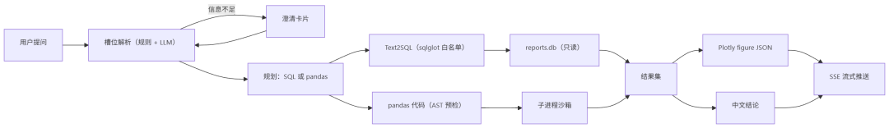

# 智电析报 · Power Report Agent

基于 LLM 的能源电力报表智能分析 Agent：用自然语言问电表数据，返回 SQL / pandas 代码、结果表格、Plotly 图表和一段中文结论。数据集是 UCI *Individual Household Electric Power Consumption*（207 万条分钟级记录，2006-12 → 2010-11）。


- **自然语言问数**：自动判断该用 SQL 还是 pandas，生成代码并执行，失败可改写重试一次
- **三层安全边界**：`sqlglot` AST 白名单（只放行单条 SELECT/UNION/WITH）→ pandas 代码 AST 预检 → 子进程沙箱（10 s / 512 MB / 5000 行）
- **结果可视化**：后端生成 Plotly figure JSON，前端 `Plotly.react` 直接渲染，导出走 `toImage()`
- **多轮追问**：8 个槽位（时间 / 维度 / 指标 / 过滤 …）持久化在会话里，信息不足时出澄清卡片
- **报表与评测**：上传 → 质量体检 → 建报表；内置 120 题评测题库与评测中心

---

## 一、快速开始

**0 · 环境**：Windows、Python 3.12+（本项目在 3.13.12 验证）、Node 18+。虚拟环境建在仓库根目录的 `.venv`。

**1 · 装依赖**

```bash
python -m venv .venv
.venv\Scripts\python.exe -m pip install -r 01.code\backend\requirements.txt
cd 01.code\frontend && npm install && cd ..\..
```

**2 · 下载原始数据（必须）**

仓库不含 133 MB 原始数据和 730 MB 数据库。从 <https://archive.ics.uci.edu/dataset/235/individual+household+electric+power+consumption> 下载解压，把 `household_power_consumption.txt` 放到**仓库根目录**（该路径在 `01.code/scripts/_common.py` 里硬编码）。

**3 · 配置**

```bash
copy 01.code\backend\.env.example 01.code\backend\.env
```

至少填 5 项：`JWT_SECRET_KEY`（32 字节以上，**缺失会直接启动失败**）、`LLM_API_KEY`、`LLM_BASE_URL`、`LLM_MODEL_MAIN`、`LLM_MODEL_LIGHT`。换厂商只改这一块——客户端只依赖 OpenAI 兼容协议。

**4 · 建库（顺序不可颠倒，在仓库根执行）**

```bash
.venv\Scripts\python.exe 01.code\scripts\01_build_reports.py   # 清洗 207 万行 → 四张报表 CSV
.venv\Scripts\python.exe 01.code\scripts\02_build_schema.py    # 字段字典 + 注入用 schema 文本
.venv\Scripts\python.exe 01.code\scripts\03_init_db.py --force # 建两个库并灌数
.venv\Scripts\python.exe 01.code\scripts\04_build_eval_set.py  # 120 题评测集
```

校验：`02.data/quality/db_verification.json` 里 hourly / daily / monthly 三级总量都应为 **37283.7477 kWh**。

**5 · 启动（两个终端）**

```bash
# 终端 1（工作目录 01.code\backend）
cd 01.code\backend
set PYTHONIOENCODING=utf-8
..\..\.venv\Scripts\python.exe -m uvicorn app.main:app --host 127.0.0.1 --port 8000

# 终端 2
cd 01.code\frontend
npm run dev
```

健康检查 `http://127.0.0.1:8000/api/v1/system/health` 应返回 `healthy`，接口文档在 `/docs`。

**6 · 第一次用**：打开前端 → 注册账号 → 「报表管理」应能看到 5 张预置报表 → 「对话工作台」选一张提问：

```
2008 年每个月的总用电量是多少？
峰、平、谷三个时段的用电量占比各是多少？
找出 2009 年 7 月用电异常的日子。
```

自己写启动脚本时注意三点：`.venv` 必须在仓库根（`.env` 的 `REPORTS_DB_PATH=02.data/...` 相对它解析）；前端端口可能落进 Windows 保留段而绑不上（`vite.config.ts` 已设 `strictPort: false`，以控制台端口为准）；后端只能单 worker（SQLite + 进程内锁）。

---

## 二、目录结构

```
power_report_agent/
├── 01.code/
│   ├── backend/        # FastAPI：app/{api,core,services,agent,db,schemas} + tests/（365 条用例）
│   │   └── .env.example
│   ├── frontend/       # React + Vite：src/{pages,components,layouts,store,api}
│   ├── scripts/        # 数据脚本 01~05 + sql/（DDL 唯一事实源）
│   └── tools/          # 评测合并/重算、接口文档导出、截图与界面回归
├── 02.data/
│   ├── reports/        # 四张报表 CSV + manifest.json（口径与 A1–A5 校验）
│   ├── schema/         # 字段字典 + schema_text.md（注入给模型的说明）
│   ├── quality/        # 质量体检报告 + 库级校验
│   ├── eval/           # 120 题题库 + 代表性评测报告
│   ├── demo/           # 演示样例 CSV
│   └── eval_tools/     # 评测辅助脚本说明
├── architecture.png    # 架构图（README 引用）
├── README.md
└── household_power_consumption.txt   # 需自己下载后放这里
```

源码目录名 `01.code` 不能改成 `src`：后端与数据脚本以「`01.code` 的上一级」为项目根推导数据与库路径，改名会让路径错位。

---

## 三、数据口径（改代码或提问前必读）

唯一事实源是 `01.code/scripts/01_build_reports.py` + `02.data/reports/manifest.json` + `02.data/schema/`。

- **单位统一 kWh**：功率列是 kW，聚合要 `÷60`；三个分表是 Wh，要 `÷1000`。
- **未计量用电**：`GAP × 1000 / 60 − SM1 − SM2 − SM3`，全期占 **51.20%**（19088.41 / 37283.75 kWh）。
- **两种正交拆分**：按用途（厨房/洗衣房/热水空调/其他）与按时段（峰 18–23 / 平 8–17 / 谷 0–7）**各自**求和都等于总电量；混加会得到约 2 倍错误结果，红线 R3 专门拦这个。
- **比率列不可求和**：`*_ratio` / `load_factor` / `power_factor` / `coverage` 只能按行读或加权。
- **结构报表 `period='全期'` 是年份行合计**，与年份行一起 `SUM` 会翻倍。
- **缺失值**是整行 7 个数值列同时为 `?`（25979 行，0.0125%）；`expected_minutes` 是自然时间长度，首日 `coverage` 仅 0.275 属边界效应。

| 报表 | 行数 |
| --- | --- |
| `report_minute`（仅入库） | 2,075,259 |
| `report_hourly.csv` | 34,589 |
| `report_daily.csv` | 1,442 |
| `report_monthly.csv` | 48 |
| `report_energy_structure.csv` | 6 |

---

## 四、架构



细节：规划阶段二选一（Text2SQL 走 `sqlglot` AST 白名单 / pandas 代码走 AST 预检 + 子进程沙箱 10 s、512 MB、5000 行），结果侧并行产出 Plotly figure JSON 与中文结论，两者共用一条 SSE 流。

编排是 **LangGraph 状态图**（13 节点 + 条件边，含重写环 / 形态自检环 / 澄清环），检查点落 SQLite（`thread_id = 会话编号`）；保留等价的显式 `async` 编排作回退（`ORCHESTRATOR=legacy`）。数据面 `reports.db` 以 `PRAGMA query_only` 只读，控制面 `power_agent.db` 承担用户/会话/审计/评测，写路径用进程内 `asyncio.Lock` 串行化。

---

## 五、技术栈

- **前端**：React 18.3 · TS 5.7 · Vite 6 · Ant Design 5.22 · Tailwind 3.4 · zustand · `plotly.js-dist-min` · `@microsoft/fetch-event-source`
- **后端**：Python 3.13 · FastAPI 0.141 · uvicorn 单 worker · SQLAlchemy 2.0 + aiosqlite · SSE-Starlette · `sqlglot` 30.18 · `json-repair`
- **Agent / 数据**：LangGraph 1.2 + langgraph-checkpoint-sqlite · SQLite 3.49 双库 · pandas 3.0 · Plotly 7.0
- **LLM**：任意 OpenAI 兼容端点，`httpx` 直调（不用 openai SDK），默认阿里云百炼

---

## 六、实测效果

120 题评测集，6 类题型（stat / agg / compare / anomaly / structure / multi_turn），含 18 道陷阱题（量纲混用、比率求和、用途与时段混加）。

| 批次 | 模型 / 提示词 | 题量 | 执行正确率 | 结论命中率 | 平均耗时 | P95 |
| --- | --- | --- | --- | --- | --- | --- |
| 主批次 | `kimi-k3` / `prompt-v3.7` | 120 | **99.2%**（119/120） | 86.2% | 14.5 s | 28.1 s |
| 对照 | `qwen3.8-max` / `prompt-v3.9` | 100 | 100% | 86.5% | 11.0 s | 20.5 s |

目标为执行正确率 ≥ 85%、结论命中率 ≥ 90%、平均耗时 ≤ 8 s。**正确率达标，命中率与耗时未达标**：瓶颈在模型侧（单题最多串 3 次 LLM 调用，槽位 20 s + 生成 60 s + 叙事 8 s 超时上限），本地无缓存。120 题批次由 5 个子批次合并、5 题按「取最后一批」补跑替换。明细在 `02.data/eval/reports/`。

---

## 七、测试

```bash
# 后端 365 条用例（约 80 s）
cd 01.code\backend && ..\..\.venv\Scripts\python.exe -m pytest -q

# 前端类型检查与构建
cd 01.code\frontend && npm run typecheck && npm run build
```

评测入口是前端「评测中心」或 `POST /api/v1/eval/runs`：`mode=selfcheck` 走脚本化 LLM（不花钱，指标不代表模型能力），`mode=real` 才调真实模型。`01.code/tools/` 下有 `eval_merge.py`（合并批次）、`eval_rebuild.py`（本地重算省额度）、`api_doc.py`、`ui_shot.mjs` / `ui_flow_check.mjs`。

---

## 八、常见问题

**建库报 `FileNotFoundError: … household_power_consumption.txt`** — 原始数据没放到仓库根目录（步骤 2）。

**启动就退出，日志里有 `JWT_SECRET_KEY`** — `.env` 没建或该字段为空，这是刻意的失败快照。

**能登录但报表列表空 / 提问报数据库错误** — 没跑 `03_init_db.py`（步骤 4）。

**前端端口起不来，报 `EACCES`** — 端口落进 Windows 保留段（`netsh int ipv4 show excludedportrange protocol=tcp` 可查，`5173` 常中招）。`strictPort: false` 会自动换端口，看控制台输出。

**图表区域空白** — 服务端图片导出 `GET /api/v1/charts/{id}.png` 因未装 `kaleido` 返回 501 属预期；前端导出走 `toImage()`，检查 Network 里 `/api/v1/charts` 的返回。

**不想下 133 MB 数据** — 数据库必须由脚本读原始数据重建（保证库内是未舍入值），要么下数据，要么直接拷别人用同一版本脚本生成的 `02.data/*.db`。

**局域网访问** — 前端 dev server 绑 `0.0.0.0`，手机访问 `http://<内网IP>:<前端端口>` 即可，`/api` 由前端代理转发，8000 不必对外开放。

---

## 九、已知限制

- 平均耗时 14.5 s **未达 8 s 目标**，瓶颈是串行 LLM 调用
- `kaleido` 未安装，服务端图片导出返回 501
- `RestrictedPython` 已装但未接入，实际沙箱是「AST 预检 + 子进程隔离 + 资源上限」
- 未做 Docker 化与公网部署，按本机 Windows 运行构建；后端固定单 worker
- 未适配移动端，前端按桌面 1440 宽设计

---

本项目未附带开源许可证文件；如需引用或二次分发，请先联系作者。
