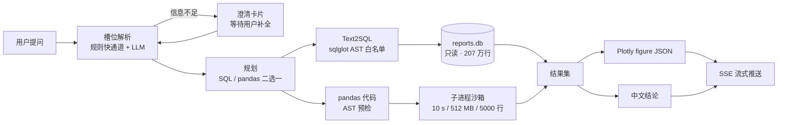

# 智电析报 · Power Report Agent

> 基于 LLM 的能源电力报表智能分析 Agent —— 用自然语言问电表数据，返回 SQL / pandas 代码、结果表格、Plotly 图表和一段中文结论。


数据集是 UCI *Individual Household Electric Power Consumption*：207 万条分钟级记录（2006-12-16 → 2010-11-26），含 7 个数值列与 3 个分表读数。

---

## 一、它能做什么

| 能力 | 说明 |
| --- | --- |
| **自然语言问数** | 「2008 年每月总用电量」→ 自动判断该用 SQL 还是 pandas，生成代码并执行 |
| **双执行路径** | Text2SQL（`sqlglot` 按语法树做只读白名单校验）与 pandas 代码（AST 预检 + 子进程沙箱）二选一，失败可自动改写重试一次 |
| **结果可视化** | 后端用 Plotly 生成 figure，前端 `Plotly.react` 直接渲染，不经任何图表映射层；导出图片走前端 `toImage()` |
| **中文结论** | 表格/图表之后再流式生成一段结论文本，首字延迟 10–16 ms |
| **多轮追问** | 8 个槽位（时间范围 / 维度 / 指标 / 过滤 …）持久化在会话里；信息不足时出**澄清卡片**而不是瞎猜 |
| **报表与评测** | 上传原始数据 → 质量体检 → 生成四张报表；内置 120 题评测题库与评测中心 |

前端的五个页面：登录、对话工作台、报表管理、评测中心、个人中心。

## 二、实测效果

120 题评测集覆盖 6 类题型（`stat` / `agg` / `compare` / `anomaly` / `structure` / `multi_turn`），其中含 18 道刻意设置的陷阱题（量纲混用、比率列求和、用途与时段混加等）。

| 批次 | 模型 / 提示词 | 题量 | 执行正确率 | 结论命中率 | 平均耗时 | P95 |
| --- | --- | --- | --- | --- | --- | --- |
| 主批次 | `kimi-k3` / `prompt-v3.7` | 120 | **99.2%**（119/120） | **86.2%** | 14.5 s | 28.1 s |
| 对照批次 | `qwen3.8-max` / `prompt-v3.9` | 100 | 100% | 86.5% | 11.0 s | 20.5 s |

目标值是执行正确率 ≥ 85%、结论命中率 ≥ 90%、平均耗时 ≤ 8 s。**正确率达标，命中率与耗时未达标**——如实标注，不修饰：

- 耗时瓶颈在模型侧：单题最多串 3 次 LLM 调用（槽位 20 s + 生成 60 s + 叙事 8 s 超时上限），本地无缓存。
- 120 题批次由 5 个子批次合并、5 道题按「取最后一批」口径补跑替换，合并脚本为 `01.code/tools/eval_merge.py`。
- 完整报告见 [`02.data/eval/reports/`](02.data/eval/reports/)。

## 三、架构



编排用 **LangGraph 状态图**（13 节点 + 条件边，含重写环 / 形态自检环 / 澄清环），会话级检查点落在 SQLite（`thread_id = 会话编号`）。保留一条等价的显式 `async` 编排作为回退（`ORCHESTRATOR=legacy`），两条链路靠等价性用例钉住事件流与落库字段。

**安全边界是三层叠起来的**：

1. **SQL 层** —— `app/core/sql_guard.py`：只放行单条 `SELECT/UNION/WITH`、表名白名单、危险函数黑名单、强制 `LIMIT 1000`，并按红线规则拦截"用途列 × 时段列相加"这类口径错误。
2. **代码层** —— `app/core/code_guard.py`：AST 预检拦非白名单 import、双下划线属性、危险调用；拦截事件逐次写入 `audit_logs`。
3. **进程层** —— `app/services/sandbox_service.py`：子进程隔离，10 s 超时、512 MB 内存软限、结果 5000 行上限。

数据面与控制面分离两个 SQLite 库：`reports.db` 以 `PRAGMA query_only` 只读挂载，`power_agent.db` 承担用户/会话/审计/评测，写路径用进程内 `asyncio.Lock` 串行化。

## 四、技术栈

| 层 | 选型 |
| --- | --- |
| 前端 | React 18.3 · TypeScript 5.7 · Vite 6 · Ant Design 5.22 · Tailwind 3.4 · zustand · `plotly.js-dist-min` · `@microsoft/fetch-event-source`（SSE） |
| 后端 | Python 3.13 · FastAPI 0.141 · uvicorn（单 worker）· SQLAlchemy 2.0 + aiosqlite · SSE-Starlette |
| Agent | LangGraph 1.2（状态图 + 条件边）· langgraph-checkpoint-sqlite · `sqlglot` 30.18 · `json-repair` |
| 数据 | SQLite 3.49（双库）· pandas 3.0 · Plotly 7.0 |
| LLM | 任意 OpenAI 兼容端点，`httpx` 直调（**不依赖 openai SDK**），默认阿里云百炼 |

## 五、数据口径（改代码前必读）

口径定义的唯一事实源是 `01.code/scripts/01_build_reports.py` + `02.data/reports/manifest.json` + `02.data/schema/`，三处必须同步。

- **单位统一 kWh**：瞬时功率列是 kW，聚合要 `÷60` 转千瓦时；三个分表是 Wh，要 `÷1000`。
- **未计量用电**：`未计量 = GAP × 1000 / 60 − SM1 − SM2 − SM3`，全期占 **51.20%**（19088.41 / 37283.75 kWh）。
- **两种正交拆分**：按用途（厨房 / 洗衣房 / 热水空调 / 其他）与按时段（峰 18–23 / 平 8–17 / 谷 0–7）**各自**求和都等于 `consumption_kwh`；把用途列和时段列混加会得到约 2 倍错误结果（红线 R3 专门拦这个）。
- **比率列不可求和**：所有 `*_ratio` / `load_factor` / `power_factor` / `coverage` 都是比率，只能加权或按行读。
- **结构报表的合计行**：`report_energy_structure.csv` 里 `period='全期'` 那行是年份行的合计，与年份行一起 `SUM` 会翻倍。
- **缺失值**：原始数据用 `?` 表示缺失，且是整行 7 个数值列同时缺失，共 25979 行（0.0125%）。
- `expected_minutes` 是自然时间长度（小时 60 / 日 1440 / 月 = 天数 × 1440），因此首日 `coverage` 只有 0.275 属边界效应，不是数据缺失。

产物规模（`02.data/reports/manifest.json`，A1–A5 校验全通过，三级总量均为 **37283.7477 kWh**，最大偏差 0.0）：

| 报表 | 行数 |
| --- | --- |
| `report_minute`（仅入库） | 2,075,259 |
| `report_hourly.csv` | 34,589 |
| `report_daily.csv` | 1,442 |
| `report_monthly.csv` | 48 |
| `report_energy_structure.csv` | 6 |

## 六、快速开始

环境：Windows 11（本项目按 Windows 本地/局域网演示构建）、Python 3.12+、Node 18+。

```bash
git clone https://github.com/GlushkoFelix/power_report_agent.git
cd power_report_agent

# 1) 虚拟环境与依赖
python -m venv .venv
.venv\Scripts\python.exe -m pip install -r 01.code\backend\requirements.txt
cd 01.code\frontend && npm install && cd ..\..

# 2) 配置（JWT_SECRET_KEY 必填，缺失会直接启动失败）
copy 01.code\backend\.env.example 01.code\backend\.env
```

在 `01.code\backend\.env` 里填两项：

```ini
JWT_SECRET_KEY=<32 字节以上随机串>
LLM_API_KEY=<OpenAI 兼容端点的 Key>
LLM_BASE_URL=https://dashscope.aliyuncs.com/compatible-mode/v1
```

```bash
# 3) 数据（见下一节）
#    原始文件放到仓库根，然后按顺序重建，顺序不可颠倒
.venv\Scripts\python.exe 01.code\scripts\01_build_reports.py
.venv\Scripts\python.exe 01.code\scripts\02_build_schema.py
.venv\Scripts\python.exe 01.code\scripts\03_init_db.py --force
.venv\Scripts\python.exe 01.code\scripts\04_build_eval_set.py

# 4) 启动（也可以直接双击 start.bat）
cd 01.code\backend
..\..\.venv\Scripts\python.exe -m uvicorn app.main:app --host 127.0.0.1 --port 8000
```

另开一个终端：

```bash
cd 01.code\frontend
npm run dev
```

健康检查：`curl http://127.0.0.1:8000/api/v1/system/health`。前端 dev server 把 `/api` 代理到 `127.0.0.1:8000`，同源调用，不需要配 CORS。

> 根目录的 `start.bat` / `stop.bat` 会先查 Windows 的 TCP 保留端口段再挑前端端口（`5173` 常被系统保留段圈进去，绑不上），后端固定 `8000`。

## 七、目录结构

```
power_report_agent/
├── 01.code/
│   ├── backend/          # FastAPI：app/{api,core,services,agent,db,schemas} + tests/（365 条用例）
│   ├── frontend/         # React + Vite：src/{pages,components,store,api}
│   ├── scripts/          # 数据脚本 01~05 + sql/（DDL 事实源）
│   └── tools/            # 评测、审计、截图与回归脚本
├── 02.data/
│   ├── reports/          # 四张报表 CSV + manifest.json（口径与校验）
│   ├── schema/           # 字段字典（注入给 LLM 的 schema 文本）
│   ├── quality/          # 数据质量体检报告与库级校验
│   ├── eval/             # 120 题题库 + 代表性评测报告
│   └── eval_tools/       # 评测辅助脚本与演示样例
├── 04.实训指导书/         # 6 篇实训 + 2 篇附录 + AI 共创过程文档与架构图
├── 05.RAG语料/           # 19 篇技术语料库
├── docs/                 # 重构记录、问题清单、交接文档、参数文档
├── start.bat / stop.bat
└── README.md
```

**为什么不把源码叫 `src/` 而叫 `01.code/`**：后端与数据脚本以「`01.code` 的上一级目录」为项目根推导配置与数据库路径（`.env` 里写的就是 `REPORTS_DB_PATH=02.data/reports.db`）。改目录层级会让路径推导错位，所以这一层名字请勿改动。

## 八、数据获取

原始数据不入库（单文件 132 MB，且属于公开数据集）：

- 下载：<https://archive.ics.uci.edu/dataset/235/individual+household+electric+power+consumption>
- 文件名：`household_power_consumption.txt`，放到仓库根目录
- 格式：`;` 分隔、CRLF 换行、`?` 表示缺失、日期形如 `1/4/2007`（不补零）

`reports.db`（约 400 MB）与 `power_agent.db` 同样不入库，用上一节的 `01→02→03→04` 四步重建即可。

## 九、测试与评测

```bash
# 后端
cd 01.code\backend
..\..\.venv\Scripts\python.exe -m pytest -q          # 365 条用例

# 前端类型检查与构建
cd 01.code\frontend
npm run typecheck && npm run build
```

评测题库在 `02.data/eval/eval_questions.json`（120 题，每题带 `gold_sql` / `gold_code` / `gold_answer_json` / `key_numbers_json`），评测入口是前端「评测中心」页或 `POST /api/v1/eval/runs`。`mode=real` 走真实模型，`mode=selfcheck` 为离线自检（**指标不代表模型能力**，报告里会置顶标注）。

`01.code/tools/` 下还有几个运维脚本：`eval_merge.py`（合并批次报告）、`eval_rebuild.py`（复用在线判分函数本地重算，省 token）、`api_doc.py`（导出接口清单）、`ui_shot.mjs` / `ui_flow_check.mjs`（截图与界面回归）。

## 十、已知限制

- **平均耗时 14.5 s，未达 8 s 目标**；瓶颈是串行 LLM 调用而非数据库或沙箱。
- **`kaleido` 未安装**，服务端图片导出 `GET /api/v1/charts/{id}.png` 返回 501；图表导出目前由前端 `toImage()` 完成。
- **`RestrictedPython` 已安装但未接入**，实际沙箱是「AST 预检 + 子进程隔离 + 资源上限」这一组合。
- **未使用 `openai` SDK**，LLM 调用是 `httpx` 直调 OpenAI 兼容端点（`app/core/llm_client.py`）。
- **未做 Docker 化与公网部署**，按本机 Windows 演示 + 局域网访问构建（局域网访问见 `04.实训指导书/实训附录B`）。
- **未适配移动端**，前端按桌面 1440 宽设计。

## 十一、文档

| 文档 | 位置 |
| --- | --- |
| 实训指导书 1–6 + 附录 A/B | [`04.实训指导书/`](04.实训指导书/) |
| 系统架构 / 数据库 / PRD / UIUX / 测试报告 / 部署手册 | [`04.实训指导书/AI共创过程文档/`](04.实训指导书/AI共创过程文档/) |
| 重构记录（图化编排、检查点、澄清 HITL） | [`docs/大修工作进度/`](docs/大修工作进度/) |
| 问题与难点总表 | [`docs/问题与难点总表.md`](docs/问题与难点总表.md) |
| 技术语料库（19 篇） | [`05.RAG语料/`](05.RAG语料/) |
| 项目参数与口径总表 | [`docs/【参数】智电析报v1.0.0.md`](docs/【参数】智电析报v1.0.0.md) |

---

本项目目前未附带开源许可证文件；如需引用或二次分发，请先联系作者。
