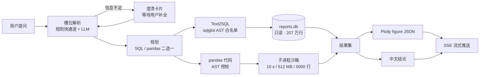

# 智电析报 · Power Report Agent

> 基于 LLM 的能源电力报表智能分析 Agent —— 用自然语言问电表数据，返回 SQL / pandas 代码、结果表格、Plotly 图表和一段中文结论。


数据集是 UCI *Individual Household Electric Power Consumption*：207 万条分钟级记录（2006-12-16 → 2010-11-26），含 7 个数值列与 3 个分表读数。

---

## 一、它能做什么

| 能力 | 说明 |
| --- | --- |
| **自然语言问数** | 「2008 年每月总用电量」→ 自动判断该用 SQL 还是 pandas，生成代码并执行 |
| **双执行路径** | Text2SQL（`sqlglot` 按语法树做只读白名单校验）与 pandas 代码（AST 预检 + 子进程沙箱）二选一，失败可自动改写重试一次 |
| **结果可视化** | 后端用 Plotly 生成 figure，前端 `Plotly.react` 直接渲染，不经任何图表映射层；导出图片走前端 `toImage()` |
| **中文结论** | 表格/图表之后再流式生成一段结论文本，首字延迟 10–16 ms |
| **多轮追问** | 8 个槽位（时间范围 / 维度 / 指标 / 过滤 …）持久化在会话里；信息不足时出**澄清卡片**而不是瞎猜 |
| **报表与评测** | 上传原始数据 → 质量体检 → 生成四张报表；内置 120 题评测题库与评测中心 |

前端四个业务页：对话工作台（`/`）、报表管理（`/reports`）、评测中心（`/eval`）、个人中心（`/profile`），外加登录页（`/login`）。

---

## 二、怎么跑起来（照这个顺序做）

### 步骤 0 · 环境

| 依赖 | 要求 | 说明 |
| --- | --- | --- |
| 操作系统 | Windows 10/11 | 启动脚本是 `.bat` / PowerShell；Linux/macOS 可手动起服务 |
| Python | 3.12+（本项目在 3.13.12 验证） | 虚拟环境**建在仓库根目录下的 `.venv`**（下文所有命令都按这个位置找解释器） |
| Node.js | 18+（本项目在 26.x 验证） | 只用于前端 |

### 步骤 1 · 装依赖

```bash
git clone https://github.com/GlushkoFelix/power_report_agent.git
cd power_report_agent

python -m venv .venv
.venv\Scripts\python.exe -m pip install -r 01.code\backend\requirements.txt

cd 01.code\frontend
npm install
cd ..\..
```

### 步骤 2 · 下载原始数据（**必须做，否则建库失败**）

仓库**不包含** 133 MB 的原始数据文件和 730 MB 的数据库文件，需要自己下：

1. 打开 <https://archive.ics.uci.edu/dataset/235/individual+household+electric+power+consumption>
2. 下载并解压，得到 `household_power_consumption.txt`
3. 把它放到**仓库根目录**（与 `01.code`、`02.data` 同级）

这个路径在代码里是硬编码的（`01.code/scripts/_common.py` 的 `RAW_FILE`），放错位置第一步建库就会抛 `FileNotFoundError`。

### 步骤 3 · 配置 `.env`

```bash
copy 01.code\backend\.env.example 01.code\backend\.env
```

打开 `.env`，**至少填这 4 项**：

```ini
JWT_SECRET_KEY=<自己生成一个 32 字节以上的随机串>   # 缺了会直接启动失败，这是刻意设计
LLM_API_KEY=sk-xxxxxx                             # OpenAI 兼容端点的 Key（样例里是占位符）
LLM_BASE_URL=https://dashscope.aliyuncs.com/compatible-mode/v1
LLM_MODEL_MAIN=qwen-max
LLM_MODEL_LIGHT=qwen-turbo
```

换厂商只改这一块，代码零改动——客户端只依赖 OpenAI 兼容协议（`POST {LLM_BASE_URL}/chat/completions`）。数据库路径 `REPORTS_DB_PATH` / `POWER_AGENT_DB_PATH` 用的是相对路径，不用改。

### 步骤 4 · 建库（四条命令，**顺序不可颠倒**）

在仓库根目录依次执行：

```bash
.venv\Scripts\python.exe 01.code\scripts\01_build_reports.py   # 清洗 207 万行 → 四张报表 CSV
.venv\Scripts\python.exe 01.code\scripts\02_build_schema.py    # 生成字段字典与注入用 schema 文本
.venv\Scripts\python.exe 01.code\scripts\03_init_db.py --force # 建 reports.db / power_agent.db 并灌数
.venv\Scripts\python.exe 01.code\scripts\04_build_eval_set.py  # 生成 120 题评测集
```

产出与自检：

- `02.data/reports.db`（约 400 MB，5 张表，207 万行分钟明细）与 `02.data/power_agent.db`（约 330 MB，10 张表 + 5 张预置报表元数据）
- `02.data/quality/db_verification.json`：A1–A5 五项口径校验，其中 **hourly / daily / monthly 三级总量必须都等于 37283.7477 kWh**

> `03_init_db.py` 对已灌数的库会提前返回，需要重建时加 `--force`。

### 步骤 5 · 启动

开两个终端，先起后端再起前端：

```bash
# 终端 1：后端（工作目录建议在 01.code\backend）
cd 01.code\backend
set PYTHONIOENCODING=utf-8
..\..\.venv\Scripts\python.exe -m uvicorn app.main:app --host 127.0.0.1 --port 8000

# 终端 2：前端
cd 01.code\frontend
npm run dev
```

PowerShell 里把 `set PYTHONIOENCODING=utf-8` 换成 `$env:PYTHONIOENCODING="utf-8"`。

健康检查：`http://127.0.0.1:8000/api/v1/system/health` 应返回 `status=healthy`；OpenAPI 文档在 `http://127.0.0.1:8000/docs`。

**想写自己的启动脚本，请把这三件事处理掉**（都是机器相关的坑）：

1. **`.venv` 放在仓库根**：后端与数据脚本按「`01.code` 的上一级」推导数据与库路径，解释器本身可以装在别处，但 `.env` 里 `REPORTS_DB_PATH=02.data/...` 是相对这个根的。
2. **前端端口可能绑不上**：Windows 会动态保留一批 TCP 端口段（`netsh int ipv4 show excludedportrange protocol=tcp`），落进保留段的端口 `bind` 直接报 `EACCES`。`vite.config.ts` 是 `port: 5173` + `strictPort: false`，撞上会自动换端口，**以控制台打印的端口为准**。
3. **后端只能单 worker**：SQLite + 进程内 `asyncio.Lock` 的写串行化依赖单进程，不要加 `--workers`。

### 步骤 6 · 第一次使用

1. 打开前端（默认 `http://127.0.0.1:5173`，实际端口以 vite 控制台输出为准）
2. 在登录页**注册**一个账号（`POST /api/v1/auth/register`，注册成功即自动登录）
3. 「报表管理」页应能看到 **5 张预置报表**（分钟 / 小时 / 日 / 月 / 结构），它们由建库脚本写入
4. 回到「对话工作台」，选一张报表，直接提问。可以试这几句：

```
2008 年每个月的总用电量是多少？
峰、平、谷三个时段的用电量占比各是多少？
找出 2009 年 7 月用电异常的日子。
厨房这个分表全年用了多少电？
```

5. 每轮回答包含：识别到的槽位 → 生成并执行的 SQL / pandas 代码 → 结果表 → 图表 → 中文结论
6. 「评测中心」可以先跑一次 `mode=selfcheck` 的离线自检（不消耗额度、指标不代表模型能力），确认链路通畅再跑 `mode=real`

---

## 三、目录结构

```
power_report_agent/
├── 01.code/
│   ├── backend/            # FastAPI：app/{api,core,services,agent,db,schemas} + tests/（365 条用例）
│   │   └── .env.example    # 环境变量样例（复制为 .env）
│   ├── frontend/           # React + Vite：src/{pages,components,layouts,store,api}
│   ├── scripts/            # 数据脚本 01~05 + sql/（DDL 唯一事实源）
│   └── tools/              # 评测合并/重算、接口文档导出、截图与界面回归脚本
├── 02.data/
│   ├── reports/            # 四张报表 CSV + manifest.json（口径与 A1–A5 校验记录）
│   ├── schema/             # 字段字典 + schema_text.md（注入给模型的说明文本）
│   ├── quality/            # 数据质量体检报告 + 库级校验
│   ├── eval/               # 120 题题库 + 代表性评测报告
│   ├── demo/               # 演示用样例 CSV
│   └── eval_tools/         # 评测辅助脚本说明与样例
├── README.md
└── household_power_consumption.txt   # ← 需自己下载后放这里（见步骤 2）
```

**为什么源码目录叫 `01.code` 而不是 `src`**：后端与数据脚本以「`01.code` 的上一级目录」为项目根来推导数据与数据库路径（`.env` 里的 `REPORTS_DB_PATH=02.data/reports.db` 就是相对这个根）。改动这一层名字会让路径推导错位，请勿重命名。

---

## 四、实测效果

120 题评测集覆盖 6 类题型（`stat` / `agg` / `compare` / `anomaly` / `structure` / `multi_turn`），其中含 18 道刻意设置的陷阱题（量纲混用、比率列求和、用途与时段混加等）。

| 批次 | 模型 / 提示词 | 题量 | 执行正确率 | 结论命中率 | 平均耗时 | P95 |
| --- | --- | --- | --- | --- | --- | --- |
| 主批次 | `kimi-k3` / `prompt-v3.7` | 120 | **99.2%**（119/120） | **86.2%** | 14.5 s | 28.1 s |
| 对照批次 | `qwen3.8-max` / `prompt-v3.9` | 100 | 100% | 86.5% | 11.0 s | 20.5 s |

目标值是执行正确率 ≥ 85%、结论命中率 ≥ 90%、平均耗时 ≤ 8 s。**正确率达标，命中率与耗时未达标**，如实标注：

- 耗时瓶颈在模型侧：单题最多串 3 次 LLM 调用（槽位 20 s + 生成 60 s + 叙事 8 s 超时上限），本地无缓存。
- 120 题批次由 5 个子批次合并、5 道题按「取最后一批」口径补跑替换，合并脚本是 `01.code/tools/eval_merge.py`。
- 明细见 `02.data/eval/reports/`。

---

## 五、架构



编排用 **LangGraph 状态图**（13 节点 + 条件边，含重写环 / 形态自检环 / 澄清环），会话级检查点落在 SQLite（`thread_id = 会话编号`）。保留一条等价的显式 `async` 编排作为回退（`.env` 里 `ORCHESTRATOR=legacy`），两条链路靠等价性用例钉住事件流与落库字段。

**安全边界三层叠加**：

1. **SQL 层** —— `app/core/sql_guard.py`：只放行单条 `SELECT/UNION/WITH`、表名白名单、危险函数黑名单、强制 `LIMIT 1000`，并按红线规则拦截「用途列 × 时段列相加」这类口径错误。
2. **代码层** —— `app/core/code_guard.py`：AST 预检拦非白名单 import、双下划线属性、危险调用；拦截事件逐次写入 `audit_logs`。
3. **进程层** —— `app/services/sandbox_service.py`：子进程隔离，10 s 超时、512 MB 内存软限、结果 5000 行上限。

数据面与控制面分离两个 SQLite 库：`reports.db` 以 `PRAGMA query_only` 只读挂载，`power_agent.db` 承担用户/会话/审计/评测，写路径用进程内 `asyncio.Lock` 串行化。

---

## 六、技术栈

| 层 | 选型 |
| --- | --- |
| 前端 | React 18.3 · TypeScript 5.7 · Vite 6 · Ant Design 5.22 · Tailwind 3.4 · zustand · `plotly.js-dist-min` · `@microsoft/fetch-event-source`（SSE） |
| 后端 | Python 3.13 · FastAPI 0.141 · uvicorn（单 worker）· SQLAlchemy 2.0 + aiosqlite · SSE-Starlette |
| Agent | LangGraph 1.2（状态图 + 条件边）· langgraph-checkpoint-sqlite · `sqlglot` 30.18 · `json-repair` |
| 数据 | SQLite 3.49（双库）· pandas 3.0 · Plotly 7.0 |
| LLM | 任意 OpenAI 兼容端点，`httpx` 直调（**不依赖 openai SDK**），默认阿里云百炼 |

---

## 七、数据口径（改代码或提问前必读）

口径定义的唯一事实源是 `01.code/scripts/01_build_reports.py` + `02.data/reports/manifest.json` + `02.data/schema/`，三处必须同步。

- **单位统一 kWh**：瞬时功率列是 kW，聚合要 `÷60` 转千瓦时；三个分表是 Wh，要 `÷1000`。
- **未计量用电**：`未计量 = GAP × 1000 / 60 − SM1 − SM2 − SM3`，全期占 **51.20%**（19088.41 / 37283.75 kWh）。
- **两种正交拆分**：按用途（厨房 / 洗衣房 / 热水空调 / 其他）与按时段（峰 18–23 / 平 8–17 / 谷 0–7）**各自**求和都等于 `consumption_kwh`；把用途列和时段列混加会得到约 2 倍错误结果（红线 R3 专门拦这个）。
- **比率列不可求和**：所有 `*_ratio` / `load_factor` / `power_factor` / `coverage` 都是比率，只能加权或按行读。
- **结构报表的合计行**：`report_energy_structure.csv` 里 `period='全期'` 那行是年份行的合计，与年份行一起 `SUM` 会翻倍。
- **缺失值**：原始数据用 `?` 表示缺失，且是整行 7 个数值列同时缺失，共 25979 行（0.0125%）。
- `expected_minutes` 是自然时间长度（小时 60 / 日 1440 / 月 = 天数 × 1440），因此首日 `coverage` 只有 0.275 属边界效应，不是数据缺失。

产物规模（见 `02.data/reports/manifest.json`，A1–A5 校验全通过，三级总量均为 **37283.7477 kWh**，最大偏差 0.0）：

| 报表 | 行数 |
| --- | --- |
| `report_minute`（仅入库，不导出 CSV） | 2,075,259 |
| `report_hourly.csv` | 34,589 |
| `report_daily.csv` | 1,442 |
| `report_monthly.csv` | 48 |
| `report_energy_structure.csv` | 6 |

---

## 八、常见问题

**建库时报 `FileNotFoundError: … household_power_consumption.txt`**
原始数据没放对位置。必须是**仓库根目录**下的 `household_power_consumption.txt`（步骤 2）。

**启动就退出，日志里有 `JWT_SECRET_KEY`**
`.env` 没建或该字段为空。这是刻意设计的失败快照，避免每次重启换密钥导致登录态全失效。

**能登录，但报表列表是空的 / 提问报数据库错误**
没跑 `03_init_db.py`，或跑的时候没有原始数据。补齐步骤 2 与 4。

**前端端口起不来，报 `EACCES: permission denied`**
Windows 会动态保留一批 TCP 端口段（`netsh int ipv4 show excludedportrange protocol=tcp` 可查），落进保留段的端口绑定必失败，`5173` 常被圈进去。`vite.config.ts` 已设 `strictPort: false`，撞上会自动换一个端口，以控制台输出的真端口为准；要固定端口就自己指定一个不在保留段里的。

**图表区域空白**
先看后端日志与浏览器 Network 里 `/api/v1/charts` 的返回。服务端图片导出 `GET /api/v1/charts/{id}.png` 因为没装 `kaleido` 会返回 501，属预期行为——前端导出走 `toImage()`，不受影响。

**不想下 133 MB 原始数据**
仓库里已经有四张报表 CSV 和字段字典，但**数据库必须由脚本重建**，而重建脚本读的是原始数据（保证库内是未舍入的精确值，三级总量严格相等）。所以要么下数据，要么直接拿别人用同一版本脚本生成的 `02.data/reports.db` 与 `02.data/power_agent.db` 拷进去。

**局域网给别的设备看**
前端 dev server 绑的是 `0.0.0.0`，手机/平板访问 `http://<本机内网IP>:<前端端口>` 即可；`/api` 由前端代理转发到 `127.0.0.1:8000`，所以**不需要**把 8000 也对外开放。

**评测花不花额度**
`mode=selfcheck` 走脚本化 LLM，不花钱、指标不代表模型能力（报告里会置顶标注）；`mode=real` 才调真实模型。跑真实批次前建议先自检一轮确认链路。

---

## 九、测试与评测

```bash
# 后端全量用例（365 条，约 80 s）
cd 01.code\backend
..\..\.venv\Scripts\python.exe -m pytest -q

# 前端类型检查与构建
cd 01.code\frontend
npm run typecheck && npm run build
```

评测题库在 `02.data/eval/eval_questions.json`（120 题，每题带 `gold_sql` / `gold_code` / `gold_answer_json` / `key_numbers_json`），入口是前端「评测中心」页或 `POST /api/v1/eval/runs`。常用工具：

- `01.code/tools/eval_merge.py` —— 合并多批次报告为对外口径
- `01.code/tools/eval_rebuild.py` —— 复用在线判分函数本地重算，省额度
- `01.code/tools/api_doc.py` —— 导出接口清单
- `01.code/tools/ui_shot.mjs` / `ui_flow_check.mjs` —— 页面截图与界面回归断言

---

## 十、已知限制

- **平均耗时 14.5 s，未达 8 s 目标**；瓶颈是串行 LLM 调用而非数据库或沙箱。
- **`kaleido` 未安装**，服务端图片导出返回 501；图表导出目前由前端 `toImage()` 完成。
- **`RestrictedPython` 已安装但未接入**，实际沙箱是「AST 预检 + 子进程隔离 + 资源上限」这一组合。
- **未使用 `openai` SDK**，LLM 调用是 `httpx` 直调 OpenAI 兼容端点（`app/core/llm_client.py`）。
- **未做 Docker 化与公网部署**，按本机 Windows 运行 + 局域网访问构建；后端固定单 worker（SQLite + 进程内锁不适用于多进程）。
- **未适配移动端**，前端按桌面 1440 宽设计。
- **`02.data/tmp` 与 `02.data/logs` 属运行期目录**，已被 `.gitignore` 忽略；需要时由程序自动创建，不必手工准备。

---

本项目目前未附带开源许可证文件；如需引用或二次分发，请先联系作者。
